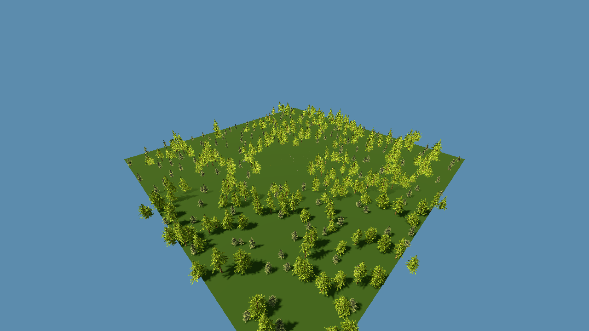

# Intégration de Godot Forest Demo dans Forge

Date : 2 août 2026.

## Périmètre livré

Le dépôt amont est conservé sans modification sous `third_party/godot-forest-demo/` au commit
`623212ffeb4efbf4c95323a4a6a57e726be4f6e9`. Le snapshot contient 422 fichiers et pèse
369 388 457 octets. Son historique Git n’est pas embarqué ; le commit, les hashes et la licence sont
enregistrés dans `third_party/godot-forest-demo.SNAPSHOT.md`.

`gnd_biomes` est extrait dans l’addon Forge `forge_forest_map`. Les types ont été renommés pour ne
pas polluer l’espace global avec des noms génériques :

- `ForgeBiomeScatter` produit des `MultiMesh` découpés en cellules ;
- `ForgeBiomeScatterEntry` décrit un modèle, sa probabilité et ses échelles ;
- `ForgeBiomeFog` conserve l’adaptation optionnelle du brouillard ;
- `ForgeForestMap` est la façade Forge et la source de la définition de carte.

## Données de carte

Une carte utilise un PNG RGBA et un JSON de format `1`.

| Opération | Donnée persistante | Effet |
|---|---|---|
| Forêt | canal rouge | densité des arbres |
| Clairière | efface rouge, vert, bleu | ouvre un espace sans végétation ni rochers |
| Fleurs | canal vert | densité des fleurs |
| Rochers | canal bleu | densité des rochers |
| Zone interdite | canal alpha | exclut tous les scatters et reste interrogeable par le futur adapter de navigation |

Le PNG et le JSON sont la donnée durable. Les nœuds `__biomes_generated` sont internes,
reconstructibles et ne doivent jamais être traités comme la source de vérité.

## Interface

Le panneau **Carte forêt** apparaît lorsque `ForgeForestMap` est sélectionné dans la vue 3D. Il
fournit : calque, peinture/effacement, rayon, dureté, opacité, résolution, création de masque,
enregistrement de la définition et remplacement des modèles.

La scène prête à l’emploi est :

`apps/Forge.Toolset/addons/forge_forest_map/scenes/forge_forest_map_demo.tscn`

Elle fournit un terrain plat de 128 × 128 m, deux pins Sketchfab attribués, une fleur Sketchfab
attribuée et un rocher procédural. Elle sert de point de départ, pas de carte Forgotten Forest finale.



## Asset Vault Forge

Le sélecteur lit le catalogue CC0 existant. Un asset ne peut être importé que si sa licence est
marquée vérifiée et si ses fichiers sont réellement installés dans le Vault. Le chemin est lu depuis
`OPENRPG_ASSET_VAULT`, avec repli sur le Vault externe voisin du dépôt. Le dossier source est copié
dans `res://forest_maps/imported/<asset-id>/` et la fiche complète est conservée dans
`provenance.json`.

Le bouton **Ressource du projet…** accepte aussi une scène ou un mesh déjà importé dans `res://`.

## Licences et crédits

- le dépôt et `gnd_biomes` sont sous CC BY 4.0 ;
- les trois modèles embarqués dans l’addon sont sous CC BY 4.0 et gardent leur `license.txt` ;
- les neuf crédits Sketchfab du dépôt amont restent conservés dans le snapshot complet ;
- la liste agrégée est dans `docs/assets/THIRD_PARTY_ASSET_CREDITS.md`.

## Validation

Le smoke test charge la scène, laisse générer le scatter, peint une clairière, peint une zone
interdite, vérifie le canal alpha et exige au moins un chunk de forêt :

```powershell
$godot = Get-ForgeEnginePath
& $godot --path apps/Forge.Toolset --headless `
  addons/forge_forest_map/scenes/forge_forest_map_demo.tscn -- --forest-map-smoke-test
```

Marqueur attendu : `OPENRPG_FORGE_FOREST_MAP_SMOKE_PASS`.

## Limites de cette tranche

- terrain plat seulement : sculpture, routes, eau et relief restent à intégrer ;
- le canal interdit exclut le scatter et fournit une requête spatiale, mais ne rebake pas encore une
  navigation Godot ;
- un seul slot principal est remplacé à la fois pour forêt, fleurs ou rochers ;
- le catalogue est consultable depuis cet outil, sans constituer encore le workspace Asset Vault
  complet ;
- la scène 128 × 128 m est un prototype de création, pas la cible finale 512 × 512 m ni le rendu
  complet montré dans la vidéo de référence.
