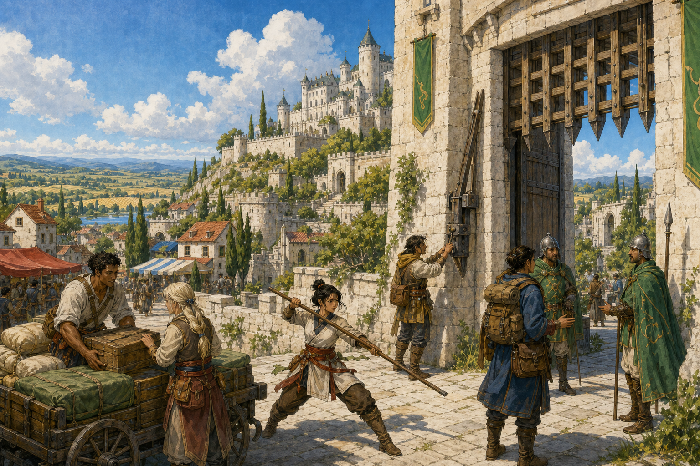
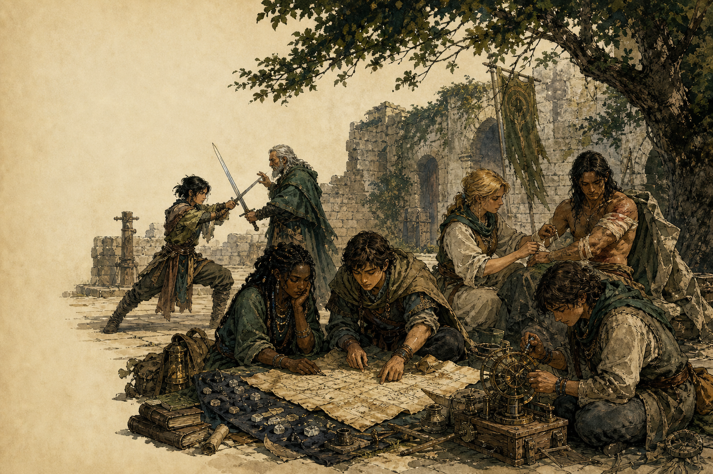
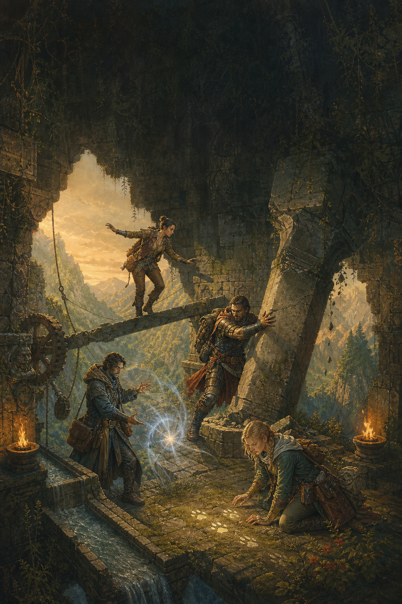
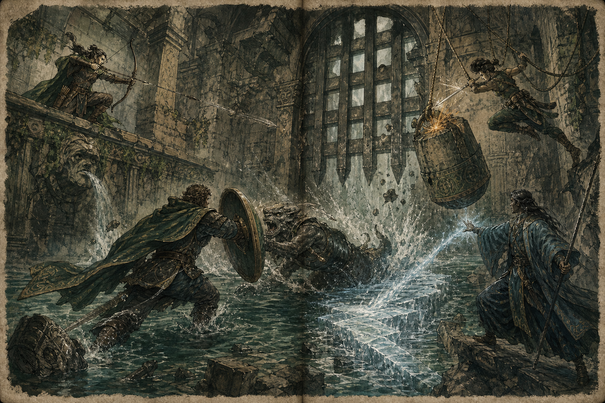
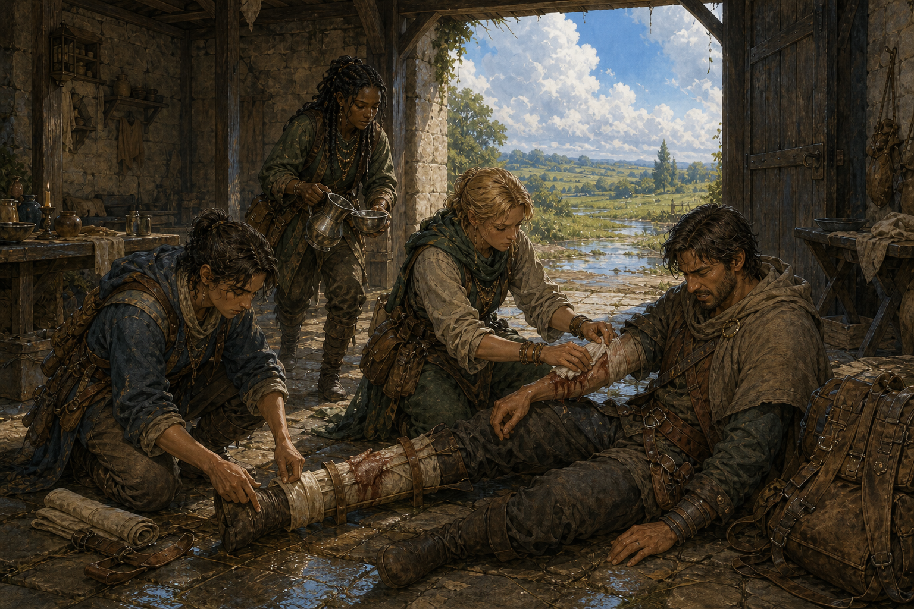
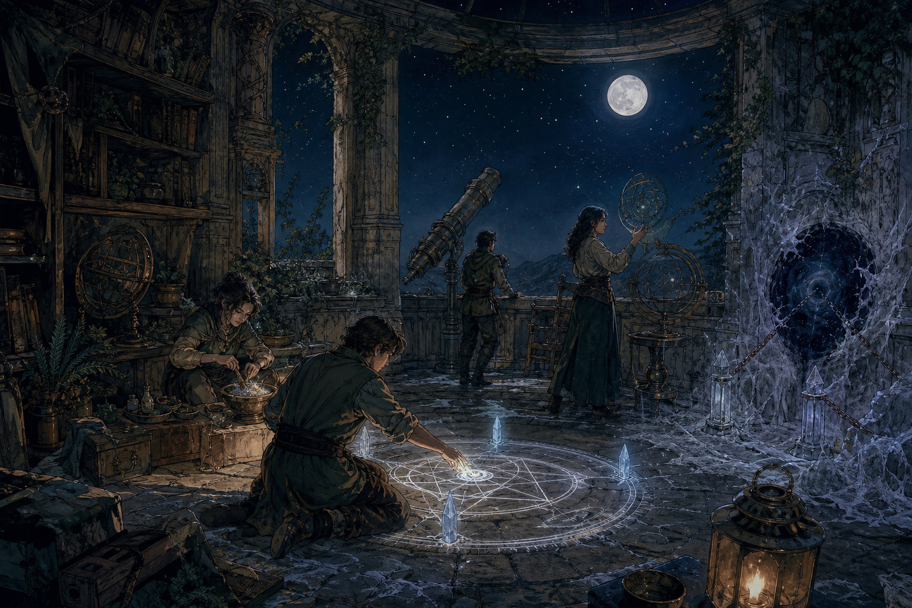
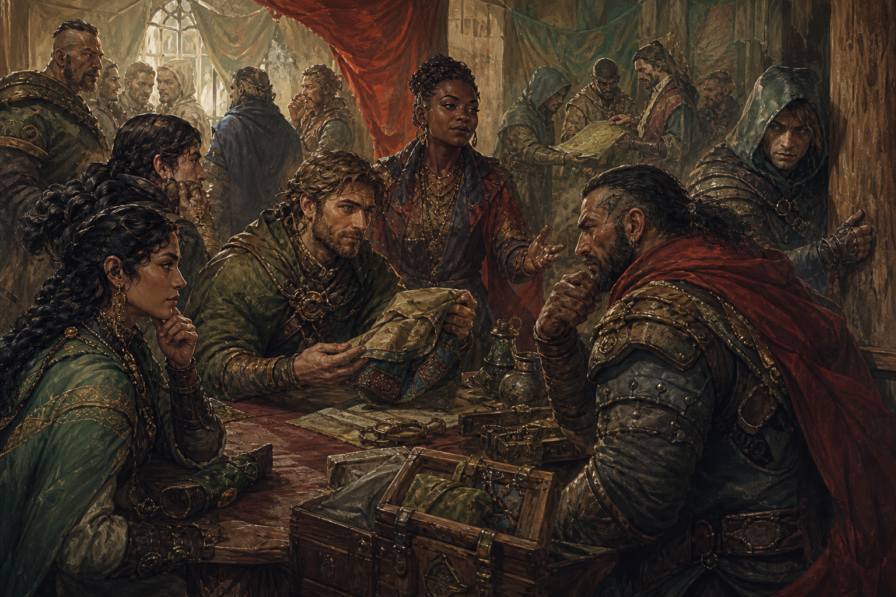
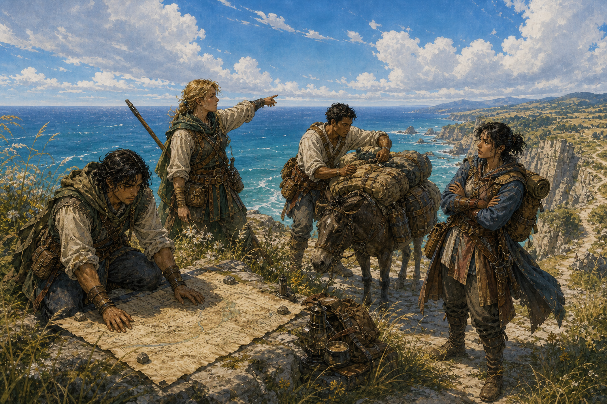

# Manuel du joueur — OpenRPG Forge

## Devenez ce que vous faites

**Version de conception 0.1 — 30 août 2026**  
Ruleset parent : `openrpg-forge.systemic-rpg.v1`  
Statut : proposition normative ; runtime Rust non implémenté et non qualifié.

Ce manuel est une création originale en clean-room. Il sert à la fois de guide de jeu et de base de
travail pour les futurs contrats, données, prototypes et tests du moteur.



---


# Fondations du Manuel du joueur

## Bienvenue dans OpenRPG Forge

OpenRPG Forge propose un jeu de rôle sans classe. Un personnage n’est pas choisi dans une liste de professions mécaniques : il se construit par ce qu’il fait, les problèmes qu’il apprend à résoudre, les personnes qu’il rencontre et les conséquences qu’il accepte.

Une voyageuse qui s’entraîne à la lance, protège ses compagnons, étudie les vestiges d’une civilisation et négocie avec ses héritiers devient peu à peu combattante, érudite et médiatrice. Ces mots racontent son parcours ; ils ne lui ferment aucune porte. La même voyageuse peut ensuite apprendre l’alchimie, délaisser son armure, devenir pisteuse ou étudier la magie.

Ce manuel présente une proposition complète destinée à remplir deux fonctions complémentaires :

1. expliquer au joueur ce qu’il peut tenter et pourquoi les conséquences se produisent ;
2. fournir à l’équipe de développement un contrat assez précis pour transformer les règles en données, systèmes Rust et tests reproductibles.

Le texte est original et conçu en **clean-room**. Il recherche la richesse, la générosité et le confort de consultation d’un grand manuel de jeu de rôle classique sans reprendre les formulations, classes, tables, univers, personnages ou compositions d’un ouvrage existant.

## Statut de cette version

**Identifiant de conception :** `openrpg-forge.player-handbook.fr.v0.1`  
**Ruleset parent :** `openrpg-forge.systemic-rpg.v1`  
**Langue :** français  
**Statut :** proposition normative de conception, prête à être découpée en contrats d’implémentation  
**Runtime Rust :** non implémenté et non qualifié à la date de cette version

Les exigences du ruleset parent restent la source normative de haut niveau. Le présent manuel en détaille une interprétation jouable : valeurs, formules, paliers, catalogues et cas de référence. Une règle chiffrée de ce manuel n’est pas une preuve qu’elle existe déjà dans le moteur. Lorsque l’implémentation commencera, chaque tranche devra être testée, équilibrée et promue explicitement.

Les valeurs marquées **référence** sont les réglages de base proposés. Un module peut les adapter au moyen d’un profil de règles versionné, mais il ne doit pas changer silencieusement la signification d’une compétence ou d’un événement.

## La promesse faite au joueur

### Aucun choix irréversible de classe

Tous les personnages disposent des mêmes attributs, des mêmes quarante-deux compétences et du même catalogue de talents. Les conditions d’accès proviennent de la pratique, des connaissances, de l’équipement, des ressources et du monde — jamais d’une étiquette de classe.

### La pratique transforme le personnage

Une action significative produit des traces d’apprentissage. Plus la compétence est haute, plus son prochain point exige de traces, de variété et de problèmes difficiles. Une répétition sans enjeu cesse rapidement d’enseigner quoi que ce soit.

### L’habileté du joueur et celle du personnage coopèrent

Le joueur choisit l’angle, le moment, l’outil et la méthode. Le personnage apporte sa précision, son contrôle, sa connaissance et son endurance. Un bon plan permet à un novice de réussir une action accessible ; la maîtrise rend possibles des méthodes, des économies et des enchaînements qu’un novice ne connaît pas encore.

### Le monde est cohérent

Une lame qui touche réellement produit un contact. Une armure résiste par sa matière et sa zone couverte. L’eau conduit, le feu éclaire et enfume, une poutre privée d’appui tombe, un témoin doit transmettre ce qu’il a vu. Les règles ne créent pas un « raté » invisible lorsque la scène montre le contraire.

### Les adversaires obéissent aux mêmes principes

Les personnages non joueurs peuvent apprendre, employer des talents, se protéger, paniquer, négocier, enquêter et exploiter le décor. Une exception doit être justifiée par une anatomie, une matière, un équipement ou une capacité explicite.

### L’échec fait avancer la situation

Un échec intéressant crée un coût, un retard, une exposition, une information partielle ou un nouveau choix. Il ne doit pas se résumer à fermer une porte jusqu’au prochain rechargement. L’échec peut aussi enseigner lorsque l’essai était plausible et qu’un retour réel en ressort.

### La puissance augmente les possibilités

La progression ouvre des verbes, des réactions, des préparations et des combinaisons. Elle ne multiplie pas indéfiniment la Vitalité ni les dégâts. Un maître reste vulnérable à une chute, une embuscade, une noyade ou une décision imprudente.

## Les trois couches de progression

Le système distingue trois formes d’évolution afin qu’aucune ne remplace les autres.

| Couche | Comment elle progresse | Ce qu’elle apporte | Ce qu’elle n’apporte pas |
|---|---|---|---|
| **Compétences** | Usage significatif, entraînement, étude et mentorat | Fiabilité, contrôle et acquis automatiques | Permission exclusive ou classe |
| **Niveau global** | Jalons obtenus aux paliers de compétences | Points de talent et rares points d’attribut | Rangs de compétence ou adaptation automatique du monde |
| **Talents** | Choix dépensé pendant un repos long | Nouvelle option, réaction, doctrine ou préparation | Bonus universel sans contre-jeu |

Cette séparation permet de lire immédiatement un personnage : ses compétences racontent ce qu’il a fait ; son niveau résume l’ampleur de son parcours ; ses talents révèlent comment il préfère agir.

## La règle commune

Un test n’est demandé que si le résultat est incertain et si l’échec change la situation.

```text
Résultat = 2d10
         + ⌊Compétence ÷ 5⌋
         + Attribut
         + Contexte
         + Aide
```

Le résultat est comparé à un seuil :

| Seuil | Niveau de difficulté | Usage de référence |
|---:|---|---|
| 14 | Ordinaire sous pression | Fondamentaux accessibles |
| 18 | Délicat | Méthode ou attention réelle |
| 22 | Exigeant | Obstacle sérieux pour une personne entraînée |
| 26 | Ardu | Danger ou complexité élevée |
| 30 | Extrême | Exploit d’expert préparé |
| 34 | Prodigieux | Exploit exceptionnel, mais encore possible dans la fiction |

`⌊x⌋` signifie que l’on conserve la partie entière inférieure. Une compétence de 44 donne donc `⌊44 ÷ 5⌋ = 8`.

Avec un avantage, lancer `3d10` et garder les deux meilleurs dés. Avec un désavantage, garder les deux plus faibles. Plusieurs avantages ne créent pas de dés supplémentaires ; leurs autres causes peuvent modifier le contexte.

### Lecture de la marge

```text
Marge = Résultat − Seuil
```

| Marge | Résultat fictionnel |
|---:|---|
| `≤ −10` | Échec net : le danger ou l’opposition s’impose |
| `−9 à −1` | Échec constructif : progrès partiel, coût ou complication |
| `0 à 4` | Réussite fragile : objectif atteint avec exposition ou consommation |
| `5 à 9` | Réussite propre : objectif atteint sans coût inattendu |
| `≥ 10` | Réussite décisive : avantage supplémentaire cohérent |

Une marge ne permet jamais d’ignorer la géométrie, la matière, la causalité ou les limites d’une capacité.

## Ce que le jeu ne teste pas

Le système ne demande pas de jet pour :

- marcher dans une pièce calme ;
- employer correctement un objet familier sans pression ;
- obtenir une information que le personnage perçoit clairement ;
- recommencer indéfiniment une action sans coût ni opposition ;
- décider à la place du joueur d’une intention morale ;
- annuler un contact physique déjà constaté par la simulation.

Lorsqu’une action pourrait être accomplie automatiquement avec assez de temps, le jeu propose soit de la résoudre, soit d’exposer le temps et les ressources nécessaires. Le jet intervient si une urgence, une opposition ou une conséquence rend ce choix intéressant.

## Le rôle des attributs

Les sept attributs décrivent les moyens généraux du personnage. Ils vont normalement de 1 à 10.

| Attribut | Question posée |
|---|---|
| **Force** | Quelle puissance et quelle prise peut-il produire ? |
| **Dextérité** | Avec quelle précision coordonne-t-il son geste ? |
| **Constitution** | Combien de temps et de contrainte peut-il endurer ? |
| **Intelligence** | Comment analyse-t-il, apprend-il et conçoit-il ? |
| **Volonté** | Comment tient-il son intention sous pression ? |
| **Perception** | Que remarque-t-il et qu’anticipe-t-il ? |
| **Présence** | Quel impact produit-il sur autrui ? |

Une compétence indique ce qui est appris ; l’attribut indique comment la personne l’accomplit dans cette situation. Une même compétence peut parfois employer un second attribut si l’approche le justifie, mais jamais additionner deux attributs.

## Lire une règle normative

Les mots suivants ont un sens précis dans les chapitres techniques et l’annexe d’implémentation :

- **doit** : exigence nécessaire à la conformité ;
- **ne doit pas** : comportement interdit ;
- **devrait** : comportement de référence, modifiable seulement avec une raison documentée ;
- **peut** : option autorisée ;
- **référence** : valeur de base destinée à l’équilibrage ;
- **module** : contenu jouable et profil de règles ;
- **situation** : unité causale au sein de laquelle les répétitions sont évaluées ;
- **contact** : intersection physique confirmée entre volumes actifs ;
- **acquis** : capacité automatique débloquée par un palier de compétence ;
- **talent** : capacité choisie avec un point de talent ;
- **trace** : unité entière d’apprentissage d’une compétence.

## Trois façons de consulter ce manuel

### Pour créer rapidement un personnage

Lire la création, répartir les attributs, sélectionner douze compétences initiales, choisir un talent et terminer l’identité. Un parcours suggéré peut accélérer les choix, mais il n’est jamais une classe.

### Pour comprendre une action

Consulter la règle commune, puis le chapitre du domaine : combat, magie, exploration, interaction sociale, artisanat ou groupe. La fiche de la compétence précise ce qu’elle apprend et les acquis automatiques.

### Pour préparer l’implémentation

Lire l’annexe de contrat : ordre de résolution, règles d’arrondi, événements, identifiants, invariants et scénarios d’acceptation. Ces éléments sont conçus pour devenir des tests avant le code de production.

## Exemple d’ouverture : la passerelle du moulin

Le groupe doit franchir une cour occupée par deux gardes sans déclencher l’alarme. Une passerelle vermoulue relie les bâtiments ; sous elle tourne la roue du moulin.

Sira possède Discrétion 20, Dextérité 6 et obtient 11 sur `2d10`. Traverser les ombres sous surveillance impose 22. La pluie masque le bruit (`+2`), mais le sol est glissant (`−1`) : contexte net `+1`.

```text
11 + ⌊20 ÷ 5⌋ + 6 + 1 = 22
```

La marge vaut 0 : réussite fragile. Sira atteint la passerelle, mais une latte craque et augmente la suspicion. Le monde n’a pas oublié son passage.

Son compagnon aurait pu :

- attirer les gardes par une négociation crédible ;
- bloquer temporairement la roue avec Mécanismes ;
- lancer une pierre pour déplacer l’attention ;
- escalader le mur opposé ;
- traverser ouvertement en acceptant le combat ;
- reporter l’action pour étudier les rondes.

Chaque méthode mobilise d’autres compétences et crée d’autres conséquences. Aucune n’est réservée à une classe.

## Principes d’équilibrage à conserver

1. Un choix doit créer une possibilité ou une méthode, pas uniquement un nombre plus grand.
2. Un haut score rend l’usage plus fiable, mais ne rend pas le monde inconsistant.
3. Les ressources empêchent la répétition gratuite des techniques les plus puissantes.
4. Les contre-mesures sont perceptibles avant d’être punitives.
5. Les échecs proches peuvent enseigner ; les tâches triviales ne deviennent pas une ferme à progression.
6. Les récompenses ne dépendent ni du coup final, ni du nombre de victimes.
7. Une chaîne causale possède un initiateur, des contributeurs et des conséquences persistantes.
8. Les compagnons sont soumis aux mêmes règles de perception, d’apprentissage et de risque.
9. Un module adapte les valeurs par données versionnées, jamais par comportement caché lié à son nom.
10. Toute future implémentation commence par des exemples exécutables et un résultat attendu.

---

# Personnage, progression et compétences

> **Portée des règles.** Les sept attributs, la progression par usage significatif, l’absence de croissance exponentielle et le principe selon lequel les talents ouvrent des possibilités proviennent du ruleset `openrpg-forge.systemic-rpg.v1`. Les valeurs, formules, paliers, compétences et acquis ci-dessous constituent la proposition détaillée du Manuel du joueur. Elles ne décrivent pas l’état actuel de l’implémentation du runtime Rust.

## Le personnage sans classe

Dans OpenRPG Forge, un personnage n’appartient jamais à une classe. Il n’existe ni profession mécanique, ni liste de compétences réservée, ni changement de classe à effectuer. Tout personnage possède les mêmes quarante-deux compétences. Ses actions, son équipement, ses rencontres, ses études et son entraînement dessinent progressivement son rôle.

Un rôle décrit le personnage ; il ne l’enferme pas.

- Une combattante lourdement protégée peut apprendre l’Escamotage.
- Un négociateur peut maîtriser les Armes d’impact.
- Une alchimiste peut devenir une excellente meneuse.
- Toute personne peut étudier la magie si elle trouve une source d’apprentissage compatible avec le monde du module.
- Changer de méthode ne demande ni changement de classe ni réinitialisation du personnage.

L’évolution suit cette chaîne :

```text
Action significative
        ↓
Traces d’apprentissage
        ↓
Point de compétence
        ↓
Palier de maîtrise
        ↓
Acquis automatique
        ↓
Jalons de parcours
        ↓
Niveau global sans classe
```



*Apprendre par la pratique — Le combat, l’étude, le soin et l’artisanat obéissent à la même logique : une difficulté significative, un retour compréhensible et du temps.*

## Créer son personnage

### 1. Définir une identité

Le joueur commence par une phrase qui décrit une personne, et non une fonction de combat.

Exemples :

- « Ancienne batelière qui recherche son frère disparu. »
- « Héritier ruiné ayant appris à survivre parmi ses créanciers. »
- « Garde-frontière fascinée par les phénomènes surnaturels. »
- « Artisan itinérant qui refuse de laisser une machine incomprise. »

Cette phrase n’accorde aucun privilège exclusif. Elle guide l’origine, les relations, les connaissances et les premières compétences.

### 2. Choisir une origine

L’origine décrit un milieu vécu : région, peuple, communauté, métier familial, institution, tradition ou événement historique.

Elle fournit :

- deux langues ou modes de communication ;
- une connaissance locale ;
- un contact ;
- une obligation, dette ou responsabilité ;
- une conviction ;
- un objet personnel ;
- deux ou trois contextes dans lesquels le vécu du personnage peut compter.

Une origine fluviale peut, par exemple, rendre immédiatement reconnaissables certains courants, usages portuaires ou signaux de batellerie. Elle ne donne pas un monopole sur la Natation ou le Négoce.

### 3. Répartir les attributs

Les attributs vont de **1 à 10**. À la création, le joueur répartit **40 points**, avec un minimum de **3** et un maximum de **8**.

La répartition standard est :

**7, 6, 6, 6, 5, 5, 5**

| Attribut | Ce qu’il représente | Exemples |
|---|---|---|
| **Force** | Puissance musculaire, prise, transfert d’impact | Soulever, pousser, frapper lourdement |
| **Dextérité** | Coordination, précision, finesse motrice | Viser, manipuler, esquiver |
| **Constitution** | Résistance, souffle et récupération | Endurer, nager longtemps, résister à un toxique |
| **Intelligence** | Analyse, mémoire structurée et invention | Comprendre un mécanisme, composer une formule |
| **Volonté** | Discipline, maîtrise de soi et résistance mentale | Maintenir un effet, surmonter la peur |
| **Perception** | Attention, lecture du monde et anticipation | Repérer, pister, lire une trajectoire |
| **Présence** | Impact social, expression et autorité | Convaincre, commander, impressionner |

Aucun attribut n’est réservé à un type de personnage et aucun ne doit devenir inutile hors de son domaine évident. La Force peut soutenir une intimidation crédible ; la Présence peut calmer un animal ; la Perception peut guider une parade.

### Ressources communes

Les modules utilisant le ruleset de référence emploient les mêmes noms pour les ressources fondamentales :

- la **Vitalité** mesure la capacité à rester en vie et à supporter les blessures ;
- l’**Endurance** alimente les efforts physiques intenses, le sprint, le blocage, l’esquive et les attaques lourdes ;
- le **Mana** alimente les formes magiques ordinaires ;
- l’**Équilibre** mesure la stabilité momentanée face aux chocs, aux parades, aux collisions et aux chutes ;
- la **Concentration** permet de maintenir une préparation, un sort, une visée ou une action complexe malgré les perturbations.

La Constitution contribue surtout à la Vitalité, à l’Endurance et à leur récupération. La Volonté contribue surtout au Mana et à la Concentration. Les valeurs exactes de ces ressources relèvent du chapitre consacré au combat et aux ressources ; la progression décrite ici ne les multiplie jamais automatiquement.

### 4. Répartir les compétences initiales

Chaque personnage inscrit les quarante-deux compétences sur sa feuille.

Pour une campagne standard :

- six compétences commencent à **10** ;
- six autres commencent à **5** ;
- l’une des six compétences à 10 reçoit **5 points supplémentaires** ;
- toutes les autres commencent à **0**.

Le joueur choisit librement ces compétences. Des parcours prédéfinis peuvent accélérer la création, mais ils ne constituent ni des classes ni des choix permanents.

Le départ standard produit six premiers jalons de parcours et place normalement le personnage au **niveau global 2**.

### 5. Choisir un talent initial

Le niveau global 2 accorde un premier point de talent. Ce point est dépensé dans le catalogue général des talents.

Les talents choisis sont distincts des **acquis de maîtrise** décrits avec chaque compétence :

- un acquis est automatique et gratuit lorsqu’un seuil de compétence est atteint ;
- un talent est choisi et payé avec un point de talent ;
- ni l’un ni l’autre n’est limité par une classe.

### 6. Finaliser le personnage

Le joueur choisit enfin :

- une apparence et des signes distinctifs ;
- un objectif immédiat ;
- une relation importante ;
- une peur ou une limite ;
- une réputation initiale ;
- un équipement cohérent avec son histoire ;
- une raison de rejoindre le groupe.


*Une identité ouverte — La cité offre des occasions de parler, de comprendre, de travailler ou de s’exercer ; aucun uniforme ne réserve ces actions à une classe.*

## Résoudre une action incertaine

Une action n’appelle un test que si son résultat est incertain et si l’échec peut modifier la situation.

```text
Résultat =
2d10
+ ⌊compétence ÷ 5⌋
+ attribut
+ contexte
+ aide
```

Le résultat est comparé à une difficulté.

| Difficulté | Seuil | Exemple général |
|---|---:|---|
| Ordinaire | 14 | Action familière sous faible pression |
| Délicate | 18 | Action demandant méthode ou attention |
| Exigeante | 22 | Obstacle sérieux pour une personne entraînée |
| Ardue | 26 | Situation dangereuse ou techniquement complexe |
| Extrême | 30 | Exploit réservé aux experts préparés |
| Prodigieuse | 34 | Action exceptionnelle réunissant maîtrise et circonstances favorables |

Le **contexte** vaut habituellement de –6 à +6. Il représente notamment la qualité des outils, la position, la lumière, les preuves disponibles, la préparation, l’état physique et l’exécution réelle du joueur.

L’**aide** vaut de 0 à +3. Un assistant doit expliquer comment il contribue et partager les risques éventuels.

Lorsqu’une compétence possède deux attributs associés, le premier correspond à l’usage habituel. Le second peut être employé si l’approche décrite le justifie. Les deux ne sont jamais additionnés.

### Avantage et désavantage

Avec un avantage, le joueur lance **3d10 et conserve les deux meilleurs dés**.

Avec un désavantage, il lance **3d10 et conserve les deux moins bons**.

Un avantage et un désavantage s’annulent. Plusieurs avantages ne s’empilent pas : les autres circonstances favorables modifient le contexte.

### Qualité du résultat

| Marge | Conséquence |
|---:|---|
| –10 ou moins | Échec net ; le danger ou l’opposition s’impose |
| –9 à –1 | Échec constructif ; progrès partiel, coût ou nouvelle complication |
| 0 à 4 | Réussite fragile ; objectif atteint avec exposition ou consommation |
| 5 à 9 | Réussite propre |
| 10 ou plus | Réussite décisive ; vitesse, discrétion ou avantage supplémentaire cohérent |

Un résultat élevé n’autorise jamais un effet physiquement impossible sans capacité explicite.

### Actions opposées

Chaque camp calcule son résultat. La meilleure marge l’emporte. Une égalité conserve la situation actuelle ou impose un compromis : deux prises restent verrouillées, un mensonge entretient le doute, deux combattants rompent le contact.

### Contact physique et statistiques

Un contact visible reste un contact. Si une lame traverse réellement le volume d’une cible, le système ne transforme pas ce fait en « raté » abstrait.

La compétence, l’attribut, l’angle, la vitesse, la protection, l’Équilibre et l’état de la cible déterminent plutôt :

- la qualité du contact ;
- la pénétration ;
- le transfert d’impact ;
- la dépense d’Endurance ;
- le contrôle de l’arme ;
- l’interruption ou la perte d’Équilibre ;
- la possibilité d’une conséquence critique.

## Progression par la pratique

Toute action peut être observée par le système, mais toute répétition ne produit pas un apprentissage. Une compétence progresse lorsqu’elle est utilisée face à une difficulté, un risque, une nouveauté ou un retour instructif.

La victoire n’est pas nécessaire. Un échec proche de la réussite peut apprendre davantage qu’un succès routinier.

### Traces d’apprentissage

Une situation significative accorde de 0 à 5 traces à la compétence principale.

Pour estimer le défi, on calcule le résultat moyen du personnage :

```text
Résultat moyen =
11
+ ⌊compétence ÷ 5⌋
+ attribut
+ contexte
+ aide
```

Puis on compare la difficulté à ce résultat moyen.

| Écart entre difficulté et résultat moyen | Traces de base |
|---|---:|
| Difficulté inférieure d’au moins 8 | 0 |
| Difficulté inférieure de 1 à 7 | 1 |
| Difficulté égale ou supérieure de 1 à 4 | 2 |
| Difficulté supérieure de 5 à 8 | 3 |
| Difficulté supérieure de 9 ou plus | 0, ou 1 si l’essai était plausible et a fourni un véritable retour |

Modificateurs possibles :

- **+1** si la situation ou la méthode est nouvelle ;
- **+1** si l’action comporte un enjeu ou un risque réel ;
- **+1** si un mentor, une analyse ou un retour précis permet de comprendre le résultat ;
- maximum **5 traces** par compétence et par situation.

Le défi est calculé avec la meilleure méthode raisonnablement disponible. Abandonner volontairement son outil ou se bander les yeux ne transforme pas une tâche banale en entraînement valable, sauf si cette contrainte répond à un besoin réel.

### Coût du prochain point

Pour faire passer une compétence de sa valeur actuelle `S` à `S + 1`, il faut :

```text
Traces requises =
5
+ ⌊S ÷ 5⌋
+ ⌊S² ÷ 400⌋
```

| Score actuel | Traces pour le point suivant |
|---:|---:|
| 0 | 5 |
| 20 | 10 |
| 40 | 17 |
| 60 | 26 |
| 80 | 37 |
| 99 | 48 |

Les premiers progrès sont rapides. Une véritable maîtrise exige des problèmes plus rares, plus variés et plus difficiles.

Les traces excédentaires sont conservées. Une compétence ne dépasse jamais 100.

### Règles anti-répétition

- Une même intention appliquée au même obstacle ne produit qu’un événement d’apprentissage.
- Une chaîne causale ne rapporte pas une récompense par victime ou par objet. Renverser une urne, l’enflammer et brûler cinq adversaires reste une seule chaîne.
- Répéter exactement la même méthode rapporte la moitié des traces la deuxième fois, puis aucune trace.
- Un simple repos ne rend pas une répétition à nouveau instructive. Il faut une nouvelle contrainte, un autre adversaire, un matériau différent ou une méthode réellement modifiée.
- Une cible consentante et sans danger ne permet pas de progresser indéfiniment.
- Les mannequins et exercices contrôlés ne suffisent plus seuls au-delà de 25.
- Le coup final n’a aucune importance. La causalité et la contribution réelle déterminent qui apprend.
- Une action déléguée fait progresser son exécutant. Donner un ordre pertinent peut en parallèle faire progresser Commandement ou Tactique.
- Une situation peut faire progresser une compétence principale et une compétence de soutien. La seconde reçoit au maximum la moitié des traces si elle a réellement changé l’issue.

### Exemple : le brasero suspendu

Sava coupe la corde d’un brasero avec une flèche, provoque sa chute sur une nappe d’huile et demande à un compagnon de repousser un ennemi vers le feu.

La scène peut produire :

- des traces de **Tir**, pour la corde atteinte sous pression ;
- des traces de **Tactique**, si le placement et l’ordre ont été déterminants ;
- des traces d’**Élémentalisme** pour le personnage qui a contrôlé l’allumage ;
- des traces de **Commandement** pour l’ordre correctement synchronisé.

Elle ne produit pas une récompense de Tir ou d’Élémentalisme pour chaque ennemi touché.

## Paliers de maîtrise

| Score | Palier | Signification |
|---:|---|---|
| 0–9 | Novice | Connaissance rudimentaire ou intuition |
| 10–24 | Initié | Gestes fondamentaux fiables |
| 25–44 | Pratiquant | Autonomie dans les situations courantes |
| 45–64 | Confirmé | Adaptation à la pression et aux imprévus |
| 65–84 | Expert | Contrôle de situations rares ou complexes |
| 85–100 | Maître | Création de méthodes et exploits exceptionnels |

Chaque compétence accorde automatiquement un acquis aux scores **10, 25, 45, 65 et 85**.

Les acquis :

- ne coûtent aucun point de talent ;
- ne sont jamais limités par une origine ;
- ouvrent des actions ou modifient leur usage ;
- ne garantissent pas un résultat impossible ;
- restent soumis aux ressources, à la géométrie et au contre-jeu.

Pour franchir certains paliers, le personnage doit avoir rencontré au moins une situation adaptée :

| Palier visé | Preuve minimale |
|---:|---|
| 25 | Une situation délicate, difficulté 18 |
| 45 | Une situation exigeante, difficulté 22 |
| 65 | Une situation ardue, difficulté 26 |
| 85 | Une situation extrême, difficulté 30 |

Les traces continuent de s’accumuler si cette preuve manque. Un mentor peut organiser l’épreuve, mais ne peut pas la remplacer par une simple dépense d’argent.

## Niveau global sans classe

Le niveau global est un résumé du parcours, pas une profession. Il n’accorde aucun monopole, ne détermine pas les compétences accessibles et ne provoque pas l’adaptation automatique du monde.

### Jalons de parcours

Une compétence rapporte des jalons la première fois qu’elle atteint chaque palier :

| Score atteint | Jalons gagnés |
|---:|---:|
| 10 | +1 |
| 25 | +2 |
| 45 | +3 |
| 65 | +4 |
| 85 | +5 |

Une compétence peut donc produire au maximum 15 jalons. Les jalons ne sont jamais perdus.

### Calcul du niveau

Le niveau va de 1 à 20. Pour atteindre le niveau `N`, il faut :

```text
Jalons requis = N² + 3N – 4
```

| Niveau | Jalons | Niveau | Jalons |
|---:|---:|---:|---:|
| 1 | 0 | 11 | 150 |
| 2 | 6 | 12 | 176 |
| 3 | 14 | 13 | 204 |
| 4 | 24 | 14 | 234 |
| 5 | 36 | 15 | 266 |
| 6 | 50 | 16 | 300 |
| 7 | 66 | 17 | 336 |
| 8 | 84 | 18 | 374 |
| 9 | 104 | 19 | 414 |
| 10 | 126 | 20 | 456 |

Cette formule récompense à la fois la spécialisation et la polyvalence. Une seule compétence ne peut pas porter tout le niveau du personnage.

### Récompenses de niveau

- Chaque niveau pair accorde **1 point de talent**.
- Les niveaux 4, 8, 12, 16 et 20 accordent **+1 à un attribut**, sans dépasser 10.
- Les talents et augmentations d’attribut sont choisis pendant un repos long.
- Aucun niveau n’accorde automatiquement une multiplication de Vitalité ou de dégâts.
- Aucun équipement, compétence ou école magique n’est verrouillé par le niveau global.
- Le monde ne met pas à niveau ses habitants pour suivre le héros.

## Entraînement, étude et mentors

La pratique réelle est la voie principale, mais pas l’unique voie d’apprentissage.

### Entraînement autonome

Un bloc d’entraînement demande généralement quatre heures, un lieu adapté et le matériel nécessaire.

- Il accorde de 1 à 3 traces selon la qualité de l’exercice.
- Il ne permet pas seul de dépasser 25.
- Un exercice déjà parfaitement connu cesse de produire des traces.
- Un nouvel exercice, une contrainte mesurée ou une analyse enregistrée peut renouveler l’apprentissage.
- L’épuisement, la blessure ou un lieu dangereux réduisent la qualité du bloc.

### Livres, plans et enregistrements

Une source possède un domaine et une qualité maximale.

- Une introduction peut enseigner jusqu’à 25.
- Un traité spécialisé peut accompagner jusqu’à 45.
- Une œuvre de référence peut accompagner jusqu’à 65.
- Les savoirs supérieurs exigent généralement plusieurs sources, un mentor ou une expérience directe.
- Relire la même source ne redonne pas les traces initiales.
- Une source peut révéler une technique sans donner immédiatement la maîtrise nécessaire pour l’exécuter.

### Mentors

Un mentor efficace possède normalement au moins 10 points de plus que l’élève dans la compétence enseignée.

Une séance de qualité :

- dure de deux à quatre heures ;
- rapporte de 2 à 5 traces ;
- fournit un retour précis ;
- peut préparer une épreuve de palier ;
- peut donner un avantage au prochain exercice correspondant.

Un mentor ne peut enseigner au-delà de sa propre compréhension. À partir de 65, l’apprentissage prend souvent la forme d’une collaboration, d’une mission ou d’un problème inédit plutôt que d’une leçon magistrale.

La relation avec le mentor compte : disponibilité, confiance, prix, devoir, rivalité ou désaccord moral peuvent devenir des éléments de jeu.

### Repos et consolidation

Un repos ne crée pas de progression par lui-même.

- Les traces sont enregistrées immédiatement.
- Les points et acquis obtenus sont consolidés lorsque le personnage sort du danger, généralement à la fin d’une scène ou pendant un repos court.
- Un repos court permet de revoir une action, réparer un outil ou recevoir un retour bref.
- Un repos long permet de dépenser les points de talent et les augmentations d’attribut.
- Dormir plusieurs fois sans nouvelle expérience ne produit aucune trace.
- Le temps consacré à l’étude avance réellement le calendrier du monde.

## Catalogue universel des compétences

Les quarante-deux compétences sont accessibles à tous. Les acquis listés aux seuils 10, 25, 45, 65 et 85 sont automatiques et gratuits.

### Mouvement et exploration

#### 1. Athlétisme (`athletics`)

**Attributs :** Force ; Constitution pour l’effort prolongé.  
**Usages :** course, saut, poussée en mouvement, portage, franchissement dynamique.  
**Difficultés :** D14 pour franchir une barrière basse en courant ; D26 pour bondir entre deux appuis instables sous le feu ennemi.  
**Progresse lorsque :** le personnage dépasse une distance, une charge, un rythme ou un obstacle significatif.

**Acquis automatiques :**

- **10 — Appui sûr :** franchir les petits obstacles dans l’élan ne demande plus d’arrêt.
- **25 — Élan porté :** une course peut alimenter directement un saut, une poussée ou un impact.
- **45 — Second souffle :** une brève baisse de rythme permet de reprendre un effort interrompu sans repartir de zéro.
- **65 — Mouvement composé :** courir, sauter et se rétablir forment une seule séquence fluide.
- **85 — Effort souverain :** le personnage peut tenter des exploits de puissance mobile normalement hors d’atteinte, sans ignorer masse ni gravité.

#### 2. Acrobatie (`acrobatics`)

**Attributs :** Dextérité ; Perception pour anticiper une trajectoire.  
**Usages :** équilibre, roulade, réception, passage étroit, récupération après perte d’Équilibre.  
**Difficultés :** D18 pour traverser une poutre humide ; D30 pour orienter une chute entre plusieurs obstacles mobiles.  
**Progresse lorsque :** l’Équilibre, l’orientation ou la réception ont une conséquence réelle.

**Acquis automatiques :**

- **10 — Roulé amorti :** une réception contrôlée réduit l’impact d’une petite chute.
- **25 — Équilibre mobile :** se déplacer prudemment sur un appui étroit ne force plus l’immobilité.
- **45 — Redressement vif :** se relever après une roulade ou une chute légère conserve l’élan.
- **65 — Passage impossible :** le personnage peut exploiter des appuis très courts ou irréguliers.
- **85 — Chute orientée :** il peut choisir une trajectoire de réception plausible, sans annuler la dangerosité d’une hauteur extrême.

#### 3. Escalade (`climbing`)

**Attributs :** Force ; Dextérité lorsque la précision des prises domine.  
**Usages :** parois, cordes, prises artificielles, traversées, sécurisation du groupe.  
**Difficultés :** D14 pour une échelle endommagée ; D30 pour une paroi exposée, glacée et parcourue par des projectiles.  
**Progresse lorsque :** la voie est nouvelle, dangereuse, limitée par le temps ou compliquée par une charge.

**Acquis automatiques :**

- **10 — Trois points :** les escalades simples deviennent stables tant que trois appuis sont disponibles.
- **25 — Traverse :** le personnage se déplace latéralement sans devoir redescendre.
- **45 — Reprise de prise :** une glissade peut devenir une suspension plutôt qu’une chute immédiate.
- **65 — Combat suspendu :** une interaction brève ou une défense devient possible depuis une prise solide.
- **85 — Ouvreur de voie :** le personnage peut installer un itinéraire qui facilite réellement le passage du groupe.

#### 4. Natation (`swimming`)

**Attributs :** Constitution ; Force contre un courant ou avec une charge.  
**Usages :** nage, plongée, sauvetage, gestion du courant, déplacement en équipement.  
**Difficultés :** D18 pour traverser une rivière froide ; D30 pour secourir une personne en armure dans une eau souterraine agitée.  
**Progresse lorsque :** courant, froid, profondeur, souffle, visibilité ou charge créent une difficulté.

**Acquis automatiques :**

- **10 — Souffle réglé :** le personnage gère correctement une immersion prévue.
- **25 — Flottaison active :** il peut se délester ou stabiliser une personne sans paniquer.
- **45 — Lecture du courant :** il repère les veines d’eau, remous et sorties praticables.
- **65 — Action aquatique :** utiliser un outil ou se défendre dans l’eau n’annule plus tout déplacement.
- **85 — Sauveteur des profondeurs :** il peut organiser et conduire une extraction complexe sous l’eau.

#### 5. Survie (`survival`)

**Attributs :** Perception ; Intelligence pour la planification.  
**Usages :** bivouac, orientation, météo, nourriture, feu, gestion d’une expédition.  
**Difficultés :** D14 pour préparer un camp par temps stable ; D26 pour garder un groupe opérationnel lors d’une tempête prolongée.  
**Progresse lorsque :** le personnage affronte un milieu, une saison, une ressource ou un danger nouveau.

**Acquis automatiques :**

- **10 — Bivouac fiable :** un camp simple protège correctement des conditions ordinaires.
- **25 — Ressources discrètes :** le personnage repère eau, combustible et nourriture sans épuiser immédiatement le lieu.
- **45 — Lecteur du ciel :** il anticipe les changements météorologiques proches.
- **65 — Route préservée :** il organise une progression limitant fatigue, traces et consommation.
- **85 — Maître d’expédition :** il peut maintenir un groupe dans un environnement extrême si des solutions physiques existent.

#### 6. Discrétion (`stealth`)

**Attributs :** Dextérité ; Perception pour exploiter lumière et rythmes.  
**Usages :** déplacement silencieux, dissimulation, approche, rupture de contact, gestion des traces immédiates.  
**Difficultés :** D18 pour traverser une pièce surveillée mais bruyante ; D30 pour rompre une recherche coordonnée sans magie.  
**Progresse lorsque :** un observateur compétent peut réellement découvrir le personnage.

**Acquis automatiques :**

- **10 — Pas mesuré :** le personnage adapte naturellement son allure au sol.
- **25 — Profil brisé :** il exploite les volumes, ombres et mouvements du décor pour réduire sa silhouette.
- **45 — Diversion silencieuse :** il peut créer une petite cause crédible de distraction sans révéler sa position.
- **65 — Passage dans l’alerte :** il sait se déplacer pendant une investigation active.
- **85 — Disparition plausible :** après avoir réellement rompu les perceptions ennemies, il peut pousser les poursuivants vers une fausse hypothèse.

### Combat

#### 7. Lames (`blades`)

**Attributs :** Dextérité ; Force pour les armes lourdes ou les coupes puissantes.  
**Usages :** armes tranchantes ou perforantes tenues en main, contrôle de ligne, coupe ciblée.  
**Difficultés :** D18 pour couper une sangle mobile ; D30 pour atteindre un défaut d’armure pendant un échange.  
**Progresse lorsque :** l’adversaire, la protection, l’espace ou la cible demandent une adaptation réelle.

**Acquis automatiques :**

- **10 — Changement de ligne :** passer d’une coupe à une pointe ne rompt plus la garde.
- **25 — Coupe utilitaire :** cordes, sangles et éléments fins deviennent des cibles de combat explicites.
- **45 — Riposte ciblée :** une ouverture permet de viser une main, une attache ou une zone exposée.
- **65 — Liaison de lame :** le personnage peut engager l’arme adverse pour déplacer sa ligne ou préparer un désarmement.
- **85 — Géométrie du duel :** il contrôle distance, angle et partie active de la lame avec une précision exceptionnelle.

#### 8. Armes d’impact (`impact_weapons`)

**Attributs :** Force ; Constitution pour absorber les retours de choc.  
**Usages :** masses, marteaux, gourdins, outils lourds, destruction et rupture de garde.  
**Difficultés :** D18 pour déformer une fixation ; D30 pour transmettre un choc précis à travers une protection articulée.  
**Progresse lorsque :** la masse, le matériau, la garde ou le retour d’impact exigent un vrai contrôle.

**Acquis automatiques :**

- **10 — Transfert d’impact :** le personnage distingue frappe de déplacement et frappe de rupture.
- **25 — Brise-garde :** un impact préparé peut viser l’Équilibre plutôt que les blessures.
- **45 — Retour maîtrisé :** le rebond d’une arme lourde ne laisse plus automatiquement une ouverture.
- **65 — Onde dans l’armure :** le personnage sait transmettre un choc sans prétendre traverser une protection intacte.
- **85 — Démolition contrôlée :** il peut frapper une structure pour provoquer une rupture choisie plutôt qu’un effondrement aveugle.

#### 9. Armes d’hast (`polearms`)

**Attributs :** Dextérité ; Perception pour la distance et les trajectoires.  
**Usages :** lances, piques, bâtons longs, crochets, maintien de distance.  
**Difficultés :** D18 pour arrêter une charge lisible ; D30 pour contrôler plusieurs lignes d’approche dans un passage.  
**Progresse lorsque :** portée, espace, vitesse ennemie ou coordination de groupe déterminent le résultat.

**Acquis automatiques :**

- **10 — Mesure :** le personnage lit naturellement sa portée utile.
- **25 — Crochet :** il peut tirer un membre, une arme ou un objet compatible.
- **45 — Réception :** une préparation visible permet d’opposer la structure de l’arme à une charge.
- **65 — Hampe courte :** il sait réduire sa prise pour combattre dans un espace resserré.
- **85 — Axe interdit :** il peut fermer une ligne de passage et forcer l’adversaire à la traiter comme un danger physique.

#### 10. Tir (`marksmanship`)

**Attributs :** Dextérité ; Perception pour lire distance et mouvement.  
**Usages :** arcs, arbalètes, frondes et armes de trait autorisées par le module.  
**Difficultés :** D18 pour atteindre une cible mobile découverte ; D30 pour couper une corde oscillante dans une fumée partielle.  
**Progresse lorsque :** distance, mouvement, couverture, vent ou choix de point d’impact sont significatifs.

**Acquis automatiques :**

- **10 — Souffle de visée :** une courte préparation stabilise le tir.
- **25 — Avance :** le personnage sait viser l’endroit où une cible mobile va se trouver.
- **45 — Tir d’interaction :** cordes, leviers, fioles et attaches deviennent des cibles maîtrisables.
- **65 — Reprise de cible :** une munition préparée peut suivre rapidement la première sans perdre toute lecture de la scène.
- **85 — Fenêtre infime :** le personnage peut exploiter une ouverture extrêmement brève si la trajectoire existe réellement.

#### 11. Lancer (`throwing`)

**Attributs :** Dextérité ; Force pour la masse et la portée.  
**Usages :** couteaux, javelots, fioles, pierres, objets improvisés et charges.  
**Difficultés :** D14 pour lancer une fiole sur une surface proche ; D26 pour placer un objet lourd sur une zone réduite depuis une hauteur.  
**Progresse lorsque :** l’objet, la trajectoire, le mouvement ou la conséquence demandent une adaptation.

**Acquis automatiques :**

- **10 — Prise d’équilibre :** le personnage identifie rapidement le centre d’un objet lançable.
- **25 — Arc choisi :** il peut privilégier une trajectoire tendue, plongeante ou indirecte.
- **45 — Arme improvisée :** un objet compatible peut être lancé sans préparation spécialisée.
- **65 — Lancer mobile :** courir ou chuter n’interdit plus un lancer contrôlé.
- **85 — Déclencheur lointain :** il peut employer un lancer pour initier précisément une chaîne environnementale complexe.

#### 12. Corps à corps (`unarmed`)

**Attributs :** Force ; Dextérité pour les prises et redirections.  
**Usages :** frappes, lutte, saisie, immobilisation, dégagement et utilisation de la masse adverse.  
**Difficultés :** D18 pour sortir d’une prise ; D30 pour retourner un adversaire plus lourd déjà déséquilibré.  
**Progresse lorsque :** l’opposition résiste réellement et que taille, posture ou espace comptent.

**Acquis automatiques :**

- **10 — Garde corporelle :** le personnage protège naturellement tête, appuis et centre.
- **25 — Corps à corps lié :** il peut passer d’une frappe à une saisie sur un contact favorable.
- **45 — Redirection :** l’élan adverse peut être déplacé plutôt que bloqué frontalement.
- **65 — Contrôle articulaire :** une cible déjà dominée peut être immobilisée ou désarmée.
- **85 — Levier vivant :** le personnage emploie appuis et masse adverse pour agir sur des cibles plus lourdes, sans annuler leur avantage physique.

#### 13. Boucliers (`shields`)

**Attributs :** Constitution ; Force pour absorber et repousser.  
**Usages :** couverture, blocage, poussée, protection d’un allié et déplacement sous attaque.  
**Difficultés :** D18 pour protéger simultanément son flanc et un allié ; D30 pour avancer sous plusieurs tirs lourds.  
**Progresse lorsque :** l’angle, l’impact, l’Endurance ou la personne protégée imposent un choix.

**Acquis automatiques :**

- **10 — Angle de couverture :** le bouclier protège selon son volume réel sans masquer inutilement la vision.
- **25 — Heurt de bord :** un blocage peut devenir une poussée courte.
- **45 — Interposition :** le personnage peut couvrir un allié proche avec un déplacement lisible.
- **65 — Déviation :** un projectile compatible peut être redirigé plutôt que seulement arrêté.
- **85 — Bastion mobile :** le personnage coordonne déplacement, couverture et groupe sans devenir invulnérable.

#### 14. Parade (`parry`)

**Attributs :** Dextérité ; Perception pour lire l’attaque.  
**Usages :** déviation, ouverture, contrôle du tempo et riposte.  
**Difficultés :** D18 contre une attaque clairement annoncée ; D30 contre une séquence rapide provenant de lignes différentes.  
**Progresse lorsque :** le timing, l’arme adverse et le risque de l’échec sont réels.

**Acquis automatiques :**

- **10 — Déviation :** une parade réussie écarte l’attaque au lieu de l’arrêter de force.
- **25 — Fenêtre :** une parade précise crée une ouverture immédiatement lisible.
- **45 — Main ouverte :** une parade parfaite peut préparer un désarmement.
- **65 — Suite brisée :** le personnage peut interrompre l’enchaînement prévu d’un adversaire.
- **85 — Temps emprunté :** une attaque lourde correctement lue peut être redirigée vers un obstacle ou une autre ligne plausible.

#### 15. Armures (`armor`)

**Attributs :** Constitution ; Force pour les protections massives.  
**Usages :** ajustement, déplacement protégé, gestion du poids, exploitation des matériaux.  
**Difficultés :** D14 pour régler correctement une armure connue ; D26 pour combattre longtemps dans une protection endommagée et chauffée.  
**Progresse lorsque :** poids, chaleur, bruit, mobilité ou dommage influencent réellement la scène.

**Acquis automatiques :**

- **10 — Ajustement :** une armure entretenue ne crée pas de gêne évitable.
- **25 — Réception protégée :** le personnage sait présenter les zones les mieux couvertes à un impact.
- **45 — Mobilité blindée :** il exploite les articulations de l’armure pour franchir, s’accroupir et se relever.
- **65 — Couches adaptées :** il peut reconfigurer une protection selon chaleur, bruit ou type de menace.
- **85 — Corps fortifié :** il transforme sa protection en outil de déplacement et d’interposition sans ignorer fatigue ni points faibles.

#### 16. Tactique (`tactics`)

**Attributs :** Intelligence ; Perception pour lire le terrain.  
**Usages :** placement, priorités, formation, contre-jeu et plans conditionnels.  
**Difficultés :** D18 pour organiser une embuscade simple ; D30 pour réviser un plan lorsque terrain, ennemis et objectifs changent simultanément.  
**Progresse lorsque :** un choix de plan modifie l’issue d’une opposition réelle.

**Acquis automatiques :**

- **10 — Lecture de menace :** le personnage identifie rapidement le danger immédiat le plus évident.
- **25 — Cible commune :** il peut désigner une priorité comprise par le groupe.
- **45 — Ordre composé :** il prépare deux actions liées par une condition simple.
- **65 — Contingence :** un plan peut inclure une réponse de repli, de substitution ou de retournement.
- **85 — Chef d’orchestre :** il coordonne plusieurs rôles autour d’une intention commune sans contrôler directement chaque geste.

### Technique et savoir

#### 17. Artisanat (`crafting`)

**Attributs :** Intelligence ; Dextérité pour l’assemblage fin.  
**Usages :** fabrication générale, réparation, assemblage, adaptation d’outils et récupération.  
**Difficultés :** D14 pour réparer un objet simple ; D26 pour fabriquer sur le terrain un dispositif soumis à une forte contrainte.  
**Progresse lorsque :** le matériau, la fonction ou les moyens disponibles posent un problème nouveau.

**Acquis automatiques :**

- **10 — Entretien :** les réparations ordinaires consomment moins de pièces inutiles.
- **25 — Récupération :** le personnage extrait des composants utilisables sans détruire systématiquement l’objet.
- **45 — Assemblage modulaire :** il combine des éléments compatibles pour une fonction temporaire.
- **65 — Fabrication de terrain :** un atelier incomplet peut suffire à une réalisation exigeante.
- **85 — Conception originale :** il peut créer un objet nouveau dont les propriétés découlent réellement des matériaux et du plan.

#### 18. Forge (`smithing`)

**Attributs :** Intelligence ; Force pour le travail de masse.  
**Usages :** métal, armes, armures, trempe, équilibrage et réparations structurelles.  
**Difficultés :** D18 pour reprendre un tranchant endommagé ; D30 pour réaliser une pièce composite aux contraintes contradictoires.  
**Progresse lorsque :** alliage, température, forme ou usage final exigent une décision technique.

**Acquis automatiques :**

- **10 — Fil entretenu :** le personnage restaure correctement un bord ou une pointe.
- **25 — Trempe choisie :** il adapte dureté et souplesse à l’usage prévu.
- **45 — Rééquilibrage :** il modifie la répartition de masse d’une arme ou d’un outil.
- **65 — Ouvrage composite :** plusieurs métaux ou pièces peuvent former un ensemble cohérent.
- **85 — Pièce maîtresse :** il crée une œuvre singulière dont les qualités viennent de sa construction, pas d’un bonus abstrait.

#### 19. Mécanismes (`mechanisms`)

**Attributs :** Intelligence ; Dextérité pour intervenir dans un espace réduit.  
**Usages :** engrenages, leviers, alimentation, machines, dispositifs et sabotage.  
**Difficultés :** D18 pour bloquer une roue sans casser l’ensemble ; D30 pour détourner une machine active inconnue.  
**Progresse lorsque :** le personnage comprend ou modifie un fonctionnement réel.

**Acquis automatiques :**

- **10 — Lecture du mouvement :** les transmissions et points de contrainte deviennent identifiables.
- **25 — Contournement sûr :** il peut neutraliser une fonction sans arrêter tout le système.
- **45 — Fonction inversée :** un mécanisme compatible peut servir à l’effet opposé ou à un nouvel usage.
- **65 — Liaison distante :** il relie plusieurs commandes par câble, pression ou transmission disponible.
- **85 — Prise de système :** il peut reconfigurer un ensemble complexe après en avoir compris les dépendances.

#### 20. Alchimie (`alchemy`)

**Attributs :** Intelligence ; Perception pour observer les réactions.  
**Usages :** extraction, mélange, potions, toxiques, combustibles, solvants et surfaces.  
**Difficultés :** D18 pour stabiliser une préparation connue ; D30 pour concevoir un catalyseur sous contraintes inconnues.  
**Progresse lorsque :** une propriété, un dosage, un support ou une réaction apporte une information nouvelle.

**Acquis automatiques :**

- **10 — Lecture de propriété :** le personnage reconnaît les familles d’effets les plus manifestes.
- **25 — Extraction stable :** il isole une propriété simple sans perdre tout l’ingrédient.
- **45 — Mélange de surface :** il conçoit des substances destinées au sol, à l’air ou à un objet.
- **65 — Catalyse contrôlée :** il accélère ou retarde une réaction avec un déclencheur explicite.
- **85 — Formule nouvelle :** il peut rechercher une préparation inédite et en documenter risques, contre-mesures et fabrication.

#### 21. Pièges (`traps`)

**Attributs :** Intelligence ; Dextérité pour la pose et le désamorçage.  
**Usages :** déclencheurs, charges, fils, surfaces, obstacles et dispositifs d’alerte.  
**Difficultés :** D18 pour désamorcer un piège connu ; D30 pour intégrer plusieurs réactions à un lieu vivant sans piéger le groupe.  
**Progresse lorsque :** déclenchement, cible, dissimulation ou environnement exigent une vraie conception.

**Acquis automatiques :**

- **10 — Déclencheur sûr :** le personnage sait armer et neutraliser ses propres dispositifs.
- **25 — Piège improvisé :** il construit une alerte ou entrave simple avec le décor.
- **45 — Réaction en chaîne :** plusieurs éléments peuvent se déclencher dans un ordre choisi.
- **65 — Sélection de cible :** le déclencheur distingue une masse, une direction ou une condition physique.
- **85 — Terrain préparé :** le personnage transforme une zone entière en problème tactique lisible et contournable.

#### 22. Médecine (`medicine`)

**Attributs :** Intelligence ; Perception pour le diagnostic.  
**Usages :** premiers secours, blessures, maladies, toxiques, chirurgie et triage.  
**Difficultés :** D14 pour traiter une plaie propre ; D30 pour stabiliser plusieurs blessés pendant une catastrophe.  
**Progresse lorsque :** le diagnostic ou le traitement comporte une incertitude et un enjeu médical réel.

**Acquis automatiques :**

- **10 — Premier geste :** le personnage arrête correctement les détériorations ordinaires de Vitalité.
- **25 — Diagnostic différentiel :** il distingue plusieurs causes possibles au lieu de traiter seulement le symptôme.
- **45 — Stabilisation critique :** une personne proche de la mort peut être maintenue jusqu’à un traitement adapté.
- **65 — Intervention lourde :** chirurgie, extraction et traitement complexe deviennent possibles avec un environnement adéquat.
- **85 — Triage de crise :** il organise simultanément priorités, assistants et ressources face à de nombreuses victimes.

#### 23. Érudition (`lore`)

**Attributs :** Intelligence ; Volonté pour l’étude longue et rigoureuse.  
**Usages :** histoire, langues, religions, créatures, cultures, textes et traditions.  
**Difficultés :** D14 pour rappeler un fait connu ; D30 pour relier plusieurs sources lacunaires à un phénomène oublié.  
**Progresse lorsque :** une source nouvelle est comprise, comparée ou vérifiée dans le monde.

**Acquis automatiques :**

- **10 — Source reconnue :** le personnage distingue récit populaire, témoignage et document.
- **25 — Traditions croisées :** il compare deux versions sans les réduire à une seule.
- **45 — Déchiffrement contextuel :** une langue ou notation partielle peut être reconstruite avec assez d’indices.
- **65 — Savoir déduit :** il formule une hypothèse exploitable à partir de connaissances séparées.
- **85 — Thèse fondatrice :** il peut établir un savoir nouveau, transmissible et contestable.

#### 24. Investigation (`investigation`)

**Attributs :** Perception ; Intelligence pour reconstruire les causes.  
**Usages :** scènes, témoignages, chronologie, preuves, contradictions et causalité.  
**Difficultés :** D18 pour reconstituer une intrusion récente ; D30 pour démêler une affaire ancienne volontairement falsifiée.  
**Progresse lorsque :** le personnage met à l’épreuve une hypothèse plutôt que fouiller mécaniquement.

**Acquis automatiques :**

- **10 — Scène préservée :** le personnage évite de détruire les indices les plus évidents.
- **25 — Suite des faits :** il reconstitue un ordre probable d’événements.
- **45 — Témoignages croisés :** il distingue erreur, omission et contradiction utile.
- **65 — Cause cachée :** une chaîne indirecte peut être attribuée à son véritable initiateur.
- **85 — Affaire froide :** il sait reprendre une enquête malgré disparition, contamination ou manipulation des preuves.

### Relations et influence

#### 25. Persuasion (`persuasion`)

**Attributs :** Présence ; Intelligence pour l’argument structuré.  
**Usages :** convaincre, expliquer, obtenir un accord et présenter une solution.  
**Difficultés :** D18 pour obtenir une concession raisonnable ; D30 pour réunir des intérêts durablement opposés autour d’un accord vérifiable.  
**Progresse lorsque :** l’interlocuteur possède des raisons crédibles de résister.

**Acquis automatiques :**

- **10 — Terrain commun :** le personnage identifie un intérêt partagé manifeste.
- **25 — Argument construit :** il ordonne preuve, bénéfice et réponse aux objections.
- **45 — Changement d’audience :** le même fond peut être présenté selon les valeurs du destinataire.
- **65 — Concession utile :** il cède un point sans abandonner l’objectif principal.
- **85 — Accord durable :** il construit un compromis assorti de garanties, responsabilités et moyens de réparation.

#### 26. Intimidation (`intimidation`)

**Attributs :** Présence ; Force lorsqu’une démonstration physique est pertinente.  
**Usages :** menace crédible, pression, démonstration de capacité et obtention d’une reddition.  
**Difficultés :** D18 pour faire reculer un adversaire isolé hésitant ; D30 pour obtenir la reddition d’un groupe discipliné disposant encore d’options.  
**Progresse lorsque :** la cible peut résister et que la menace implique des conséquences.

**Acquis automatiques :**

- **10 — Menace lisible :** le personnage exprime clairement ce qu’il peut et compte faire.
- **25 — Pression silencieuse :** posture, preuve ou contrôle du lieu peuvent remplacer les cris.
- **45 — Faille de résolution :** il repère peur, loyauté fragile ou priorité cachée.
- **65 — Rupture collective :** une démonstration ciblée peut affecter le moral d’un groupe témoin.
- **85 — Reddition contrôlée :** il peut obtenir armes déposées, distances et garanties sans déclencher une panique aveugle.

#### 27. Tromperie (`deception`)

**Attributs :** Présence ; Intelligence pour maintenir la cohérence.  
**Usages :** mensonge, fausse identité, omission, diversion sociale et couverture.  
**Difficultés :** D18 pour soutenir une excuse plausible ; D30 pour maintenir une identité sous vérifications croisées.  
**Progresse lorsque :** l’interlocuteur cherche réellement les incohérences.

**Acquis automatiques :**

- **10 — Détail plausible :** le personnage ajoute les éléments ordinaires qui rendent un récit crédible.
- **25 — Histoire de couverture :** il prépare motifs, chronologie et réponses simples.
- **45 — Mensonge à couches :** une vérité partielle peut protéger le mensonge central.
- **65 — Contradiction réparée :** il peut intégrer une erreur découverte sans effacer magiquement le soupçon.
- **85 — Masque vécu :** il maintient durablement habitudes, relations et contraintes d’une identité construite.

#### 28. Empathie (`empathy`)

**Attributs :** Perception ; Présence pour répondre avec justesse.  
**Usages :** humeur, motivation, apaisement, soutien, tension et sincérité émotionnelle.  
**Difficultés :** D14 pour reconnaître une émotion manifeste ; D30 pour comprendre une réaction mêlant peur, loyauté et culpabilité.  
**Progresse lorsque :** le personnage écoute, vérifie et agit sur une relation réelle.

**Acquis automatiques :**

- **10 — Humeur lue :** il distingue les émotions principales visibles.
- **25 — Désescalade :** il peut réduire une tension si une issue acceptable existe.
- **45 — Motif sous-jacent :** il différencie la demande exprimée du besoin probable.
- **65 — Ancrage émotionnel :** il aide une personne consentante à résister à la panique ou à une manipulation.
- **85 — Point de rupture :** il reconnaît les événements capables de transformer durablement loyauté, peur ou confiance.

#### 29. Commandement (`leadership`)

**Attributs :** Présence ; Volonté pour tenir sous pression.  
**Usages :** ordres, cohésion, moral, délégation et doctrine du groupe.  
**Difficultés :** D18 pour rallier un groupe surpris ; D30 pour coordonner plusieurs unités pendant un effondrement du plan.  
**Progresse lorsque :** des personnes autonomes suivent, adaptent ou refusent réellement les instructions.

**Acquis automatiques :**

- **10 — Ordre clair :** objectif, cible et limite sont compris sans ambiguïté.
- **25 — Ralliement :** le personnage peut recentrer des alliés hésitants autour d’une action immédiate.
- **45 — Double consigne :** deux actions liées peuvent être transmises sans surcharge.
- **65 — Doctrine ajustée :** il modifie le comportement général du groupe pendant l’action.
- **85 — Intention autonome :** les alliés comprennent suffisamment le but pour improviser sans trahir ses limites.

#### 30. Négoce (`trade`)

**Attributs :** Présence ; Intelligence pour évaluer contrats et marchés.  
**Usages :** estimation, achat, vente, contrat, approvisionnement et réseaux.  
**Difficultés :** D14 pour évaluer un objet courant ; D30 pour monter un accord logistique entre factions méfiantes.  
**Progresse lorsque :** valeur, information, risque ou relation commerciale sont réellement en jeu.

**Acquis automatiques :**

- **10 — Valeur d’usage :** le personnage distingue prix affiché, utilité et état réel.
- **25 — Lot négocié :** il traite ensemble quantité, délai et qualité.
- **45 — Réseau de route :** il identifie intermédiaires, goulots et coûts cachés d’un approvisionnement.
- **65 — Contrat conditionnel :** il prévoit garanties, défauts, pénalités et événements imprévus.
- **85 — Faiseur de marché :** il peut créer une filière ou un échange nouveau, avec des conséquences économiques persistantes.

### Vigilance et finesse

#### 31. Vigilance (`vigilance`)

**Attributs :** Perception ; Volonté pour maintenir l’attention.  
**Usages :** embuscades, changements, dangers immédiats, surveillance et tours de garde.  
**Difficultés :** D18 pour remarquer un comportement anormal dans une foule ; D30 pour maintenir une lecture utile pendant une attaque multisource.  
**Progresse lorsque :** le danger est réellement dissimulé ou l’attention partagée.

**Acquis automatiques :**

- **10 — Balayage :** le personnage examine naturellement accès, hauteurs et couvertures.
- **25 — Signe de danger :** un détail incohérent peut déclencher une suspicion avant l’identification complète.
- **45 — Regard périphérique :** surveiller une zone n’efface plus toute attention au voisinage immédiat.
- **65 — Alerte prédictive :** il anticipe le type probable de danger à partir de signes convergents.
- **85 — Tableau instantané :** en entrant dans une scène, il retient positions, sorties et anomalies principales.

#### 32. Pistage (`tracking`)

**Attributs :** Perception ; Intelligence pour interpréter les traces.  
**Usages :** empreintes, passage, direction, nombre, ancienneté et contre-pistage.  
**Difficultés :** D14 pour suivre des traces fraîches dans la boue ; D30 pour reconstituer un passage ancien à travers plusieurs terrains contaminés.  
**Progresse lorsque :** le terrain, le temps ou l’adversaire efface ou falsifie réellement les indices.

**Acquis automatiques :**

- **10 — Piste fraîche :** direction et allure générales deviennent lisibles.
- **25 — Âge du passage :** le personnage estime l’ancienneté et les interruptions.
- **45 — Trace urbaine :** habitudes, témoins et perturbations remplacent les empreintes naturelles.
- **65 — Contre-piste :** il reconnaît et produit des tentatives cohérentes de dissimulation.
- **85 — Histoire du passage :** il reconstitue organisation, fatigue, conflit ou objectif probable d’un grand déplacement.

#### 33. Crochetage (`lockpicking`)

**Attributs :** Dextérité ; Intelligence pour comprendre la serrure.  
**Usages :** serrures, verrous, clés, mécanismes de sûreté et ouverture non destructive.  
**Difficultés :** D18 pour une serrure entretenue ; D30 pour un mécanisme complexe sous surveillance et sans laisser de trace.  
**Progresse lorsque :** la conception, l’état ou la pression diffèrent des exercices connus.

**Acquis automatiques :**

- **10 — Tension juste :** les serrures simples ne sont plus endommagées par une erreur grossière.
- **25 — Faux passage :** le personnage ressent les sécurités ou déclencheurs mécaniques évidents.
- **45 — Travail sans vue :** il peut agir par toucher dans une position contrainte.
- **65 — Empreinte de clé :** il peut relever ou reproduire une géométrie accessible.
- **85 — Ouverture blanche :** un mécanisme extrêmement complexe peut être ouvert sans signe manifeste si le temps et les outils le permettent.

#### 34. Escamotage (`sleight_of_hand`)

**Attributs :** Dextérité ; Présence lorsque l’attention doit être guidée.  
**Usages :** dissimulation, substitution, prélèvement, dépôt et manipulation sous observation.  
**Difficultés :** D18 pour cacher un petit objet pendant une conversation ; D30 pour effectuer une substitution face à plusieurs observateurs attentifs.  
**Progresse lorsque :** une personne capable d’intervenir possède une chance réelle de remarquer le geste.

**Acquis automatiques :**

- **10 — Poche sûre :** le personnage dissimule et récupère un petit objet sans maladresse.
- **25 — Main rapide :** une interaction brève peut se fondre dans un geste ordinaire.
- **45 — Dépôt discret :** il place un objet sur une personne ou dans un lieu accessible.
- **65 — Échange sous regard :** une diversion cohérente permet une substitution pendant l’observation.
- **85 — Transfert invisible :** il accomplit une manipulation spectaculaire, mais toujours fondée sur un contact et une attention réellement détournée.

#### 35. Dressage (`animal_handling`)

**Attributs :** Présence ; Perception pour lire l’animal.  
**Usages :** approche, calme, monte, soins comportementaux, apprentissage et conduite.  
**Difficultés :** D18 pour calmer une monture effrayée ; D30 pour coordonner plusieurs animaux au milieu d’un danger inhabituel.  
**Progresse lorsque :** l’animal possède peur, volonté, douleur ou habitudes propres.

**Acquis automatiques :**

- **10 — Approche calme :** le personnage évite les signaux de menace les plus évidents.
- **25 — Conduite :** il obtient un déplacement ou arrêt fiable d’un animal entraîné.
- **45 — Tâche apprise :** il peut enseigner une action précise au fil de séances réelles.
- **65 — Groupe animal :** il coordonne montures, meute ou troupeau dans une situation tendue.
- **85 — Lien de travail :** un animal longuement entraîné comprend des intentions complexes sans devenir surnaturellement obéissant.

### Disciplines magiques

Les sept disciplines sont présentes sur toutes les feuilles de personnage. Elles ne sont pas réservées à une classe. Les pratiquer exige cependant des formes connues, une source d’apprentissage, le Mana nécessaire et les conditions établies par le module. Une forme maintenue peut également mobiliser la Concentration.

#### 36. Élémentalisme (`elementalism`)

**Attributs :** Intelligence ; Volonté pour maintenir l’effet.  
**Usages :** feu, froid, électricité, chaleur, surfaces et réactions élémentaires.  
**Difficultés :** D18 pour modifier une petite flamme existante ; D30 pour contrôler une réaction en chaîne dans une zone occupée.  
**Progresse lorsque :** propriétés, propagation, intensité ou risques apportent une difficulté réelle.

**Acquis automatiques :**

- **10 — Sens élémentaire :** température, combustion et conductivité manifestes deviennent lisibles.
- **25 — Surface modelée :** le personnage peut étendre ou contenir un élément déjà présent.
- **45 — Réaction composée :** il associe deux propriétés élémentaires sans les traiter comme des dégâts abstraits.
- **65 — Chaîne contrôlée :** il peut préparer propagation, délai ou interruption d’une réaction.
- **85 — Domaine élémentaire :** il orchestre plusieurs foyers interdépendants, chacun restant soumis au milieu et au contre-jeu.

#### 37. Force, discipline magique (`force_magic`)

**Attributs :** Volonté ; Intelligence pour répartir les contraintes.  
**Usages :** poussée, attraction, suspension, barrière, déviation et télékinésie.  
**Difficultés :** D18 pour déplacer un objet libre de faible masse ; D30 pour détourner une charge lourde sans détruire ses appuis.  
**Progresse lorsque :** masse, vitesse, stabilité, distance ou nombre de cibles posent un vrai problème.

**Acquis automatiques :**

- **10 — Impulsion :** le personnage pousse ou attire un petit objet libre.
- **25 — Suspension :** il maintient brièvement une masse compatible avec sa maîtrise.
- **45 — Plan de force :** il crée une déviation ou un appui temporaire, pas une invulnérabilité.
- **65 — Liens multiples :** plusieurs objets peuvent être maintenus dans une même intention.
- **85 — Impulsion structurelle :** il applique la force à une structure entière en tenant compte de ses appuis et ruptures.

#### 38. Altération (`alteration`)

**Attributs :** Intelligence ; Volonté pour maintenir la transformation.  
**Usages :** dureté, souplesse, forme, densité, état matériel et transformation temporaire.  
**Difficultés :** D18 pour assouplir un petit matériau homogène ; D30 pour transformer durablement un assemblage complexe.  
**Progresse lorsque :** composition, durée, volume ou stabilité sont nouveaux.

**Acquis automatiques :**

- **10 — Lecture de matière :** le personnage reconnaît les propriétés dominantes d’un matériau.
- **25 — État infléchi :** il assouplit, durcit ou fragilise temporairement une petite zone.
- **45 — Forme adaptée :** il remodèle un objet simple sans en ignorer le volume.
- **65 — Propriété transférée :** une qualité compatible peut être déplacée ou partagée pour une durée limitée.
- **85 — Métamorphose stable :** un rituel permet une transformation majeure dont coûts, durée et réversibilité sont explicitement établis.

#### 39. Illusion (`illusion`)

**Attributs :** Intelligence ; Présence pour rendre l’apparence convaincante.  
**Usages :** lumière, son, apparence, dissimulation perceptive et scènes trompeuses.  
**Difficultés :** D18 pour produire un son localisé crédible ; D30 pour maintenir une scène multisensorielle face à des interactions imprévues.  
**Progresse lorsque :** l’illusion doit répondre à un observateur actif ou à un environnement changeant.

**Acquis automatiques :**

- **10 — Éclat et murmure :** lumière ou son simple peuvent être produits.
- **25 — Apparence posée :** un objet ou une personne reçoit une enveloppe visuelle cohérente.
- **45 — Scène multisensorielle :** plusieurs perceptions concordantes peuvent être associées.
- **65 — Illusion réactive :** l’effet répond à des conditions préparées ou à une conduite active.
- **85 — Monde partagé :** un espace limité peut recevoir une fausse lecture commune, vulnérable aux contradictions physiques.

#### 40. Esprit (`spirit`)

**Attributs :** Volonté ; Présence pour entrer en relation avec une conscience.  
**Usages :** Concentration, émotions, communication mentale, défense psychique et empreintes de mémoire.  
**Difficultés :** D18 pour calmer une panique consentante ; D30 pour affronter une présence mentale puissante sans perdre son identité.  
**Progresse lorsque :** une volonté autonome, une émotion réelle ou un risque psychique intervient.

**Acquis automatiques :**

- **10 — Centre intérieur :** le personnage reconnaît plus vite une influence étrangère sur son esprit.
- **25 — Fil de pensée :** une communication mentale brève devient possible avec un sujet consentant.
- **45 — Rempart mental :** il peut protéger une intention, un souvenir ou une émotion contre une intrusion.
- **65 — Écho mémoriel :** il perçoit des fragments laissés par une conscience dans des conditions appropriées.
- **85 — Paysage intérieur :** il peut entrer dans une confrontation mentale structurée où chaque volonté conserve moyens de défense et de rupture.

#### 41. Vitalité, discipline magique (`vitality_magic`)

**Attributs :** Volonté ; Intelligence pour comprendre les fonctions vivantes.  
**Usages :** soins, toxiques, croissance, affaiblissement, purification et fonctions biologiques.  
**Difficultés :** D18 pour accélérer la fermeture d’une plaie stabilisée ; D30 pour restaurer une fonction gravement atteinte sans provoquer de dérèglement.  
**Progresse lorsque :** anatomie, toxine, traumatisme ou coût vital posent une question nouvelle.

**Acquis automatiques :**

- **10 — Sens du vivant :** le personnage distingue vie, blessure et corruption manifeste.
- **25 — Impulsion réparatrice :** il accélère un processus de guérison déjà possible.
- **45 — Fonction modulée :** il stimule, ralentit ou neutralise temporairement une fonction biologique comprise.
- **65 — Champ vital :** plusieurs êtres proches peuvent être soutenus ou affaiblis selon une même règle explicite.
- **85 — Retour du seuil :** il peut rappeler une personne d’un état critique tant que la mort n’est pas devenue irréversible selon le module.

#### 42. Invocation (`summoning`)

**Attributs :** Volonté ; Intelligence pour construire le lien.  
**Usages :** appel, ancrage, pacte, manifestation, renvoi et créatures invoquées.  
**Difficultés :** D18 pour appeler une présence mineure connue ; D30 pour ouvrir puis refermer un passage majeur sous opposition.  
**Progresse lorsque :** l’entité, la distance, l’ancrage, la durée ou la négociation sont réellement difficiles.

**Acquis automatiques :**

- **10 — Signe d’appel :** le personnage crée un repère perceptible par une présence connue.
- **25 — Ancrage mineur :** une entité ou manifestation limitée peut demeurer brièvement.
- **45 — Service négocié :** l’invocation reçoit une intention complexe assortie de limites explicites.
- **65 — Cercle partagé :** plusieurs ancrages ou assistants peuvent soutenir une même manifestation.
- **85 — Grand passage :** un rituel permet une invocation majeure dont dette, risque, rupture et renvoi font partie intégrante de l’effet.

---

# Talents : cent manières de devenir soi-même

## Aucun talent n’est une classe

Les talents sont des choix transversaux. Ils ne forment ni classes, ni métiers fermés, ni arbres imposés.

- Tous les personnages peuvent apprendre tous les talents.
- Aucun talent ne dépend d’une origine, d’un rôle, d’un équipement initial ou d’un autre talent.
- Un talent exige uniquement des attributs, des rangs de compétence et, lorsque nécessaire, une connaissance concrète comme une formule ou un effet magique.
- Les talents débloquent surtout de nouveaux verbes, de nouvelles préparations ou de nouvelles réactions. Ils n’augmentent pas artificiellement la Vitalité ou l’Impact de base.
- Un usage significatif d’un talent fait progresser les compétences réellement mobilisées, selon les règles normales de risque, de difficulté et de nouveauté.
- Les adversaires et les compagnons peuvent employer les mêmes talents s’ils remplissent les mêmes conditions.

## Acquisition, coût et rangs

Le parcours général accorde **1 point de talent aux niveaux pairs**. Un point peut être dépensé pendant un repos long.

- Chaque rang d’un talent coûte **1 point de talent**.
- Un talent de rang III coûte donc trois points au total.
- Les rangs doivent être acquis dans l’ordre.
- Les prérequis séparés par des barres correspondent aux rangs I, II et III.
- Un talent à un seul rang coûte également 1 point.
- Aucun achat ne donne directement de rang de compétence.
- Si plusieurs compétences sont proposées, le talent fonctionne avec chaque compétence ayant elle-même atteint le prérequis du rang utilisé.

Exemple : « Lames, Armes d’impact ou Armes d’hast 25/45/65 » signifie que le rang II fonctionne avec une catégorie d’arme seulement si cette catégorie a atteint 45.

Les compétences vont de 0 à 100 et les attributs de 1 à 10. Les abréviations utilisées dans les prérequis sont : **FOR** Force, **DEX** Dextérité, **CON** Constitution, **INT** Intelligence, **VOL** Volonté, **PER** Perception et **PRE** Présence.

Une **compétence d’arme de mêlée** désigne Lames, Armes d’impact, Armes d’hast ou Corps à corps. Une **compétence magique** désigne Élémentalisme, Force, Altération, Illusion, Esprit, Vitalité ou Invocation. Dans ce chapitre, « compétence Force » et « compétence Vitalité » désignent sans ambiguïté les compétences magiques `force_magic` et `vitality_magic` ; la Vitalité sans précision désigne la ressource du personnage.

## Référentiel des 42 compétences

Ces noms et identifiants sont ceux du catalogue universel. Les identifiants restent stables même si un module adapte leur libellé affiché.

| Domaine | Compétence | ID |
|---|---|---|
| Mouvement | Athlétisme | `athletics` |
| Mouvement | Acrobatie | `acrobatics` |
| Mouvement | Escalade | `climbing` |
| Mouvement | Natation | `swimming` |
| Mouvement | Survie | `survival` |
| Mouvement | Discrétion | `stealth` |
| Combat | Lames | `blades` |
| Combat | Armes d’impact | `impact_weapons` |
| Combat | Armes d’hast | `polearms` |
| Combat | Tir | `marksmanship` |
| Combat | Lancer | `throwing` |
| Combat | Corps à corps | `unarmed` |
| Combat | Boucliers | `shields` |
| Combat | Parade | `parry` |
| Combat | Armures | `armor` |
| Combat | Tactique | `tactics` |
| Savoir-faire | Artisanat | `crafting` |
| Savoir-faire | Forge | `smithing` |
| Savoir-faire | Mécanismes | `mechanisms` |
| Savoir-faire | Alchimie | `alchemy` |
| Savoir-faire | Pièges | `traps` |
| Savoir-faire | Médecine | `medicine` |
| Savoir-faire | Érudition | `lore` |
| Savoir-faire | Investigation | `investigation` |
| Relations | Persuasion | `persuasion` |
| Relations | Intimidation | `intimidation` |
| Relations | Tromperie | `deception` |
| Relations | Empathie | `empathy` |
| Relations | Commandement | `leadership` |
| Relations | Négoce | `trade` |
| Observation | Vigilance | `vigilance` |
| Observation | Pistage | `tracking` |
| Observation | Crochetage | `lockpicking` |
| Observation | Escamotage | `sleight_of_hand` |
| Observation | Dressage | `animal_handling` |
| Magie | Élémentalisme | `elementalism` |
| Magie | Force | `force_magic` |
| Magie | Altération | `alteration` |
| Magie | Illusion | `illusion` |
| Magie | Esprit | `spirit` |
| Magie | Vitalité | `vitality_magic` |
| Magie | Invocation | `summoning` |

## Ressources et résolution communes

Les talents ne recalculent pas les maximums. Ils utilisent les ressources du moteur commun :

| Ressource | Maximum de référence |
|---|---:|
| Vitalité | `60 + 6 × Constitution + 2 × Force` |
| Endurance | `50 + 5 × Constitution + 3 × Volonté` |
| Mana | `20 + 6 × Volonté + 4 × Intelligence` |
| Équilibre | `40 + 4 × Force + 4 × Constitution` |
| Concentration | `40 + 4 × Perception + 4 × Volonté` |
| Charge sûre | `10 + 4 × Force + 2 × Constitution` kg |

Un test suit la formule commune :

```text
Résultat = 2d10
         + partie entière de (Compétence / 5)
         + Attribut
         + Contexte
```

Un bonus de +1 s’ajoute au résultat. Un avantage permet de lancer 3d10 et de garder les deux meilleurs dés. Les avantages ne se cumulent pas.

Les coûts en Endurance, Mana, Vitalité ou Concentration sont exprimés en points ou en pourcentage du maximum. Les réductions de même nature ne se cumulent pas : seule la meilleure s’applique. Aucune réduction ne peut ramener une action sous 50 % de son coût de référence, sauf mention explicite.

## Doctrines et exclusions

Une doctrine représente une manière de se préparer, pas une identité permanente.

- Un personnage peut apprendre les deux doctrines d’un même groupe.
- Une seule doctrine de chaque groupe peut être active.
- Changer une doctrine demande 30 secondes de concentration hors combat.
- Une interruption annule le changement.
- Les quatre groupes proposés sont **Allure**, **Initiative**, **Préparation alchimique** et **Flux magique**.

---

## Mobilité

| Nº | Talent | Rangs et coût | Prérequis | Effet chiffré | Limite et contre-jeu |
|---:|---|---|---|---|---|
| 1 | **Foulée économe** | III, 1 point par rang | Athlétisme 25/45/65 ; CON 4/6/8 | Réduit de 10/20/30 % le coût d’Endurance du sprint et de la course en montée. | Ne supprime ni pente, chaleur, blessure, manque d’air ou surcharge. Aucun effet à l’état surchargé. |
| 2 | **Réception souple** | III, 1 point par rang | Acrobatie 25/45/65 ; DEX 4/6/8 | Une réception préparée réduit la hauteur de chute effective de 1,5/3/4,5 m et la perte d’Équilibre de 20/35/50 %. | Doit être déclenchée dans les 0,30 seconde précédant l’impact. Pointes, feu, acide et surface trop étroite conservent leurs effets. Une surcharge divise le bénéfice par deux. |
| 3 | **Franchissement continu** | III, 1 point par rang | Acrobatie 25/45/65 ; Athlétisme 25/45/65 | Permet de franchir sans arrêt complet un obstacle stable de 0,9/1,2/1,5 m. L’animation dure 0,8/0,6/0,45 seconde. | Exige au moins une main libre. Une barrière piégée, mobile, brûlante ou fragile reste dangereuse. |
| 4 | **Impulsion murale** | II, 1 point par rang | Acrobatie 45/65 ; DEX 6/8 | Débloque une impulsion sur une paroi : jusqu’à +0,8/+1,4 m de hauteur et 30/50 degrés de réorientation. Coût : 10 % de l’Endurance maximale. | Une seule impulsion par séquence aérienne. Nécessite une surface solide, non huilée et capable de supporter l’impact. |
| 5 | **Prise de corniche** | III, 1 point par rang | Escalade 25/45/65 ; DEX 4/6/8 | Permet de saisir une corniche à une vitesse descendante maximale de 4/6/8 m/s. La saisie coûte 12/10/8 % de l’Endurance maximale. | La corniche doit être atteignable, saisissable et assez solide. Les mains occupées donnent un désavantage au test. |
| 6 | **Nage lestée** | III, 1 point par rang | Natation 25/45/65 ; CON 4/6/8 | Réduit de 20/35/50 % les pénalités de déplacement dues à la charge portée et de 10/20/30 % la consommation d’air. | Ne rend pas flottante une armure dense et ne neutralise ni courant, froid, entrave ou état surchargé. |
| 7 | **Reprise d’appui** | III, 1 point par rang | Acrobatie 25/45/65 ; PER 4/6/8 | Après une glissade ou un trébuchement, permet de choisir la direction de récupération et réduit sa durée de 0,25/0,45/0,65 seconde. | N’accorde aucune invulnérabilité. Un coup, une saisie ou un second obstacle peut interrompre la reprise. |
| 8 | **Course d’élan** | III, 1 point par rang | Athlétisme 25/45/65 ; FOR 4/6/8 | Après 2 secondes de course presque rectiligne, augmente la distance du prochain saut de 15/25/35 % ou l’Impact de la prochaine poussée de 10/20/30 %. | Un virage supérieur à 45 degrés, un choc ou un arrêt annule l’élan. Une poussée renforcée coûte 5 points d’Endurance supplémentaires. |
| 9 | **Passage étroit** | II, 1 point par rang | Acrobatie 45/65 ; PER 5/7 | Permet de progresser accroupi dans un espace contraint à 85/100 % de la vitesse accroupie normale et de se retourner dans un passage large d’au moins 60/50 cm. | Impossible avec un objet rigide plus large que le passage ou à l’état surchargé. Les armes longues restent physiquement gênées. |
| 10 | **Corps fluide** — doctrine Allure | III, 1 point par rang | Acrobatie 45/65/85 ; DEX 6/8/9 | Tant que la doctrine est active et la charge normale, augmente l’accélération latérale de 10/20/30 % et réduit de 10/15/20 % le coût d’une esquive. | Réduit la résistance aux poussées de 10 %. Incompatible avec **Ancrage profond**. Aucun effet avec une charge lourde. |

---

## Mêlée

| Nº | Talent | Rangs et coût | Prérequis | Effet chiffré | Limite et contre-jeu |
|---:|---|---|---|---|---|
| 11 | **Mesure de portée** | III, 1 point par rang | Compétence d’arme de mêlée 25/45/65 ; PER 4/6/8 | Après 0,8 seconde passée à maintenir une cible visible dans l’allonge optimale, la prochaine attaque gagne 10/15/20 % d’Impact et +1 au test d’exploitation d’une ouverture. | L’effet expire après 3 secondes, un changement de cible ou une sortie de portée. Il n’augmente pas directement le Trauma. |
| 12 | **Pression sur la garde** | III, 1 point par rang | Compétence d’arme de mêlée 25/45/65 ; FOR 4/6/8 | Une attaque puissante bloquée inflige 20/35/50 % de perte d’Équilibre supplémentaire au défenseur. | Si la garde cède, le Trauma net éventuel est réduit de 15 %. Une esquive ou une déviation évite entièrement l’effet. |
| 13 | **Pointe dans l’ouverture** | III, 1 point par rang | Lames ou Armes d’hast 25/45/65 ; DEX 4/6/8 | Une attaque perforante lancée dans les 0,8 seconde suivant une parade parfaite gagne 15/25/35 % de pénétration. | Exige une pointe réelle et une zone atteignable. Une plaque sans joint exposé conserve sa protection. |
| 14 | **Taille entravante** | III, 1 point par rang | Lames 25/45/65 ; DEX 4/6/8 | Une blessure tranchante localisée à un membre réduit sa vitesse associée de 10/15/20 % pendant 3/4/5 secondes. | L’effet exige une blessure réelle. Armure, absence d’anatomie, immunité biologique ou membre non fonctionnel le neutralisent. |
| 15 | **Crochet désarmant** | III, 1 point par rang | Lames, Armes d’hast ou Corps à corps 45/65/85 ; DEX 6/8/9 | Débloque un test opposé de désarmement contre une cible à 25 % d’Équilibre ou moins, avec un bonus de +1/+2/+3. | Un échec coûte 12 % de l’Endurance maximale et expose l’attaquant pendant 0,6 seconde. Impossible contre une arme intégrée ou solidement attachée. |
| 16 | **Prise sur rupture** | III, 1 point par rang | Corps à corps 45/65/85 ; FOR 6/8/9 | Permet de saisir une cible dont l’Équilibre est brisé jusqu’à 1/1,25/1,5 fois sa propre masse. La prise peut devenir poussée, projection ou immobilisation. | La cible conserve un test opposé. Pointes, feu, alliés, anatomie inhabituelle et différence de taille restent des contre-mesures. |
| 17 | **Mouvement compact** | III, 1 point par rang | Compétence d’arme de mêlée 25/45/65 ; DEX 4/6/8 | En espace trop étroit pour une attaque normale, débloque une frappe compacte infligeant 70/80/90 % de l’Impact normal sans heurter les parois latérales. | L’allonge est réduite de 30 %. La géométrie frontale et la longueur réelle de l’arme restent contraignantes. |
| 18 | **Feinte tangible** — doctrine Initiative | III, 1 point par rang | Compétence d’arme de mêlée 45/65/85 ; DEX 6/8/9 ; INT 5/7/9 | Permet d’annuler une attaque après 35/45/55 % de sa préparation. Un adversaire qui réagit à la feinte subit −1/−2/−3 à sa prochaine défense pendant 1 seconde. | L’annulation consomme 40 % du coût d’Endurance de l’attaque. Aucun effet si l’adversaire ne voit pas, ne réagit pas ou attend volontairement. Incompatible avec **Riposte mesurée**. |
| 19 | **Main complémentaire** | III, 1 point par rang | Lames ou Corps à corps 45/65/85 ; DEX 6/8/9 | Débloque une frappe, une parade ou une interaction de la seconde main. Une frappe secondaire produit 65/75/85 % de son effet normal. | Chaque objet doit pouvoir être manié à une main et conserve ses collisions. Deux contacts simultanés ne cumulent pas deux fois l’Impact sur le même point. |
| 20 | **Riposte mesurée** — doctrine Initiative | III, 1 point par rang | Parade 45/65/85 ; compétence d’arme concernée 25/45/65 ; PER 6/8/9 | Une attaque lancée dans la seconde suivant un blocage ou une parade coûte 10/20/30 % d’Endurance en moins et gagne 10/15/20 % d’Impact. | Les attaques lancées sans défense préalable coûtent 10 % d’Endurance supplémentaires. Une feinte ou une attaque retardée peut attirer une riposte prématurée. Incompatible avec **Feinte tangible**. |

---

## Défense

| Nº | Talent | Rangs et coût | Prérequis | Effet chiffré | Limite et contre-jeu |
|---:|---|---|---|---|---|
| 21 | **Garde économe** | III, 1 point par rang | Boucliers ou Parade 25/45/65 ; CON 4/6/8 | Réduit de 10/20/30 % le coût d’Endurance des impacts correctement contenus dans l’angle de garde. | Aucun effet contre une attaque qui contourne la garde, une saisie, une surface dangereuse ou une masse dépassant la capacité du défenseur. |
| 22 | **Parade orientée** | III, 1 point par rang | Parade 25/45/65 ; DEX 4/6/8 | Lors d’une parade réussie, permet de choisir une déviation latérale allant jusqu’à 15/25/35 degrés. | La direction doit être physiquement compatible avec les armes et leur masse. Une arme deux fois plus massive divise l’angle par deux. |
| 23 | **Ancrage profond** — doctrine Allure | III, 1 point par rang | Boucliers ou Armures 45/65/85 ; FOR 6/8/9 ; CON 5/7/9 | Après 0,8 seconde sans déplacement, augmente l’Équilibre de 20/35/50 % et donne +1/+2/+3 aux tests contre poussée ou renversement. | Réduit de 25 % l’accélération initiale. Déplacer un pied de plus de 50 cm annule l’ancrage. Sol mobile ou appui détruit le neutralise. Incompatible avec **Corps fluide**. |
| 24 | **Bouclier itinérant** | III, 1 point par rang | Boucliers 25/45/65 ; Athlétisme 25/45/65 | Permet de maintenir la garde en avançant à 80/90/100 % de la vitesse de marche et d’étendre la couverture à un allié placé à moins de 0,75/1/1,25 m. | Le sprint rompt la garde. Les attaques plongeantes, latérales, explosives ou traversant le matériau restent efficaces. |
| 25 | **Déviation de projectile** | III, 1 point par rang | Parade ou Boucliers 45/65/85 ; PER 6/8/9 ; DEX 6/8/9 | Une parade parfaite peut dévier un projectile de 20/35/50 degrés au lieu de seulement l’arrêter. | Ne renvoie pas automatiquement le projectile vers un ennemi. Impossible contre une explosion, un nuage, une munition trop massive ou un projectile non perçu. |
| 26 | **Couverture jointe** | III, 1 point par rang | Boucliers 25/45/65 ; Tactique 25/45/65 | Deux défenseurs à moins de 1,5 m peuvent répartir 25/35/50 % de la perte d’Équilibre d’un impact touchant leurs gardes superposées. | Les deux paient leur part d’Endurance. Une attaque de zone, un encerclement ou la séparation du duo neutralise la technique. |
| 27 | **Armure apprivoisée** | III, 1 point par rang | Armures 25/45/65 ; CON 4/6/8 | Après huit heures d’usage du même type d’armure, réduit de 10/20/30 % ses pénalités d’Endurance, de bruit de mouvement et de vitesse de récupération. | Ne réduit ni masse, flottabilité, chaleur, encombrement réel ou protection. Le bénéfice disparaît avec une armure d’une construction très différente. |
| 28 | **Relèvement protégé** | III, 1 point par rang | Boucliers ou Parade 45/65/85 ; Acrobatie 25/45/65 | Permet de se relever en conservant une garde de 120/160/200 degrés. Le relèvement dure 1,4/1,15/0,9 seconde et coûte 15 % de l’Endurance maximale. | Une saisie, une attaque venant hors de l’angle ou un sol empêchant l’appui peut interrompre le mouvement. |
| 29 | **Absorption rotative** | III, 1 point par rang | Parade 45/65/85 ; Acrobatie 25/45/65 ; DEX 6/8/9 | Sur un blocage réussi, peut convertir 20/30/40 % de la perte d’Équilibre en un déplacement forcé contrôlé de 0,4/0,7/1 m. | Nécessite un espace libre et un appui praticable. Une falaise, un mur, une immobilisation ou une attaque multidirectionnelle transforme ce déplacement en danger. |
| 30 | **Garde de réserve** | III, 1 point par rang | Boucliers ou Parade 65/85/95 ; VOL 7/9/10 | Quand l’Équilibre devrait tomber à zéro, il reste à 1 et impose seulement un recul de 0,8/0,6/0,4 seconde. Récupération : 30/24/18 secondes. | Coûte immédiatement 20 % de l’Endurance maximale. Ne fonctionne pas à zéro Endurance, contre une chute, un effondrement d’appui ou plusieurs impacts simultanés. |

---

## Combat à distance

| Nº | Talent | Rangs et coût | Prérequis | Effet chiffré | Limite et contre-jeu |
|---:|---|---|---|---|---|
| 31 | **Souffle de visée** | III, 1 point par rang | Tir 25/45/65 ; CON 4/6/8 | Après 0,6 seconde de préparation, réduit l’oscillation de visée de 20/35/50 % pendant 3 secondes. | Consomme 2 % de l’Endurance maximale par seconde. Courir, subir un impact ou manquer d’air rompt la concentration. |
| 32 | **Tir en déplacement** | III, 1 point par rang | Tir 25/45/65 ; DEX 4/6/8 | Réduit de 25/50/75 % la pénalité de précision causée par une marche ou un déplacement latéral. | Aucun effet pendant un sprint, une chute ou un mouvement violent. Le projectile est toujours soumis à la trajectoire et aux obstacles. |
| 33 | **Coupe à distance** | III, 1 point par rang | Tir 45/65/85 ; PER 6/8/9 | Permet de viser précisément cordes, sangles et câbles. Donne +1/+2/+3 au test de sectionnement d’une cible de 3/2/1 cm ou moins. | Le projectile doit réellement atteindre et pouvoir endommager la matière. Vent, mouvement, protection et angle insuffisant restent déterminants. |
| 34 | **Trait d’arrêt** | III, 1 point par rang | Tir 45/65/85 ; PER 6/8/9 | Un projectile blessant une jambe, une aile ou un bras en mouvement inflige 20/35/50 % d’Impact supplémentaire et ralentit le membre de 10/15/20 % pendant 2 secondes. | Aucun effet sans blessure réelle, sur une anatomie inadaptée ou à travers une protection qui absorbe l’impact. |
| 35 | **Angle plongeant** | III, 1 point par rang | Tir 25/45/65 ; PER 4/6/8 | Depuis au moins 2 m au-dessus de la cible, une trajectoire plongeante gagne 10/20/30 % de pénétration et ignore 10/20/30 % de la couverture horizontale. | Le tireur doit voir la zone visée. Un plafond, une couverture supérieure ou une cible collée au tireur annule l’avantage. |
| 36 | **Ricochet calculé** | III, 1 point par rang | Tir ou Lancer 45/65/85 ; INT 6/8/9 ; PER 6/8/9 | Débloque une trajectoire à un ricochet sur une surface dure reconnue. Le projectile conserve au maximum 50/60/70 % de son Impulsion. | Le test subit −3/−2/−1. Une surface friable, irrégulière ou trop inclinée produit un rebond imprévisible. |
| 37 | **Rechargement conservé** | III, 1 point par rang | Tir 25/45/65 ; DEX 4/6/8 | Une interruption conserve 40/70/100 % de la progression d’un rechargement. Reprendre l’action dans les 4/6/8 secondes continue depuis ce point. | Une chute de l’arme, une pièce arrachée, l’eau ou un sabotage peuvent toujours annuler le rechargement. |
| 38 | **Munitions préparées** | III, 1 point par rang | Tir 25/45/65 ; Escamotage 25/45/65 | Permet de préparer 3/5/8 groupes de munitions et de changer de groupe en 0,6/0,4/0,25 seconde. | Seules les munitions physiquement placées dans les emplacements préparés sont disponibles. Une main entravée double le temps. |
| 39 | **Lancer pondéré** | III, 1 point par rang | Lancer 25/45/65 ; FOR 4/6/8 | Permet un lancer précis d’un objet pesant jusqu’à 10/20/30 % de plus que la limite précise normale. Donne +1 au test de trajectoire en cloche préparée. | Le coût d’Endurance du lancer augmente de 5/10/15 %. L’objet conserve sa forme, sa prise, son aérodynamique et son risque de rupture. |
| 40 | **Fenêtre d’interruption** | III, 1 point par rang | Tir 45/65/85 ; PER 6/8/9 | Un projectile qui produit assez d’Impact pendant une incantation, un rechargement ou une interaction prolonge cette action de 0,4/0,7/1 seconde. | Une protection rigide, une concentration réussie ou une action sans geste interruptible peut neutraliser l’effet. Une même action ne peut être retardée qu’une fois par tireur. |

---

## Le monde comme arme

| Nº | Talent | Rangs et coût | Prérequis | Effet chiffré | Limite et contre-jeu |
|---:|---|---|---|---|---|
| 41 | **Main de levier** | III, 1 point par rang | Athlétisme ou Mécanismes 25/45/65 ; FOR 4/6/8 ; INT 4/6/8 | En utilisant un levier approprié, augmente de 25/50/75 % la masse manipulable lors d’un soulèvement, déplacement ou arrachement lent. | L’action prend 3/2,5/2 fois le temps normal. Le levier, l’appui et la pièce manipulée peuvent casser. |
| 42 | **Lancer d’occasion** | III, 1 point par rang | Lancer 25/45/65 ; Athlétisme 25/45/65 | Permet d’enchaîner saisie et lancer d’un objet proche en 1,2/1/0,8 seconde si sa masse ne dépasse pas 10/15/20 % de la Charge sûre. | L’objet doit être accessible et saisissable. Aucune correction automatique de trajectoire et aucun dégât minimal garanti. |
| 43 | **Poussée oblique** | III, 1 point par rang | Athlétisme 25/45/65 ; Corps à corps 10/25/45 ; FOR 4/6/8 | Permet d’orienter une poussée jusqu’à 20/35/50 degrés sur le côté et donne +1/+2/+3 au test si l’attaque atteint réellement le flanc. | Une cible ancrée, plus massive, dos au mur ou ayant anticipé la direction conserve son avantage physique. |
| 44 | **Lecture des appuis** | III, 1 point par rang | Investigation ou Mécanismes 25/45/65 ; INT 4/6/8 ; PER 4/6/8 | Après 2 secondes d’observation, révèle les supports reconnus et leur charge approximative dans un rayon de 8/12/16 m. Donne +1 aux tests les concernant. | Ne révèle pas une structure cachée sans indice perceptible. Les données restent approximatives si la matière ou l’intérieur sont inconnus. |
| 45 | **Sabotage rapide** | III, 1 point par rang | Mécanismes 45/65/85 ; DEX 6/8/9 | Permet de saboter un mécanisme connu en 4/3/2 secondes au lieu de l’opération complète. | Le test subit −2. Le sabotage laisse des traces visibles et un échec peut bloquer, déclencher ou alerter le mécanisme. Un outil adapté reste nécessaire. |
| 46 | **Déclenchement à couvert** | III, 1 point par rang | Pièges ou Mécanismes 25/45/65 ; INT 4/6/8 | Permet de préparer un lien physique déclenchant un levier, piège ou loquet depuis 6/10/14 m. Préparation : 4/3/2 secondes. | Le lien peut être vu, coupé, coincé ou retourné. Le talent ne commande pas à distance un objet sans connexion réelle. |
| 47 | **Chaîne préméditée** | III, 1 point par rang | Tactique 25/45/65 ; Investigation 25/45/65 ; INT 4/6/8 | En concentration tactique, permet de marquer 2/3/4 éléments environnementaux et d’afficher l’ordre causal prévu. Les alliés avertis gagnent +1 aux tests pour exécuter cette séquence pendant 10 secondes. | Ne renforce aucune propriété physique. Un déplacement, une rupture prématurée, une substance inconnue ou l’action ennemie peut invalider la prévision. |
| 48 | **Bouclier de fortune** | III, 1 point par rang | Boucliers ou Artisanat 25/45/65 ; Athlétisme 10/25/45 ; PER 4/6/8 | Permet de saisir un objet rigide comme couverture en 0,9/0,7/0,5 seconde si sa masse ne dépasse pas 10/15/20 % de la Charge sûre. | La protection dépend uniquement du matériau et de la forme. L’objet gêne la vue, occupe une main et peut casser ou brûler. |
| 49 | **Détournement de charge** | III, 1 point par rang | Mécanismes 45/65/85 ; INT 6/8/9 | Avec 2 secondes de préparation sur une corde, un support ou un contrepoids, permet de modifier la direction initiale de sa chute de 10/20/30 degrés. | Le centre de gravité, la tension et les attaches doivent rendre la trajectoire possible. Une charge déjà en chute ne peut pas être arbitrairement réorientée. |
| 50 | **Réflexe de catastrophe** | III, 1 point par rang | Vigilance 45/65/85 ; PER 6/8/9 | Lorsqu’un effondrement, une explosion ou une chute de charge perceptible commence à moins de 6/8/10 m, donne immédiatement avantage au premier test d’évasion et avertit les compagnons proches. Récupération : 30/24/18 secondes. | N’accorde aucune immunité et ne fonctionne pas contre un danger imperceptible ou sans issue physique. Une seconde catastrophe utilise les règles normales. |

---

## Survie et furtivité

| Nº | Talent | Rangs et coût | Prérequis | Effet chiffré | Limite et contre-jeu |
|---:|---|---|---|---|---|
| 51 | **Pas de matière** | III, 1 point par rang | Discrétion 25/45/65 ; Survie 25/45/65 ; PER 4/6/8 | Après 2 secondes d’observation du sol, réduit de 20/35/50 % le bruit des pas en adaptant cadence et appui. | La vitesse est limitée à la marche, puis au petit trot au rang III. Débris mobiles, eau profonde, course ou poussée ennemie annulent l’adaptation. |
| 52 | **Ombre traversante** | III, 1 point par rang | Discrétion 45/65/85 ; DEX 6/8/9 | Permet de franchir 4/6/8 m entre deux zones sombres à 70/80/90 % de la vitesse accroupie sans produire de suspicion supplémentaire liée au mouvement. | Ce n’est pas une invisibilité. Une ligne de vue directe, une lumière déplacée, le son, l’odeur ou un contact révèlent normalement le personnage. |
| 53 | **Effacement méthodique** | III, 1 point par rang | Discrétion ou Investigation 25/45/65 ; INT 4/6/8 | Permet de traiter une trace, tache ou preuve simple en 4/3/2 secondes. Le test reçoit +1/+2/+3 pour éviter de créer une nouvelle preuve. | Nécessite les moyens matériels adéquats. Une preuve déjà observée ou mémorisée n’est pas effacée de l’esprit des témoins. |
| 54 | **Camouflage local** | III, 1 point par rang | Survie 25/45/65 ; Discrétion 25/45/65 | En 30/20/10 secondes, applique un camouflage procurant −1/−2/−3 aux tests visuels adverses tant que le porteur reste dans le milieu correspondant. | Mouvement rapide, pluie, proximité, odeur, silhouette ou changement de biome réduisent ou annulent le bénéfice. |
| 55 | **Souffle contenu** | III, 1 point par rang | Natation ou Discrétion 25/45/65 ; CON 4/6/8 ; VOL 4/6/8 | Multiplie par 1,5/2/2,5 la durée normale de rétention du souffle et réduit de moitié le bruit respiratoire. | Attaquer, sprinter, subir un choc ou inhaler un toxique accélère normalement l’asphyxie. Ce talent ne filtre pas l’air. |
| 56 | **Chronique des traces** | III, 1 point par rang | Pistage 25/45/65 ; PER 4/6/8 | Une piste étudiée pendant 3 secondes révèle direction et classe de taille, puis âge approximatif à 25 %, puis charge, allure ou blessure probable. | Météo, foule, terrain stérile et contre-pistage augmentent le seuil. Le talent ne révèle pas une identité sans indice distinctif. |
| 57 | **Veille tournante** | III, 1 point par rang | Vigilance 25/45/65 ; Tactique 25/45/65 | Pendant un repos, organise 2/3/4 secteurs de surveillance. Le veilleur assigné gagne +1/+2/+3 au premier test contre une approche dans son secteur. | Aucun bénéfice si le veilleur dort, abandonne son poste ou surveille un secteur incorrect. Une diversion peut attirer le regard ailleurs. |
| 58 | **Bivouac discret** | III, 1 point par rang | Survie 25/45/65 ; Discrétion 25/45/65 | En 8/6/4 minutes, réduit de 25/40/55 % la portée perceptible de la lumière, des odeurs et des bruits ordinaires du camp. | Exige un terrain et des matériaux convenables. Un grand feu, des animaux agités, une tempête ou une patrouille proche restent détectables. |
| 59 | **Fuite balisée** | III, 1 point par rang | Survie 25/45/65 ; Tactique 25/45/65 | Permet de mémoriser 2/3/4 points de repli par zone. En combat, le groupe voit une route vers le point choisi et réduit de 20/35/50 % ses hésitations de navigation. | La route n’est pas garantie : porte fermée, feu, ennemi, effondrement ou déplacement du terrain peuvent la couper. |
| 60 | **Embuscade mesurée** | III, 1 point par rang | Discrétion 45/65/85 ; Tactique 25/45/65 ; PER 6/8/9 | La première attaque depuis une dissimulation contre une cible calme ou soupçonneuse inflige 20/35/50 % d’Impact supplémentaire et retarde son appel d’alarme de 0,5/0,8/1,1 seconde si elle touche. | Aucun bonus direct de Trauma. Inactif contre une cible déjà en combat, avertie de la position ou protégée de l’Impact. |

---

## Artisanat, alchimie et pièges

| Nº | Talent | Rangs et coût | Prérequis | Effet chiffré | Limite et contre-jeu |
|---:|---|---|---|---|---|
| 61 | **Diagnostic de matière** | III, 1 point par rang | Artisanat ou Forge 25/45/65 ; INT 4/6/8 | Après 3 secondes d’examen, identifie le matériau principal et les dommages, puis les résistances approximatives, puis les contraintes et réparations possibles. Donne +1 au prochain travail correspondant. | Ne révèle pas une propriété interne, magique ou contrefaite sans outil ou indice approprié. |
| 62 | **Réparation de campagne** | III, 1 point par rang | Artisanat ou Forge 25/45/65 ; DEX 4/6/8 | Avec un nécessaire, restaure 20/35/50 % de la condition perdue d’un objet non détruit en 20/15/10 secondes. | Une réparation de terrain ne dépasse pas 80 % de condition et ne recrée pas une pièce manquante. L’action est interruptible. |
| 63 | **Formule stable** — doctrine Préparation alchimique | III, 1 point par rang | Alchimie 25/45/65 ; INT 4/6/8 | Réduit de 20/35/50 % la variabilité, la Toxicité accidentelle et le risque d’instabilité d’une formule connue. | Réduit de 10 % son intensité maximale et double le temps d’improvisation. Incompatible avec **Mélange vif**. |
| 64 | **Mélange vif** — doctrine Préparation alchimique | III, 1 point par rang | Alchimie 45/65/85 ; INT 6/8/9 ; DEX 5/7/9 | Permet d’improviser une formule connue en 3/2/1 minute et augmente son intensité de 10/15/20 %. | Un échec augmente d’un degré la gravité de l’instabilité. Le mélange expire après 30/60/120 minutes. Incompatible avec **Formule stable**. |
| 65 | **Neutralisation ciblée** | III, 1 point par rang | Alchimie ou Médecine 25/45/65 ; INT 4/6/8 | Après identification d’un poison ou acide, permet de préparer en 2/1,5/1 minute un neutralisant réduisant son intensité de 1/2/3 degrés. | Exige un réactif compatible. Un mauvais diagnostic peut accélérer la réaction. Ne rend pas la Vitalité déjà perdue. |
| 66 | **Solvant sélectif** | III, 1 point par rang | Alchimie 45/65/85 ; Artisanat 25/45/65 | Prépare un produit attaquant une famille de matières. Réduit de 25/50/75 % les dégâts collatéraux sur une matière adjacente choisie. | Aucun solvant n’est universel. Temps, température, couche protectrice et contamination modifient la réaction. |
| 67 | **Charge contenue** | III, 1 point par rang | Alchimie 45/65/85 ; Pièges 25/45/65 ; INT 6/8/9 | Permet de façonner une charge en cône de 60/45/30 degrés, en réduisant de 20/35/50 % l’Impulsion hors du cône. | La quantité totale d’énergie ne change pas. Un confinement défectueux, un déplacement ou une paroi réfléchissante peut retourner l’explosion. |
| 68 | **Piège récupérable** | III, 1 point par rang | Pièges 25/45/65 ; DEX 4/6/8 | Le démontage réussi d’un piège intact récupère 60/80/100 % de ses composants réutilisables et prend 80/65/50 % du temps normal. | Une charge consommée, une pièce brisée ou un poison répandu n’est pas recréé. Un piège inconnu exige toujours identification et test. |
| 69 | **Munition de propriété** | III, 1 point par rang | Artisanat ou Alchimie 25/45/65 ; Tir ou Lancer 25/45/65 | Prépare 3/5/8 projectiles portant une propriété connue : chaleur, froid, conductivité, adhérence, fumée, toxine ou corrosion. | Une seule préparation active par projectile. L’effet dépend de la matière, du contact et de l’environnement ; il n’ajoute pas automatiquement du Trauma. |
| 70 | **Conception modulaire** | III, 1 point par rang | Artisanat 45/65/85 ; Mécanismes 25/45/65 ; INT 6/8/9 | Permet d’assembler 2/3/4 composants connus en un dispositif temporaire. Complexité maximale : 4/7/10. Préparation minimale : 5/3/2 minutes. | Chaque fonction nécessite un composant réel. Encombrement, énergie, compatibilité et panne sont résolus séparément. Un échec peut consommer une pièce. |

---

## Social et commandement

| Nº | Talent | Rangs et coût | Prérequis | Effet chiffré | Limite et contre-jeu |
|---:|---|---|---|---|---|
| 71 | **Écoute des silences** | III, 1 point par rang | Empathie 25/45/65 ; PER 4/6/8 | Après 30/20/10 secondes de conversation, permet de demander un indice sur une hésitation, une émotion dominante ou un sujet évité. Donne +1 au prochain test qui exploite correctement cet indice. | Un test opposé de Tromperie peut masquer ou fabriquer un signal. Le talent ne révèle jamais automatiquement la vérité complète. |
| 72 | **Argument étayé** | III, 1 point par rang | Persuasion 25/45/65 ; Érudition ou Investigation 25/45/65 | Présenter une preuve pertinente donne +1/+2/+3 au test concernant exactement le fait démontré. Deux preuves indépendantes accordent avantage au rang III. | Une preuve falsifiée, hors sujet ou discréditée peut produire la pénalité inverse. Une conviction morale n’est pas nécessairement réfutée par un fait. |
| 73 | **Menace crédible** | III, 1 point par rang | Intimidation 25/45/65 ; PRE 4/6/8 | Lorsqu’un moyen réel d’exécuter la menace est visible, donne +1/+2/+3 au test et permet de proposer une reddition limitée plutôt qu’une soumission totale. | La cible peut fuir, appeler à l’aide, préférer mourir ou préparer une vengeance. Une menace découverte comme mensonge augmente l’hostilité. |
| 74 | **Marchandage gradué** | III, 1 point par rang | Négoce 25/45/65 ; Empathie 25/45/65 | Après avoir identifié la priorité de l’interlocuteur, permet d’échanger jusqu’à 1/2/3 concessions. Chaque concession pertinente peut améliorer le prix de 5 %, jusqu’à 5/10/15 %. | Ne franchit jamais le seuil de refus économique ou moral du vendeur. La négociation prend au moins une minute par concession. |
| 75 | **Désamorçage public** | III, 1 point par rang | Persuasion ou Empathie 45/65/85 ; PRE 6/8/9 | En 3 secondes, tente de faire baisser d’un degré l’hostilité d’un groupe pouvant entendre. Bonus de +1/+2/+3 si une issue honorable est réellement proposée. | Une attaque en cours, une haine irréconciliable ou l’absence de langue commune augmente fortement le seuil. Une seule tentative par incident. |
| 76 | **Ordre bref** | III, 1 point par rang | Commandement 25/45/65 ; PRE 4/6/8 | Porte la distance d’un ordre rapide à 12/20/30 m et réduit de 0,2/0,35/0,5 seconde le délai de réaction d’un compagnon préparé. | Le compagnon doit entendre, comprendre et pouvoir exécuter l’ordre. Bruit, peur, désaccord grave ou obstacle physique restent valables. |
| 77 | **Plan partagé** | III, 1 point par rang | Tactique 25/45/65 ; Commandement 25/45/65 ; INT 4/6/8 | En concentration tactique, enregistre 2/3/4 actions liées. Chaque participant gagne +1 au premier test exécuté conformément au plan dans les 8 secondes. | Une action imprévue, une cible déplacée ou un ordre incompatible rompt la chaîne pour le participant concerné. |
| 78 | **Ralliement lucide** | III, 1 point par rang | Commandement 45/65/85 ; PRE 6/8/9 | Une exhortation de 2 secondes restaure 15/25/35 % de l’Équilibre et donne +1 au prochain test de peur des alliés à 6/10/14 m. Récupération par cible : 30 secondes. | Exige d’être entendu et reconnu. Ne rend aucune Vitalité, ne supprime pas le contrôle mental et peut révéler la position du groupe. |
| 79 | **Témoin sous protection** | III, 1 point par rang | Persuasion ou Commandement 25/45/65 ; PRE 4/6/8 | Une personne ayant accepté la protection gagne +1/+2/+3 aux tests de peur et d’identification tant qu’un protecteur reste à moins de 4/6/8 m. | Abandonner, menacer ou mettre volontairement le témoin en danger annule le bénéfice et crée une conséquence de réputation. |
| 80 | **Réseau de dettes** | III, 1 point par rang | Négoce ou Persuasion 45/65/85 ; PRE 6/8/9 | Permet d’entretenir 1/2/3 faveurs documentées par établissement. Une faveur peut fournir information, hébergement, introduction ou matériel courant dans les limites du contact. | Chaque usage consomme ou transforme la dette. Aucun contact n’apparaît sans relation préalable et personne ne sacrifie automatiquement sa vie ou sa faction. |

---

## Magie systémique

| Nº | Talent | Rangs et coût | Prérequis | Effet chiffré | Limite et contre-jeu |
|---:|---|---|---|---|---|
| 81 | **Forme sculptée** | III, 1 point par rang | Une compétence magique 25/45/65 ; INT 4/6/8 | Permet de réduire ou décaler la forme d’un effet connu : cône resserré de 25/40/55 %, zone déplacée de 0,5/1/1,5 m ou ligne raccourcie sans réduire son intensité. | Ne crée pas une forme inconnue et n’augmente ni portée ni énergie totale. Le temps d’incantation augmente de 0,3 seconde. |
| 82 | **Source stable** — doctrine Flux magique | III, 1 point par rang | Une compétence magique 25/45/65 ; VOL 4/6/8 | Donne +1/+2/+3 aux tests pour maintenir une incantation après blessure, déplacement ou perturbation. | Le coût de Mana augmente de 10 % et l’intensité maximale baisse d’un degré. Incompatible avec **Flux ardent**. |
| 83 | **Flux ardent** — doctrine Flux magique | III, 1 point par rang | Une compétence magique 45/65/85 ; VOL 6/8/9 | Augmente de 10/15/20 % l’Impulsion, la température transférée ou l’intensité biologique d’un effet magique. | Coût de Mana +25 % et −1/−2/−3 au test de maintien en cas d’interruption. Incompatible avec **Source stable**. |
| 84 | **Surface inscrite** | III, 1 point par rang | Élémentalisme ou Altération 45/65/85 ; INT 6/8/9 | Un effet de zone peut laisser une surface de 1/2/3 m de rayon pendant 4/6/8 secondes : chaleur, glace, humidité, adhérence ou corrosion connue. | Coût de Mana +20 %. Vent, drainage, isolation, pluie, absorption et contre-propriété modifient normalement la surface. |
| 85 | **Conduction choisie** | III, 1 point par rang | Élémentalisme, compétence Force ou compétence Vitalité 45/65/85 ; PER 6/8/9 | Permet à un effet conducteur de franchir 1/2/3 connexions physiques supplémentaires distantes de 2 m au maximum. Chaque connexion conserve 60/50/40 % de l’intensité initiale. | L’effet suit réellement conducteurs, fluides, corps ou liens. Le lanceur ne peut pas ignorer un conducteur intermédiaire non protégé. |
| 86 | **Voile concordant** | III, 1 point par rang | Illusion ou Esprit 25/45/65 ; INT 4/6/8 ; PER 4/6/8 | Une illusion connue peut coordonner 2/3/4 canaux parmi vision, son, odeur, température apparente et sensation mentale. Les tests d’examen superficiel subissent −1/−2/−3. | L’illusion ne crée ni masse, chaleur réelle, barrière ou son hors de sa portée. Contact physique, incohérence et Investigation peuvent la révéler. |
| 87 | **Suture relayée** | III, 1 point par rang | Compétence Vitalité 25/45/65 ; VOL 4/6/8 | Lors d’un soin ou d’une neutralisation en contact, permet de rediriger 25/40/55 % de l’effet vers une seconde cible à 2/3/4 m. | L’effet total est partagé, jamais créé. Coût de Mana +15/25/35 %. Le lien visible est interrompu par obstacle, distance ou perte de concentration. |
| 88 | **Rupture de trame** | III, 1 point par rang | Compétence magique concernée 45/65/85 ; Érudition 25/45/65 ; PER 6/8/9 | Débloque une réaction de 0,4 seconde contre un effet magique perçu. Un test opposé réussi réduit son intensité de 1/2/3 degrés ou rompt un maintien du même degré. | Coûte 20 % du Mana maximal. Il faut reconnaître l’effet et disposer d’un principe compatible. Un échec de marge 5 ou plus provoque une interruption de 1 seconde. |
| 89 | **Double propriété** | III, 1 point par rang | Deux compétences magiques 45/65/85 ; INT 6/8/9 | Permet de combiner deux effets connus dans une seule incantation. Chaque propriété agit à 60/70/80 % de son intensité normale. | Coût de Mana +40 %, préparation +0,8 seconde. Les propriétés incompatibles peuvent se neutraliser ou produire une réaction dangereuse. |
| 90 | **Invocation bornée** | III, 1 point par rang | Invocation 25/45/65 ; VOL 4/6/8 ; Commandement ou Dressage 25/45/65 | Une créature invoquée peut recevoir 1/2/3 ordres en attente et agir jusqu’à 12/20/30 m de son ancre. Réduit son entretien en Mana de 10/20/30 %. | Une seule invocation autonome à la fois. Détruire l’ancre, rompre le pacte, effrayer ou bannir la créature reste possible. Les ordres impossibles sont refusés. |

---

## Groupe et résilience

| Nº | Talent | Rangs et coût | Prérequis | Effet chiffré | Limite et contre-jeu |
|---:|---|---|---|---|---|
| 91 | **Secours en mouvement** | III, 1 point par rang | Médecine 25/45/65 ; Athlétisme 25/45/65 | Permet de saisir un allié à terre et de le traîner à 60/75/90 % de la vitesse de marche tout en maintenant une compression simple. | Occupe une main, réduit l’angle de garde de moitié et ne stabilise pas une blessure nécessitant une intervention complète. |
| 92 | **Compression d’urgence** | III, 1 point par rang | Médecine 25/45/65 ; DEX 4/6/8 | En 3/2,2/1,5 secondes, réduit un saignement accessible d’un rang pendant 20/40/60 secondes et prolonge d’autant la fenêtre de secours. | Nécessite une main, un accès à la plaie et du matériel adapté. Mouvement violent, nouvelle blessure ou interruption peut rouvrir le saignement. |
| 93 | **Portage coordonné** | III, 1 point par rang | Athlétisme 25/45/65 ; Tactique 25/45/65 | Deux porteurs peuvent utiliser 75/90/100 % de la somme de leurs Charges sûres et avancer à 50/65/80 % de la vitesse normale. | Les deux doivent rester coordonnés et disposer de prises. Escalier, passage étroit, attaque ou perte d’un porteur impose un nouveau test. |
| 94 | **Formation souple** | III, 1 point par rang | Tactique 25/45/65 ; PER 4/6/8 | Des alliés à moins de 3 m couvrant des directions différentes gagnent 10/15/20 % d’Équilibre et réduisent de 20/35/50 % leurs collisions mutuelles. | Aucun effet si tous regardent la même menace. Explosion, terrain étroit, poussée massive ou séparation brise la formation. |
| 95 | **Repli couvert** | III, 1 point par rang | Tactique ou Commandement 45/65/85 ; PRE 6/8/9 | Pendant 4 secondes après un ordre de repli, les alliés préparés reculent à 75/85/95 % de leur vitesse normale et réduisent de 10/15/20 % le coût du blocage. Récupération : 20 secondes. | L’ordre doit être reçu. Une route coupée, une panique, un encerclement ou un allié immobilisé limite le repli. |
| 96 | **Vigilance croisée** | III, 1 point par rang | Vigilance 25/45/65 ; Tactique 25/45/65 | Deux alliés couvrant des secteurs distincts de 90 degrés gagnent +1/+2/+3 au premier test de détection dans leur secteur et transmettent l’alerte en 0,5/0,35/0,2 seconde. | Une diversion peut attirer un secteur. Mur, bruit, illusion et communication coupée empêchent la transmission. |
| 97 | **Relais de souffle** | III, 1 point par rang | Médecine ou Commandement 45/65/85 ; CON 6/8/9 | En 1,5 seconde de contact, transfère 10/20/30 % de son Endurance maximale à un allié avec 80/90/100 % d’efficacité. | Le donneur ne peut pas descendre sous 20 % d’Endurance. Les deux sont vulnérables pendant le transfert. Une cible ne peut en recevoir qu’un toutes les 20 secondes. |
| 98 | **Sang-froid transmis** | III, 1 point par rang | Commandement ou Empathie 45/65/85 ; PRE 6/8/9 ; VOL 5/7/9 | En 2 secondes, permet aux alliés à 6/10/14 m de refaire un test de peur avec +1/+2 ou avec avantage au rang III. | Une seule reprise par source de peur. Exige communication et compréhension ; ne supprime ni contrôle mental, douleur ou danger réel. |
| 99 | **Refus de céder** | I, 1 point | Athlétisme ou Survie 85 ; CON 8 ; VOL 9 | Une fois par repos long, une atteinte non catastrophique qui devrait mettre le personnage hors de combat le laisse à 1 point de Vitalité pendant 3 secondes. Il peut seulement se déplacer, bloquer, appeler ou employer un secours. | Dégâts persistants, décapitation, noyade, chute létale et nouvelle atteinte peuvent toujours l’abattre. Aucun soin automatique n’est accordé. |
| 100 | **Relais de commandement** | III, 1 point par rang | Commandement 25/45/65 ; Tactique 25/45/65 ; PRE 4/6/8 | Si le donneur d’ordres tombe ou perd le contact, un allié qualifié reprend automatiquement 2/3/4 ordres préparés et leur priorité pendant 10/20/30 secondes. | Le relais ne donne pas les talents, effets magiques ou connaissances manquants. Isolement, conflit de loyauté ou communication impossible interrompent la continuité. |

## Garde-fous d’équilibrage

- Un talent ne transforme jamais un contact visible en échec arbitraire.
- Aucun bonus ne remplace la masse, la géométrie, les matériaux, la visibilité ou la causalité.
- Les réductions de coût ne peuvent jamais ramener une action sous 50 % de son coût de base.
- Les bonus de même nature ne se cumulent pas ; seul le meilleur s’applique.
- Un même effet de contrôle issu du même talent ne peut être renouvelé avant la fin de sa durée.
- Un talent donnant avantage ne peut jamais produire un « double avantage ».
- Une créature immunisée doit l’être pour une raison perceptible : anatomie, matière, ancrage, équipement ou état.
- Les talents créent des options et de la maîtrise ; ils ne rendent pas le héros invulnérable aux chutes, pièges, embuscades, explosions, noyades ou décisions imprudentes.

---

# Jouer dans le monde



*Aux portes du danger — Les ombres appartiennent aux ruines et aux menaces ; les personnages conservent des visages, des proportions et un équipement réalistes.*

> **Portée des règles.** Cette partie constitue une proposition normative du Manuel du joueur pour le ruleset **openrpg-forge.systemic-rpg.v1**. Elle décrit le comportement attendu du jeu et fournit des valeurs de référence destinées à être équilibrées, prototypées et testées. Elle ne constitue pas une preuve que ces règles sont déjà implémentées dans le runtime Rust.
>
> Les mécaniques et les textes sont conçus en clean-room. La présentation peut retrouver la générosité d’un grand manuel illustré classique, avec tables, exemples et planches, mais elle ne reprend ni classes, ni formulations, ni univers, ni compositions graphiques d’un jeu existant.

## Le principe fondamental

Dans OpenRPG Forge, aucun personnage n’est défini par une classe. Tous les personnages ont accès au même ensemble de compétences. Leurs actions, leurs apprentissages, leur équipement, leurs rencontres et leurs décisions déterminent ce qu’ils deviennent.

Un personnage devient bon à l’épée parce qu’il affronte réellement des adversaires capables de lui résister. Il apprend à négocier en conduisant des discussions difficiles. Il développe sa magie en étudiant, préparant et employant des effets dans des situations significatives. Il ne progresse pas en répétant sans risque une action contre une cible inerte.

La réussite repose toujours sur trois couches :

1. ce que le personnage a appris ;
2. ce que le joueur exécute ;
3. ce que la situation permet.

Un personnage peu expérimenté peut vaincre un adversaire supérieur en détruisant son appui, en attirant son attention ailleurs ou en préparant correctement le terrain. Un maître reste cependant plus précis, plus économe en ressources et capable d’un plus grand nombre de techniques.

> **Nul ne naît guerrier.** L’équipement, les gestes, les cicatrices et la posture racontent l’expérience acquise. Aucun uniforme de classe ne sépare artificiellement les étapes d’une vie.

## Résoudre une action incertaine

Le jeu ne demande pas de test pour une action évidente et sans conséquence. Marcher dans une pièce calme, ouvrir sa propre sacoche ou monter une échelle solide ne requiert aucun jet.

Un test est utilisé lorsqu’il existe au moins deux des éléments suivants :

- une difficulté réelle ;
- une opposition ;
- un risque ;
- une dépense significative ;
- une urgence ;
- une conséquence intéressante en cas d’échec.

### Formule commune

~~~text
Résultat =
2d10
+ ⌊compétence ÷ 5⌋
+ attribut
+ contexte
+ aide
~~~

Les compétences vont de **0 à 100**. Les attributs vont normalement de **1 à 10**, avec 5 comme valeur humaine moyenne.

| Difficulté | Seuil | Exemple |
|---|---:|---|
| Ordinaire | 14 | Franchir une fenêtre pendant une poursuite |
| Délicate | 18 | Suivre des traces récentes sur un sol meuble |
| Exigeante | 22 | Crocheter une serrure correcte sans bon outil |
| Ardue | 26 | Convaincre un garde méfiant avec une histoire plausible |
| Extrême | 30 | Toucher une corde en mouvement avec un projectile |
| Prodigieuse | 34 | Stabiliser un mécanisme ancien pendant son effondrement |

Le **contexte** varie normalement de −6 à +6. Une preuve décisive, un plan exceptionnel ou une situation presque impossible peut aller jusqu’à +8 ou −8.

L’**aide** vaut de 0 à +3. Un assistant doit expliquer sa contribution, disposer des moyens nécessaires et partager les conséquences éventuelles.

### Avantage et désavantage

Avec un avantage, le joueur lance **3d10 et conserve les deux meilleurs dés**.

Avec un désavantage, il lance **3d10 et conserve les deux moins bons**.

Un avantage et un désavantage s’annulent. Plusieurs avantages ne donnent pas davantage de dés ; les circonstances supplémentaires modifient éventuellement le contexte.

### Qualité du résultat

| Marge | Conséquence |
|---:|---|
| −10 ou moins | **Échec net** : le danger ou l’opposition s’impose |
| −9 à −1 | **Échec constructif** : progrès partiel, coût ou nouvelle complication |
| 0 à 4 | **Réussite fragile** : objectif atteint avec exposition ou consommation |
| 5 à 9 | **Réussite propre** |
| 10 ou plus | **Réussite décisive** : vitesse, discrétion ou avantage supplémentaire cohérent |

Un résultat élevé ne rend jamais possible une action physiquement impossible sans capacité explicite.

### Opposition

Lorsque deux acteurs agissent activement l’un contre l’autre, chacun calcule son résultat. La meilleure marge l’emporte. Une égalité maintient la situation actuelle ou impose un compromis : deux prises restent verrouillées, un mensonge entretient le doute, ou deux combattants rompent le contact.

### Le contact visible n’est pas un échec

Un volume d’arme, un projectile ou un objet qui touche physiquement une cible produit toujours un contact.

La compétence détermine la qualité du geste, la dépense d’Endurance, l’angle, la pénétration, la récupération et les conséquences. Elle ne transforme jamais un coup visiblement porté en raté abstrait.

## Ressources communes

Les modules utilisant les valeurs de référence emploient partout les noms **Vitalité**, **Endurance**, **Mana**, **Équilibre** et **Concentration**.

| Ressource | Maximum de référence | Fonction |
|---|---:|---|
| Vitalité | 60 + 6 × Constitution + 2 × Force | Trauma, blessures et survie |
| Endurance | 50 + 5 × Constitution + 3 × Volonté | Efforts physiques et défenses |
| Mana | 20 + 6 × Volonté + 4 × Intelligence | Magie ordinaire |
| Équilibre | 40 + 4 × Force + 4 × Constitution | Résistance aux chocs et projections |
| Concentration | 40 + 4 × Perception + 4 × Volonté | Préparations, visée, maintien et concentration tactique |

La charge sûre, exprimée en kilogrammes, vaut :

~~~text
Charge sûre =
10
+ 4 × Force
+ 2 × Constitution
~~~

Un personnage moyen ayant 5 dans chaque attribut possède environ 100 points de Vitalité, 90 d’Endurance, 70 de Mana, 80 d’Équilibre et 80 de Concentration. Ces nombres ne signifient pas qu’il peut absorber cent coups. Une attaque dangereuse peut provoquer une blessure grave avant que toute la Vitalité soit perdue.

## La boucle de jeu

La boucle fondamentale est :

**Observer → comprendre → préparer → agir → improviser → assumer.**

### Observer

Le joueur examine :

- les personnes et leurs comportements ;
- les accès visibles ou cachés ;
- les hauteurs ;
- les surfaces et matériaux ;
- les témoins ;
- les mécanismes ;
- les issues de secours ;
- les signes d’un danger.

### Comprendre

Une corde effilochée indique une rupture possible. Une plaque de métal conduit l’électricité. Une odeur âcre révèle un gaz. Des bottes couvertes de boue peuvent identifier l’itinéraire d’une patrouille.

Le jeu doit expliquer ses systèmes par des indices perceptibles avant d’en appliquer les conséquences.

### Préparer

Le groupe peut déplacer un objet, changer de formation, enduire une arme, mémoriser un ordre, mouiller une surface, couper une retraite ou préparer une formule magique.

### Agir

Le temps réel commence ou continue. Les attaques, déplacements, sons, alarmes et réactions physiques se produisent simultanément.

### Improviser

Un plan n’est jamais garanti. Le feu peut couper la route prévue. Un compagnon peut être séparé. Un ennemi peut retourner une grue contre le groupe. L’improvisation constitue une partie normale du jeu.

### Assumer

Une victoire par incendie reste un incendie. Elle peut détruire des preuves, tuer un prisonnier, effrayer une faction ou fermer une route commerciale.

> **Progression liée à la boucle.** Une action significative peut faire progresser la compétence employée, y compris lorsqu’elle échoue. La progression dépend de la difficulté, du risque, de la nouveauté et de l’apprentissage produit, jamais du nombre brut de répétitions.

## Actions et écoulement du temps

### Temps réel

Les durées de combat utilisent des secondes réelles. Les animations communiquent clairement trois phases :

1. **préparation** : le geste devient lisible ;
2. **contact** : l’arme ou l’effet devient dangereux ;
3. **récupération** : l’acteur retrouve une posture disponible.

Une attaque ne devient pas dangereuse pendant toute son animation.

### Durées de référence

| Action | Durée typique |
|---|---:|
| Interaction simple | 0,4 à 1 seconde |
| Dégainer une arme préparée | 0,35 à 0,8 seconde |
| Changer de jeu d’armes | 1,2 seconde |
| Attaque rapide | 0,45 à 0,9 seconde |
| Attaque puissante | 0,9 à 1,8 seconde |
| Boire un consommable préparé | 1,8 à 2,5 secondes |
| Poser un bandage | 4 secondes |
| Stabiliser un allié | 3 secondes |
| Relever un allié stabilisé | 5 secondes |
| Recharger une arbalète | 2,8 à 4 secondes |
| Crocheter sous pression | 5 à 20 secondes |
| Changer entièrement d’armure | 30 à 120 secondes |

Les actions longues peuvent être interrompues. Leur progression n’est conservée que lorsque cela possède un sens physique.

### Temps du monde

Le réglage de référence est :

- combat et danger immédiat : temps 1:1 ;
- exploration locale : une minute réelle représente cinq minutes du monde ;
- voyage sur la carte : avance explicite selon la distance, le terrain et l’itinéraire ;
- repos court : vingt minutes ;
- repos long : huit heures.

Un module peut modifier cette échelle, mais toute urgence doit annoncer clairement son échéance.

### Concentration tactique

En solo, la concentration tactique ralentit le monde à 15 % de sa vitesse. Elle consomme **20 points de Concentration par seconde réelle** et permet :

- d’examiner les dangers déjà perçus ;
- de sélectionner un compagnon ;
- de placer jusqu’à trois ordres ;
- de viser un objet du décor ;
- de choisir une capacité ;
- de visualiser une trajectoire approximative.

La Concentration se régénère à **10 points par seconde** hors danger et à **2 points par seconde** pendant une accalmie en combat. Un effet maintenu ou une visée exigeante peut ralentir cette récupération.

Une option d’accessibilité peut remplacer le ralentissement par une pause complète en solo.

## Combat en temps réel lisible



*Le contact et la conséquence — L’attaque bloquée existe, l’eau réagit, la charge tombe et le froid change les appuis. Les statistiques qualifient ces faits ; elles ne les effacent pas.*

### Pas de tour d’initiative

Tout le monde agit en temps réel. L’avantage initial vient du placement, de la Perception, de la surprise, de l’allonge et de la préparation.

Une embuscade réussie n’accorde pas un tour gratuit abstrait. Elle place l’adversaire dans un état physique défavorable : arme non dégainée, regard ailleurs, formation brisée ou issue bloquée.

Les attaques ennemies dangereuses doivent annoncer leur direction, leur portée et leur intensité par la posture, le son, la lumière ou le mouvement. Un adversaire peut feinter, mais une feinte est elle-même un geste lisible et appris.

### Coûts d’Endurance

| Action | Coût de référence |
|---|---:|
| Attaque rapide | 6 à 10 |
| Attaque puissante | 16 à 24 |
| Parade | 12 |
| Esquive | 18 |
| Coup de pied ou poussée | 14 |
| Saut | 10 |
| Sprint | 8 par seconde |
| Escalade | 4 à 10 par seconde |
| Blocage | 6 + 0,35 × Impact reçu |

Après 1,2 seconde sans effort intense, l’Endurance se régénère à **18 points par seconde**. Elle se régénère à seulement **6 points par seconde** tant que la garde est maintenue.

Sous 25 % d’Endurance :

- les attaques sont plus lentes de 10 % ;
- les parades coûtent 25 % de plus ;
- l’Équilibre récupère moins vite ;
- un blocage parfait devient impossible.

À zéro Endurance, le personnage peut encore marcher, lâcher sa garde et effectuer une attaque désespérée. Il ne peut ni sprinter ni esquiver.

### Impact, protection et Trauma

La conséquence d’un coup dépend de l’arme, de sa vitesse, de son angle, de la zone touchée et de la protection réellement présente.

~~~text
Trauma net =
max(0,
    arrondi(
      (Impact brut × Qualité du contact
       − 0,65 × Protection de la zone)
      × Coefficient de zone
    )
)
~~~

| Contact | Coefficient |
|---|---:|
| Effleuré ou mauvais angle | 0,60 |
| Contact normal | 1,00 |
| Angle ou distance optimale | 1,20 |
| Critique situationnel | 1,50 |

| Zone | Coefficient |
|---|---:|
| Tête | 1,40 |
| Torse | 1,00 |
| Bras | 0,75 |
| Jambes | 0,80 |

Un résultat de zéro Trauma n’efface pas le contact. Le coup produit toujours un son, un recul, des étincelles et éventuellement une perte d’Endurance ou d’Équilibre.

### Critiques déterministes

Un critique provient d’une situation lisible :

- tête non protégée ;
- point faible identifié ;
- cible au sol ;
- attaque dans le dos ;
- garde brisée ;
- cible immobilisée ou gelée ;
- armure déjà ouverte ;
- attaque plongeante ;
- parade parfaite suivie d’une riposte adaptée.

Le hasard peut varier légèrement une conséquence, mais ne doit pas être l’unique cause d’un coup critique.

### Allonge et espace

L’arme possède un volume réel.

- Une lance domine entre 1,2 et 2 mètres, mais devient maladroite sous 0,7 mètre.
- Une grande lame peut heurter un mur.
- Une dague est faible à distance mais pleinement utilisable dans une saisie.
- Une arme d’hast peut être tenue plus court au prix d’une efficacité réduite.
- Un projectile peut être dévié par un obstacle réellement présent.

La compétence améliore le contrôle de l’allonge et les transitions. Elle ne permet pas de traverser le décor.

### Tir et projectiles

Le projectile suit une trajectoire. La compétence influence :

- la dispersion initiale ;
- le tremblement ;
- le temps de visée ;
- la lecture de la distance ;
- la vitesse de rechargement ;
- l’utilisation d’une couverture ;
- les tirs spéciaux appris.

Un tir physiquement correct touche. Un tir sur une corde, un levier ou une petite articulation peut exiger un test de précision parce que la cible représente une difficulté réelle.

### Feu allié

Par défaut, les armes, projectiles, explosions et réactions peuvent atteindre les alliés. Les compagnons tiennent compte des trajectoires qu’ils connaissent. Une option d’accessibilité peut réduire ou supprimer le Trauma allié, sans supprimer les signaux visuels ni les déplacements physiques.

## Blocage, parade et esquive

### Blocage

Le blocage place réellement une arme ou un bouclier entre l’attaque et le corps.

Un bouclier couvre normalement un angle de 110°. Une arme en garde couvre environ 70°. La compétence peut augmenter cet angle jusqu’à 20°, sans protéger le dos.

Le blocage :

- réduit ou annule le Trauma selon la protection ;
- consomme de l’Endurance ;
- transmet une partie du choc à l’Équilibre ;
- peut céder contre une force suffisante ;
- n’arrête pas automatiquement le feu, le gaz ou une surface dangereuse.

### Parade

La parade exige une entrée précise avant le contact.

~~~text
Fenêtre de parade =
120 millisecondes
+ 2 millisecondes × compétence concernée
maximum 280 millisecondes
~~~

Le centre de cette fenêtre constitue la parade parfaite. Une parade parfaite :

- détourne entièrement une attaque compatible ;
- inflige un choc important à l’Équilibre de l’attaquant ;
- ouvre une courte fenêtre de riposte ;
- peut déclencher des techniques apprises.

Une dague ne pare pas proprement un tronc d’arbre lancé à pleine vitesse. Une parade doit rester physiquement crédible.

### Esquive

L’esquive déplace le corps de 1,5 à 3 mètres selon la direction, l’équipement et l’espace disponible.

Une tolérance maximale de 90 millisecondes peut accompagner la compression initiale du corps. Elle ne protège pas contre :

- une flamme persistante ;
- une explosion englobant la position finale ;
- une nappe de poison ;
- une chute ;
- une arme dont la trajectoire traverse encore le personnage.

La compétence réduit le coût, accélère la récupération et permet de mieux choisir la distance.

### Équilibre et garde brisée

Les impacts, explosions, réceptions de chute et parades parfaites diminuent l’Équilibre.

À zéro Équilibre, la garde est brisée pendant **1,2 à 2,5 secondes**. La cible peut être :

- interrompue ;
- désarmée ;
- saisie ;
- poussée ;
- renversée ;
- frappée par un critique situationnel.

L’Équilibre récupère à **20 points par seconde** après une seconde sans choc.

## Blessures, états et soins



*Secourir avant de repartir — Le diagnostic, la compression, l’attelle et l’eau propre sont des actions coordonnées ; le soin reste lisible, matériel et exposé aux circonstances.*

### Gravité d’une blessure

La blessure dépend du Trauma net produit par un seul événement.

| Trauma net | Gravité |
|---:|---|
| 0 à 14 | Choc ou atteinte superficielle |
| 15 à 24 | Blessure mineure |
| 25 à 39 | Blessure grave |
| 40 ou plus | Blessure critique |

La localisation précise la conséquence.

| Localisation | Effet possible |
|---|---|
| Tête | Désorientation, vision troublée, perte de Concentration |
| Bras | Précision réduite, arme lourde difficile à tenir |
| Jambe | Déplacement ralenti, esquive raccourcie |
| Torse | Récupération d’Endurance réduite, saignement |
| Main | Objet lâché, manipulation lente |
| Pied | Course et Équilibre réduits |

Les blessures du même type peuvent aggraver un état existant.

### Seuils de Vitalité

- Au-dessus de 50 % : le personnage reste fonctionnel hors blessures locales.
- De 26 % à 50 % : récupération d’Endurance réduite de 15 %.
- De 1 % à 25 % : état critique, actions longues ralenties de 25 %.
- À 0 : mise hors de combat.

La magie de soin peut rendre de la Vitalité. Elle ne fait pas automatiquement disparaître une fracture, un poison ou une brûlure critique.

### Saignement

| Saignement | Perte |
|---|---:|
| Mineur | 1 Vitalité toutes les 15 secondes |
| Grave | 1 Vitalité toutes les 5 secondes |
| Critique | 1 Vitalité par seconde |

Une pression ou un bandage réduit le saignement d’un rang. Un soin adapté, une suture ou un effet magique peut l’arrêter.

### États à accumulation

Les états élémentaires possèdent une jauge de 0 à 100. L’exposition augmente la jauge ; la protection, le traitement et le temps la réduisent.

| Jauge | Déclenchement à 100 | Réponse |
|---|---|---|
| Chaleur | Embrasement | Rouler, eau, couverture, froid |
| Froid | Engourdissement puis gel local | Chaleur, mouvement, abri |
| Charge | Choc électrique | Quitter le conducteur, isoler, dissiper |
| Toxicité | Empoisonnement | Antidote, repos, dilution |
| Suffocation | Perte de conscience | Air, sortie de fumée, assistance |
| Panique | Fuite ou perte de contrôle brève | Sécurité, commandement, Volonté |

Une immunité totale exige une justification visible. Une résistance ralentit l’accumulation ; elle ne rend pas nécessairement invulnérable.

### Mise hors de combat et secours

À zéro Vitalité, un acteur ordinaire dispose de **60 secondes** avant la mort. Un saignement grave ou critique accélère ce compte.

- Stabiliser : 3 secondes.
- Relever avec une trousse ou une capacité : 5 secondes.
- Vitalité au retour : 15.
- Nouvelle mise hors de combat dans les dix minutes : fenêtre réduite de 15 secondes.

Une décapitation, une immersion prolongée, une destruction corporelle ou une chute extrême peut provoquer une mort immédiate selon la difficulté.

## Armes et armures

### Armes de référence

| Arme | Impact | Allonge | Endurance | Particularité |
|---|---:|---:|---:|---|
| Dague | 16 tranchant / 18 perforant | 0,45 m | 6 | Rapide au contact |
| Épée à une main | 24 tranchant / 22 perforant | 0,9 m | 9 | Polyvalente |
| Hache | 28 tranchant | 0,75 m | 12 | Efficace contre les structures |
| Masse | 25 contondant | 0,65 m | 11 | Transmission à travers l’armure |
| Lance | 27 perforant | 1,8 m | 10 | Contrôle de distance |
| Bâton | 20 contondant | 1,4 m | 8 | Parade et contrôle |
| Grande lame | 34 tranchant | 1,4 m | 18 | Large arc, récupération lente |
| Arc court | 18 à 26 perforant | distance | 8 à 12 | Impact selon l’allonge |
| Arbalète | 36 perforant | distance | 4 au tir | Rechargement long |

Ces valeurs décrivent un contact normal. La vitesse, l’angle, la zone et les techniques les modifient.

### Protections de référence

| Protection | Tranchant | Perforant | Contondant | Poids complet | Bruit |
|---|---:|---:|---:|---:|---|
| Vêtement épais | 5 | 2 | 3 | 3 kg | Très faible |
| Matelassé | 10 | 5 | 8 | 7 kg | Faible |
| Cuir renforcé | 14 | 8 | 9 | 10 kg | Faible |
| Mailles | 23 | 13 | 10 | 16 kg | Élevé |
| Plaques | 33 | 25 | 14 | 25 kg | Moyen à élevé |

L’armure est localisée. Un casque ne protège pas le torse et une cuirasse ne couvre pas automatiquement les articulations.

### Effets secondaires

Une armure influence aussi :

- le bruit ;
- la chaleur ;
- la flottabilité ;
- l’accélération ;
- la récupération d’Endurance ;
- l’apparence sociale ;
- la facilité d’escalade ;
- la vitesse de nage.

Tout le monde peut porter toute armure physiquement accessible. L’expérience réduit les pénalités de manipulation ; elle ne constitue pas une permission de classe.

### Boucliers

| Bouclier | Protection | Angle | Particularité |
|---|---:|---:|---|
| Rondache | 18 | 70° | Parade rapide |
| Bouclier moyen | 30 | 110° | Usage général |
| Grand bouclier | 40 | 140° | Couverture, lourd, lent |

Les boucliers et objets improvisés peuvent se briser. Le ruleset n’impose pas une dégradation permanente de chaque arme après chaque combat.

## Le monde comme arme

### Saisir et déplacer

| Masse | Exemple |
|---:|---|
| 0 à 2 kg | Bouteille, pierre, torche |
| 2 à 8 kg | Tabouret, petite caisse, arme lourde |
| 8 à 30 kg | Coffre, meuble léger, corps |
| 30 à 100 kg | Grande caisse, poutre, statue légère |
| Plus de 100 kg | Mécanisme, bloc, structure |

La Force détermine ce qui peut être soulevé. La compétence détermine la vitesse, le contrôle et la précision.

### Impact d’un objet

~~~text
Impact de projectile =
arrondi(
  1,2
  × racine carrée de la masse en kilogrammes
  × vitesse en mètres par seconde
)
~~~

L’impact est normalement plafonné à 60 pour un objet portable. Les chutes de structures utilisent leur propre simulation et peuvent dépasser cette limite.

Le joueur n’a pas à calculer cette formule. L’interface communique le danger par la trajectoire, la masse perçue, le son et une prévisualisation approximative en concentration tactique.

### Pousser une cible

~~~text
Pression =
2d10
+ Force
+ ⌊Athlétisme ÷ 5⌋
+ contexte d’impulsion
~~~

Elle est comparée à :

~~~text
Résistance =
16
+ masse
+ posture
+ ancrage
+ Équilibre restant ÷ 10
~~~

Modificateur indicatif de masse :

- cible légère : −4 ;
- taille humaine : 0 ;
- cible lourde : +4 ;
- cible massive : +10 ;
- cible ancrée : impossible tant que l’ancrage subsiste.

L’échec ne supprime pas le contact. La cible peut ne reculer que de quelques centimètres, perdre de l’Équilibre ou être forcée de réajuster sa garde.

### Chute

~~~text
Impact de chute =
max(0, (hauteur en mètres − 2) × 6)
~~~

| Surface | Coefficient |
|---|---:|
| Eau profonde dégagée | 0,35 |
| Neige ou végétation épaisse | 0,60 |
| Terre | 0,85 |
| Pierre | 1,00 |
| Débris ou mécanisme | 1,20 |
| Pointes | Impact normal + dégâts perforants |

L’Acrobatie peut réduire jusqu’à 40 % l’impact d’une réception contrôlée. Elle ne protège pas d’une chute inconsciente, surchargée ou dans un danger létal.

### Réactions systémiques

| Situation | Réaction |
|---|---|
| Huile + feu | Combustion et propagation |
| Eau + froid | Gel et perte de friction |
| Cible mouillée + électricité | Accumulation de Charge accrue de 50 % |
| Gaz inflammable + étincelle | Explosion |
| Feu + lieu fermé | Fumée, chaleur et suffocation |
| Corde + lame ou feu | Perte de résistance puis rupture |
| Support détruit + charge | Chute de la charge |
| Glace + impact | Rupture et projection d’éclats |
| Eau + chaleur intense | Vapeur et visibilité réduite |
| Vent + fumée ou gaz | Déplacement du nuage |
| Acide + métal | Perte progressive de protection |
| Objet lourd + hauteur | Impact accru |

La réaction appartient à la chaîne causale du personnage qui l’a initiée. Cette attribution sert à la progression, aux crimes, aux quêtes et aux réactions des compagnons.

> **Lire une salle comme un système.** Dans une fonderie, un levier bloqué, de l’huile renversée, une poutre fragilisée, un brasero suspendu, un canal d’eau et une passerelle peuvent former plusieurs chaînes plausibles sans imposer une solution unique.

## Magie systémique



*Une discipline, pas une classe — La magie s’apprend, se prépare et se paie. Sa forme, son intensité et ses conséquences restent visibles.*

### Un savoir accessible à tous

Aucune discipline magique n’est réservée à une classe. Tout personnage peut apprendre la magie s’il trouve une source d’apprentissage, une forme connue et des conditions compatibles avec le monde du module.

Connaître une formule ne signifie pas la maîtriser. Un personnage peu expérimenté :

- consomme davantage de Mana ;
- prépare plus lentement ;
- contrôle moins bien la forme ;
- supporte moins d’intensité ;
- risque davantage une interruption.

### Grammaire d’un effet

Un effet magique est composé de :

~~~text
Forme
+ principe
+ intensité
+ durée
+ portée
+ contraintes
~~~

| Forme | Coût de base en Mana |
|---|---:|
| Contact | 2 |
| Projectile | 4 |
| Lien ou rayon maintenu | 5 |
| Cône | 6 |
| Aura | 7 |
| Zone | 8 |
| Rituel | Variable, avec temps élevé |

| Intensité | Coût en Mana |
|---:|---:|
| 1 | 2 |
| 2 | 8 |
| 3 | 18 |
| 4 | 32 |
| 5 | 50 |

Un effet immédiat n’ajoute aucun coût de durée. Un effet maintenu coûte normalement **3 Mana par seconde** et mobilise la Concentration. Une surface persistante ajoute au moins **5 Mana par tranche de dix secondes**.

### Intensité sûre

~~~text
Intensité sûre =
1
+ ⌊compétence de discipline ÷ 20⌋
+ ⌊(Intelligence + Volonté − 10) ÷ 4⌋
~~~

Le résultat est limité de 1 à 5.

Il est possible de dépasser cette intensité. Le lanceur effectue alors un test de contrôle de seuil **22 + 3 par rang excédentaire**. L’échec peut provoquer :

- une perte supplémentaire de Mana ;
- une forme déviée ;
- une interruption ;
- une perte de Concentration ;
- une accumulation élémentaire sur le lanceur ;
- un effet plus faible ;
- une conséquence environnementale liée à la formule.

La conséquence ne doit jamais être choisie dans une table absurde sans rapport avec l’effet lancé.

### Temps de préparation

~~~text
Temps d’incantation =
0,25 seconde
+ 0,15 × Intensité
+ coût total en Mana ÷ 30
~~~

La compétence peut réduire ce temps jusqu’à 30 %. Une formule intense reste toujours lisible et interruptible.

### Puissance commune

Lorsque l’effet a besoin d’une valeur de puissance :

~~~text
Puissance =
10
+ 6 × Intensité
+ ⌊compétence de discipline ÷ 10⌋
+ attribut directeur
~~~

Cette puissance peut devenir chaleur, impulsion, froid, lumière, durée d’illusion, soin ou difficulté de dissipation. Elle ne représente pas toujours des dégâts directs.

### Disciplines

- **Élémentalisme** : chaleur, froid, électricité et réactions élémentaires.
- **Force, discipline magique** : poussée, traction, suspension, barrière et déviation.
- **Altération** : densité, friction, solidité, forme et état matériel.
- **Illusion** : lumière, son, apparence et information sensorielle.
- **Esprit** : attention, émotion, mémoire, Concentration et Volonté.
- **Vitalité, discipline magique** : soin, poison, croissance et fonctions biologiques.
- **Invocation** : appel, ancrage, pacte et renvoi d’une présence.

La magie agit sur les propriétés existantes. Un effet de feu éclaire et produit de la fumée. Un effet de froid peut éteindre une faible combustion. Une illusion sonore peut alerter un garde sans déplacer physiquement un objet.

### Interruption

Une incantation est interrompue si le lanceur :

- perd tout son Équilibre ;
- est mis hors de combat ;
- ne peut plus accomplir les gestes ou conditions requis ;
- perd la ligne nécessaire à l’effet ;
- échoue à maintenir sa Concentration après un Trauma net d’au moins 10.

Le test de maintien utilise la discipline magique et la Volonté contre un seuil de 18, augmenté de la moitié du Trauma reçu.

Une interruption consomme normalement la moitié du Mana préparé. Une réussite fragile peut conserver l’effet avec une puissance ou une durée réduite.

### Contre-jeu

Toute magie puissante offre au moins un contre-jeu :

- interrompre le lanceur ;
- quitter la zone ;
- briser la ligne de vue ;
- bloquer ou détourner le projectile ;
- modifier l’environnement ;
- dissiper ;
- détruire l’ancrage ;
- retourner la réaction contre son auteur.

> **La grammaire des merveilles.** Un même principe de froid peut geler une flaque, refroidir une serrure ou former un écran de cristaux. La forme, l’intensité, la durée et la contrainte expliquent la différence.

## Furtivité et Perception


*Se cacher ne supprime pas les preuves — Couvertures, lignes de vue, surfaces bruyantes, lumière et traces expliquent ce que chaque observateur peut réellement comprendre.*

### Jauge de détection

Chaque observateur possède une détection locale de 0 à 100.

| Valeur | État |
|---:|---|
| 0 à 19 | Calme |
| 20 à 44 | Suspicion |
| 45 à 74 | Investigation |
| 75 à 99 | Alerte locale |
| 100 | Identification ou combat |

La jauge augmente selon la visibilité, le son, les traces, le comportement et les connaissances de l’observateur. Elle diminue progressivement lorsque rien ne confirme le danger.

### Visibilité

| Condition | Modificateur indicatif |
|---|---:|
| Immobilité | −20 |
| Accroupi en mouvement | −10 |
| Marche | 0 |
| Course | +15 |
| Sprint | +25 |
| Pénombre | −15 |
| Obscurité profonde | −30 |
| Lumière directe | +20 |
| Couverture partielle | −15 |
| Silhouette sur un horizon clair | +15 |
| Armure brillante ou très visible | +10 |

| Distance | Modificateur indicatif |
|---|---:|
| Moins de 5 m | +20 |
| 5 à 12 m | 0 |
| 12 à 25 m | −15 |
| Plus de 25 m | −30 |

Ces valeurs alimentent la vitesse d’accumulation de la détection. Elles ne remplacent ni une ligne de vue réelle ni la Perception de l’observateur.

### Son

Le son est émis par une source et se propage selon les murs, les portes, les surfaces et les conditions.

| Son | Rayon indicatif en espace ouvert |
|---|---:|
| Très faible | 4 m |
| Faible | 8 m |
| Normal | 15 m |
| Fort | 30 m |
| Alarme | 60 m ou plus |

Marcher sur du tissu, de la pierre, des tessons ou une grille métallique ne produit pas le même bruit. Une armure lourde reste utilisable en infiltration, mais demande davantage de préparation.

### Preuves

Une personne peut remarquer :

- une porte forcée ;
- un objet manquant ;
- une torche éteinte ;
- du sang ;
- un corps ;
- une empreinte ;
- une arme abandonnée ;
- un mécanisme saboté ;
- une odeur inhabituelle.

L’absence de vision directe ne signifie donc pas l’absence de conséquence.

### Information locale

Un observateur ne partage pas instantanément son information avec toute la zone. Il doit :

- crier ;
- déclencher une alarme ;
- rejoindre un allié ;
- envoyer un messager ;
- utiliser un dispositif ou une capacité explicite.

Le groupe peut couper une ligne de communication sans effacer ce qui a déjà été vu.

### Attaques furtives

Il n’existe pas de privilège de classe appelé attaque sournoise. Tout personnage peut exploiter :

- une cible inconsciente du danger ;
- une zone non protégée ;
- une posture exposée ;
- un point faible observé ;
- une immobilisation préparée.

La situation produit alors une qualité de contact favorable ou critique. L’arme et la protection continuent de compter.

## Exploration et survie


*Voyager est une action — Lire le terrain, sécuriser un passage et comprendre le vivant produisent des choix aussi importants qu’un combat.*

### Déplacement

Le monde de référence autorise :

- marche et course ;
- sprint ;
- accroupissement ;
- saut ;
- escalade contextuelle ;
- échelles et cordes ;
- nage et plongée ;
- déplacement en terrain instable ;
- vol lorsqu’une capacité le permet.

Un test n’est demandé que lorsque le passage présente une difficulté ou un risque.

### Encombrement

| Charge portée | État | Effets |
|---:|---|---|
| 0 à 70 % de la charge sûre | Normal | Aucun |
| 71 à 100 % | Chargé | Sprint et récupération d’Endurance réduits de 10 % |
| 101 à 130 % | Surchargé | Pas de sprint, esquive courte, escalade difficile |
| Plus de 130 % | Immobilisé | Déposer, traîner ou transférer des objets |

L’armure portée compte, mais son poids peut être partiellement réparti par une bonne maîtrise.

### Nage et respiration

~~~text
Respiration calme =
20
+ 5 × Constitution
secondes
~~~

Le temps est divisé par deux lors d’un effort intense ou d’une panique.

L’armure, la charge, le courant et la température influencent la nage. Retirer un sac ou abandonner une arme peut sauver un personnage.

### Vol

Le vol tient compte :

- du poids total ;
- de l’Endurance ou du Mana consommé ;
- du vent ;
- de la hauteur ;
- de la visibilité ;
- des projectiles ;
- des lieux où il est possible d’atterrir.

Voler ne supprime ni la météo, ni le risque de chute, ni les défenses préparées par le monde.

### Température et météo

Le système de survie léger utilise trois états :

- confortable ;
- exposé ;
- dangereux.

L’exposition devient dangereuse selon la durée, le vent, l’humidité, l’abri, les vêtements et l’effort. La météo crée des décisions ; elle ne sert pas seulement à remplir des jauges.

### Faim, soif et fatigue

Référence en mode de survie normal :

- premiers effets de faim après 18 heures sans nourriture ;
- premiers effets de soif après 8 heures sans eau ;
- fatigue après 16 heures d’éveil ;
- aggravation rapide après 24 heures.

Les pénalités affectent d’abord la récupération de l’Endurance, du Mana et de la Concentration. Elles ne diminuent pas immédiatement chaque action.

Un mode de survie détaillé peut ajouter qualité des aliments, maladies, cuisson et exposition prolongée. Il reste optionnel.

### Carte et navigation

Le journal distingue :

- position connue ;
- zone probable ;
- rumeur non vérifiée ;
- itinéraire déjà parcouru ;
- danger signalé ;
- information périmée.

Le voyage rapide avance le temps, consomme les ressources prévues et peut déclencher des événements. Il ne téléporte pas gratuitement le groupe hors des conséquences.

## Dialogues, factions et crimes



*Plusieurs leviers, plusieurs volontés — Preuve, intérêt, empathie et réputation ouvrent une discussion sans transformer l’interlocuteur en objet.*

### Une parole n’est pas un sort mental

Un test social ne peut pas rendre acceptable une demande fondamentalement impossible sans levier.

Le joueur doit disposer d’au moins un angle crédible :

- intérêt ;
- preuve ;
- dette ;
- peur ;
- autorité ;
- compassion ;
- mensonge plausible ;
- compromis ;
- menace réalisable.

### Résistance sociale

Pour un interlocuteur important :

~~~text
Seuil social =
14
+ Volonté
+ ⌊compétence de résistance ÷ 5⌋
+ contexte
~~~

Le contexte peut compter davantage que la compétence. Montrer le véritable ordre d’un gouverneur peut donner +6. Porter un uniforme inadapté peut imposer −4.

### Résultats sociaux

- **Échec net** : l’interlocuteur ferme cette approche, appelle de l’aide ou exige une garantie.
- **Échec constructif** : information partielle, prix accru, délai ou dette.
- **Réussite fragile** : accord limité avec coût ou surveillance.
- **Réussite propre** : accord aux conditions raisonnablement recherchées.
- **Réussite décisive** : l’interlocuteur prend un risque réel, si cela reste compatible avec ses convictions.

### Relations et réputation

Une relation ne se résume pas à une seule jauge. Elle peut suivre :

- confiance ;
- respect ;
- peur ;
- dette ;
- affection ;
- rivalité ;
- méfiance.

Les factions utilisent au minimum :

- réputation publique ;
- confiance interne ;
- peur inspirée ;
- dette ;
- hostilité.

Chaque axe va de −100 à +100. Les personnes et factions interprètent les mêmes faits selon leurs propres valeurs.

### Crimes

Un crime possède :

- une juridiction ;
- une gravité ;
- un propriétaire lésé ;
- des témoins ;
- des preuves ;
- un niveau d’identification ;
- un temps de transmission.

| Acte | Gravité de base |
|---|---:|
| Intrusion | 5 |
| Vol mineur | 5 + valeur relative de l’objet |
| Vandalisme | 10 à 25 |
| Agression | 20 |
| Sabotage majeur | 30 à 60 |
| Meurtre | 50 |
| Crime contre une faction ou un dirigeant | +10 à +50 |

Les réponses sont graduées : avertissement, amende, restitution, confiscation, arrestation, bannissement, chasse, négociation ou vengeance.

### Témoins et identification

L’identification va de 0 à 100.

- 0 à 24 : description vague ;
- 25 à 49 : silhouette, équipement ou voix ;
- 50 à 74 : suspect crédible ;
- 75 à 99 : identification forte ;
- 100 : certitude directe ou preuve irréfutable.

Un masque protège le visage, pas la voix, la taille, l’arme rare ou le compagnon reconnu.

Un témoin doit transmettre l’information par la parole, un messager, une alarme ou une capacité explicite. Il peut être convaincu, protégé, soudoyé ou intimidé. Le tuer crée un nouveau crime et peut laisser de nouvelles preuves.

## Groupe et compagnons



*Un plan partagé par des volontés distinctes — Préparer la route, répartir les charges et contester une décision appartiennent à la même vie de groupe.*

### Composition

Le groupe actif comprend le héros et jusqu’à trois compagnons. Tous progressent selon leurs actions.

Le rôle d’un compagnon décrit son équipement, sa doctrine et ses compétences actuelles. Ce n’est pas une classe. Un protecteur peut apprendre l’Illusion ; une négociatrice peut devenir excellente avec une lance.

### Ordres rapides

Ordres universels :

- attaquer ;
- défendre ;
- suivre ;
- tenir ;
- se regrouper ;
- battre en retraite ;
- protéger une personne ;
- ne pas attaquer ;
- rester caché ;
- viser une cible ;
- utiliser une capacité ;
- interagir avec un objet ;
- pousser ;
- préparer une réaction.

Un ordre simple doit être exécutable sans ouvrir un menu complexe.

### Files tactiques

En concentration tactique, le joueur peut placer jusqu’à trois ordres par compagnon.

Un ordre affiche :

- sa cible ;
- son chemin estimé ;
- son coût ;
- sa durée ;
- les risques connus ;
- la condition qui peut l’annuler.

Un compagnon n’exécute pas aveuglément un ordre devenu manifestement impossible. Il signale l’échec et applique sa doctrine.

### Doctrines

| Doctrine | Comportement |
|---|---|
| Prudente | Conserve ses ressources et évite l’exposition |
| Agressive | Cherche les ouvertures et poursuit |
| Défensive | Protège une zone ou un allié |
| Soutien | Soigne, dissipe et contrôle |
| Furtive | Évite les sons et attend une occasion |
| Économe | Préserve consommables et capacités majeures |

Conditions configurables :

- soigner sous un seuil ;
- éviter le feu ;
- ne pas poursuivre ;
- viser les tireurs ;
- conserver une charge majeure ;
- protéger le personnage le plus blessé ;
- pousser une cible proche d’un danger.

### Personnalité et refus

Les convictions influencent les décisions graves, pas chaque seconde de combat.

Un compagnon peut refuser :

- une exécution ;
- une trahison ;
- un sacrifice ;
- un crime majeur ;
- l’usage d’un pouvoir qu’il juge interdit.

Il ne doit pas ignorer arbitrairement un ordre tactique ordinaire au milieu d’une urgence.

### Séparation et contrôle direct

Le joueur peut :

- prendre directement le contrôle d’un compagnon ;
- séparer le groupe ;
- préparer deux accès ;
- laisser une équipe en réserve ;
- ordonner une retraite indépendante.

L’information reste locale. Un personnage séparé ne transmet pas automatiquement ce qu’il voit, sauf liaison ou signal prévu.

> **Quatre volontés, un seul plan.** Une archère coupe une corde, un compagnon protège un prisonnier, un troisième ferme une herse et le héros attire la garde. Chacun exécute une intention comprise plutôt qu’une chorégraphie omnisciente.

## Inventaire, préparation et artisanat


*La qualité vient du travail visible — Outils, matériaux, temps, déchets et préparation donnent un coût concret à chaque réparation et fabrication.*

### Inventaire

L’inventaire général peut contenir tout objet transportable dans la limite de la charge. L’accès immédiat dépend de la préparation.

Équipement rapide de référence :

- deux jeux d’armes ;
- quatre emplacements de ceinture ;
- deux outils ;
- un objet tenu ;
- une munition active.

Changer un objet de ceinture hors combat est immédiat. Réorganiser une sacoche en combat prend du temps et expose le personnage.

### Valeur fonctionnelle des objets

Une arme, un outil ou un ingrédient possède des propriétés :

- matière ;
- masse ;
- volume ;
- équilibre ;
- solidité ;
- tranchant ;
- conductivité ;
- inflammabilité ;
- toxicité ;
- pureté ;
- provenance ;
- légalité ;
- valeur sociale.

Une coupe cérémonielle peut être un récipient médiocre mais une excellente preuve diplomatique.

### Artisanat

Un projet demande :

1. un résultat souhaité ;
2. des propriétés nécessaires ;
3. des matériaux ;
4. un outil ou poste adapté ;
5. du temps ;
6. une compétence pertinente.

| Complexité | Seuil indicatif |
|---|---:|
| Réparation simple | 14 |
| Objet courant | 18 |
| Objet spécialisé | 22 |
| Mécanisme complexe | 26 |
| Ouvrage de maître | 30 |
| Prototype exceptionnel | 34 |

Un échec constructif peut produire une qualité inférieure, un retard ou une consommation supplémentaire. Seul un échec dangereux avec des substances instables provoque une catastrophe.

### Qualité

La qualité va de 1 à 5. Elle améliore surtout :

- la fiabilité ;
- l’économie de matière ;
- le temps d’utilisation ;
- la précision ;
- la résistance ;
- le nombre d’emplacements de modification.

Elle ne multiplie pas sans limite les dégâts.

### Alchimie et Toxicité

Les consommables alchimiques ajoutent une Toxicité temporaire.

| Produit | Toxicité indicative |
|---|---:|
| Tonique léger | 10 |
| Potion courante | 20 |
| Stimulant puissant | 35 |
| Mutation ou élixir extrême | 50 |

Au-dessus de 60, des effets secondaires apparaissent. À 100, le personnage subit un empoisonnement sévère.

La Toxicité décroît lentement et peut être traitée. Boire quatre potions en quelques secondes devient ainsi possible, mais dangereux.

### Pièges

Un piège combine :

- déclencheur ;
- charge ou effet ;
- support ;
- camouflage ;
- condition de sécurité ;
- éventuel mécanisme de désactivation.

Les pièges utilisent les mêmes règles que le monde. Un fil peut être coupé, une dalle bloquée, un gaz ventilé ou une charge récupérée.

## Repos, mort et sauvegarde

### Repos court

Un repos court dure vingt minutes et exige un endroit raisonnablement sûr.

Il permet :

- de remettre les objets rapides en place ;
- de manger et boire ;
- d’appliquer des soins ;
- de récupérer 40 % du Mana manquant ;
- de restaurer les ressources mineures ;
- de stabiliser les blessures ;
- d’échanger l’équipement du groupe.

Il ne guérit pas automatiquement une blessure grave. L’Endurance et l’Équilibre se régénèrent déjà à court terme ; le repos sert surtout aux soins, au Mana, à la préparation et à la consolidation.

### Repos long

Un repos long dure huit heures.

Il restaure normalement :

- toute l’Endurance ;
- tout le Mana ;
- tout l’Équilibre ;
- toute la Concentration ;
- les capacités majeures ;
- la Vitalité jusqu’à la limite permise par les blessures.

| Blessure non traitée | Limite de Vitalité après repos |
|---|---:|
| Mineure | 90 % |
| Grave | 70 % |
| Critique | 50 % |

Un soin approprié supprime ou relève cette limite.

Le repos fait avancer le monde. Une patrouille peut changer, une faction réagir ou une urgence expirer si le joueur en avait été averti.

### Lieu de repos

Un repos long demande au minimum :

- une température supportable ;
- l’absence de danger immédiatement connu ;
- assez d’espace pour s’allonger ou se relayer ;
- une source d’eau disponible ou transportée.

Un camp de mauvaise qualité peut imposer une interruption, une récupération partielle ou un tour de garde. Le jeu doit annoncer le risque estimé avant de demander confirmation.

### Mort

Le réglage normal applique :

- mise hors de combat avant la mort ;
- secours possible ;
- mort immédiate réservée aux dangers extrêmes ;
- résurrection rare et dépendante du module ;
- compagnons soumis aux mêmes règles.

Les modes plus permissifs empêchent la mort permanente des compagnons. Les modes sévères raccourcissent la fenêtre de secours ou autorisent la mort critique.

### Sauvegardes

Le mode normal autorise :

- sauvegarde manuelle ;
- sauvegarde rapide ;
- sauvegarde automatique ;
- plusieurs emplacements.

Une sauvegarde attend au maximum que les contacts physiques immédiats soient sérialisables. Elle ne doit pas modifier le résultat d’un combat, replacer les acteurs ou effacer une réaction déjà engagée.

Sauvegardes automatiques recommandées :

- entrée dans une zone ;
- fin de combat majeur ;
- repos ;
- décision narrative ;
- voyage ;
- acquisition d’un objet unique.

Les états persistants enregistrent les morts importantes, les destructions, les alliances, les crimes connus, les routes et les décisions. Les petits objets sans importance peuvent être restaurés lors du rechargement d’une zone lorsque leur position exacte n’a aucune conséquence.

Un mode optionnel de destinée limite les rechargements. Il ne constitue jamais le réglage imposé.

## Difficulté et accessibilité

### Une difficulté sans ennemis éponges

Les niveaux de difficulté modifient surtout :

- coordination ;
- réaction ;
- précision ;
- agressivité ;
- usage du décor ;
- ressources ;
- blessures ;
- sauvegardes ;
- mort ;
- aides visuelles.

La Vitalité ennemie reste généralement à 100 % de sa valeur normale.

| Réglage | Récit | Voyage | Référence | Tactique | Implacable |
|---|---:|---:|---:|---:|---:|
| Trauma reçu | 65 % | 85 % | 100 % | 110 % | 120 % |
| Coordination ennemie | Faible | Modérée | Complète | Élevée | Maximale |
| Fenêtre de parade | +80 ms | +40 ms | Normale | −20 ms | −40 ms |
| Blessures | Clémentes | Réduites | Normales | Sévères | Très sévères |
| Compagnons | Ne meurent pas | Sauvetage long | Normal | Sauvetage court | Mort critique |
| Concentration tactique | Pause | Vitesse 10 % | Vitesse 15 % | Vitesse 25 % | Vitesse 35 % |

Chaque ligne peut être personnalisée séparément. Le joueur peut également régler :

- le Trauma infligé par les alliés ;
- la rareté des ressources ;
- la vitesse des télégraphes ennemis ;
- la sévérité de la survie ;
- les restrictions de sauvegarde ;
- la permanence de la mort ;
- le nombre d’informations tactiques affichées.

### Accessibilité

Options minimales :

- taille des textes ;
- police lisible ;
- contraste ;
- sous-titres complets ;
- identification du locuteur ;
- réduction des secousses ;
- réduction des flashes ;
- maintien ou bascule des touches ;
- remappage intégral ;
- assistance de visée ;
- vitesse du jeu solo ;
- concentration tactique en pause ;
- visualisation des sons ;
- surbrillance des objets interactifs ;
- contraste des surfaces dangereuses ;
- fenêtres de parade et d’esquive réglables ;
- simplification des actions répétées ;
- options de mouvements de caméra.

Les aides rendent les règles plus perceptibles. Elles ne jouent pas secrètement à la place du joueur et n’empêchent pas une personne de comprendre pourquoi un événement s’est produit.

## Exemples complets

### La sentinelle en plaques

Ilyan manie une épée à une main d’Impact 24. Il frappe normalement le torse d’une sentinelle protégée par 33 contre le tranchant.

~~~text
24 − 0,65 × 33 = 2,55
~~~

La sentinelle reçoit 3 Trauma. Le contact reste visible : métal frappé, recul et perte d’Équilibre, mais la cuirasse remplit son rôle.

Ilyan change de tactique. Il utilise une masse d’Impact 25. La plaque ne possède que 14 contre le contondant.

~~~text
25 − 0,65 × 14 = 15,9
~~~

La sentinelle reçoit 16 Trauma, une blessure mineure et une perte d’Équilibre supérieure.

Ilyan aurait aussi pu :

- viser une articulation avec une estocade ;
- pousser la sentinelle dans l’escalier ;
- mouiller le sol puis le geler ;
- ordonner à un compagnon de l’encercler ;
- négocier avant le combat.

### Le canal électrifié

Sava possède 55 en Élémentalisme, 7 en Intelligence et 6 en Volonté. Son Mana maximal vaut :

~~~text
20 + 6 × 6 + 4 × 7 = 84
~~~

Elle prépare un projectile électrique d’intensité 2.

- forme projectile : 4 Mana ;
- intensité 2 : 8 Mana ;
- coût total immédiat : 12 Mana.

Sa Puissance est :

~~~text
10 + 6 × 2 + ⌊55 ÷ 10⌋ + 7
= 34
~~~

La cible se trouve dans l’eau. Le sort produit son effet normal et l’accumulation de Charge augmente de 50 %. L’électricité se propage aux conducteurs reliés avec une Puissance décroissante.

Sava doit tenir compte de son compagnon qui traverse le même canal. La réaction ne distingue pas arbitrairement alliés et ennemis.

### La négociation du registre

Naël veut convaincre une intendante de lui montrer un registre interdit.

Il possède :

- Négociation 40, soit +8 ;
- Présence 7 ;
- une lettre compromettante, contexte +4.

L’intendante impose un seuil de 26. Naël obtient 9 sur 2d10.

~~~text
9 + 8 + 7 + 4 = 28
~~~

La marge vaut 2 : c’est une réussite fragile. L’intendante accepte, mais surveille la consultation.

Avec un total de 31, la marge aurait été 5 : réussite propre, sans surveillance immédiate. Avec une marge d’au moins 10, elle aurait pu révéler l’existence d’un second registre, si cette confiance restait compatible avec ses intérêts.

Sans la lettre, le résultat aurait été 24 : échec constructif. Elle aurait pu proposer un accès contre un service.

### Le témoin oublié

Le groupe vole une clé dans un entrepôt. Aucun garde ne voit directement le vol, mais un ouvrier aperçoit une silhouette masquée sortir avec un compagnon reconnaissable.

Son identification atteint 55. Il ne connaît pas immédiatement le nom du héros, mais peut accuser le compagnon. S’il rejoint le poste de garde, la faction reçoit cette information.

Le joueur peut :

- lui expliquer la raison du vol ;
- rembourser le propriétaire ;
- l’intimider ;
- intercepter son trajet sans violence ;
- accepter l’enquête ;
- laisser la rumeur se propager.

Le tuer transforme un vol en meurtre et laisse un corps, du sang et un disparu attendu à son poste.

### Le voyage dans les hauts plateaux

Le groupe doit traverser une crête avant la tombée de la nuit. Il reste six heures dans le monde. L’itinéraire direct prend quatre heures, mais traverse un col exposé au vent. Le détour prend sept heures et dépasse donc l’échéance annoncée.

Le groupe choisit le col.

Une première réussite propre de Survie identifie un abri de pierre à mi-chemin. Une réussite fragile aurait trouvé l’abri au prix d’une heure supplémentaire. Un échec constructif aurait permis de poursuivre, mais avec un état d’exposition.

Pendant la montée :

- la combattante chargée transfère une partie de son sac ;
- un compagnon prépare une corde ;
- le personnage le plus perceptif surveille les signes de gel ;
- la personne connaissant l’Altération consolide temporairement une prise.

Lorsque le vent augmente, le groupe peut se réfugier, consommer davantage de ressources ou risquer le passage. Le danger vient d’une décision lisible, pas d’une perte de Vitalité arbitraire.

### La fonderie des prisonniers

Le groupe doit libérer un prisonnier dans une ancienne fonderie.

**Observation :**

- canal sous une grille ;
- brasero suspendu ;
- ouvriers hostiles à leur contremaître ;
- passerelle maintenue par deux chaînes ;
- registre prouvant des enlèvements ;
- garde en plaques ;
- charbon et huile près du four.

**Préparation :**

- la membre la plus discrète du groupe traverse le canal ;
- le héros convainc un ouvrier de retarder l’alarme ;
- un compagnon tient la sortie ;
- Sava prépare un effet de froid.

**Action :**

Le canal est gelé. Une garde glisse mais ne tombe pas automatiquement : elle perd de l’Équilibre. Le héros la pousse pendant qu’elle se rétablit. Le contact et la faible friction rendent la projection possible.

L’alarme est déclenchée par un second garde. Le compagnon à la sortie ferme la herse, isolant les renforts.

**Improvisation :**

Un projectile coupe une chaîne. Le brasero tombe sur la passerelle, enflamme l’huile et menace le prisonnier. Le groupe doit choisir entre :

- poursuivre le contremaître ;
- sauver le prisonnier ;
- récupérer le registre ;
- contenir l’incendie.

**Conséquences :**

- le prisonnier sauvé devient un témoin ;
- les ouvriers se révoltent ;
- le registre brûlé ne peut plus servir de preuve ;
- la fonderie arrêtée affecte l’économie locale ;
- les morts par incendie sont attribuées à la chaîne causale du groupe.

Aucune de ces conséquences n’est une simple variante cosmétique de la même récompense.

## Référence rapide

### Test d’action

~~~text
2d10
+ ⌊Compétence ÷ 5⌋
+ Attribut
+ Contexte
+ Aide
~~~

Seuils : **14 / 18 / 22 / 26 / 30 / 34**.

Avantage : 3d10, garder les deux meilleurs.  
Désavantage : 3d10, garder les deux moins bons.

| Marge | Qualité |
|---:|---|
| −10 ou moins | Échec net |
| −9 à −1 | Échec constructif |
| 0 à 4 | Réussite fragile |
| 5 à 9 | Réussite propre |
| 10 ou plus | Réussite décisive |

### Ressources

~~~text
Vitalité      = 60 + 6 Constitution + 2 Force
Endurance     = 50 + 5 Constitution + 3 Volonté
Mana          = 20 + 6 Volonté + 4 Intelligence
Équilibre     = 40 + 4 Force + 4 Constitution
Concentration = 40 + 4 Perception + 4 Volonté
Charge sûre   = 10 + 4 Force + 2 Constitution kg
~~~

### Blessures

| Trauma net | Conséquence |
|---:|---|
| 0 à 14 | Superficiel |
| 15 à 24 | Mineure |
| 25 à 39 | Grave |
| 40 ou plus | Critique |

### Charge

| Part de la charge sûre | État |
|---:|---|
| 0 à 70 % | Normal |
| 71 à 100 % | Chargé |
| 101 à 130 % | Surchargé |
| Plus de 130 % | Immobilisé |

### Réactions essentielles

~~~text
huile + feu                 → combustion
eau + froid                 → glace
mouillé + électricité       → conduction accrue
gaz inflammable + étincelle → explosion
support détruit + charge    → chute
corde + lame ou feu         → rupture
feu + espace fermé          → fumée et suffocation
~~~

### Repos et secours

| Action | Durée |
|---|---:|
| Stabiliser | 3 secondes |
| Relever | 5 secondes |
| Repos court | 20 minutes |
| Repos long | 8 heures |

### Dix principes à retenir

1. Un contact visible existe toujours.
2. La protection explique la résistance.
3. Le monde obéit aux mêmes règles pour tous.
4. Les compétences progressent par usage significatif.
5. La puissance augmente surtout les possibilités.
6. Toute action importante possède une chaîne causale.
7. L’échec crée une situation jouable.
8. Aucun personnage n’est enfermé dans une classe.
9. Les compagnons sont des personnes, pas des extensions muettes.
10. La difficulté ne doit pas masquer la simulation.

## Lire les illustrations

Les planches montrent des situations possibles, jamais des rôles imposés. Un même personnage peut
tenir une lance, soigner, négocier ou étudier un mécanisme. La lumière varie avec le sujet : les
extérieurs restent lumineux et colorés ; l’obscurité est réservée aux lieux et dangers qui la
justifient. Chaque image dispose d’un texte alternatif et d’une légende afin qu’aucune règle ne dépende
uniquement de la couleur ou de l’illustration.

---

# Annexe — Contrat d’implémentation et scénarios de référence

## Objet de l’annexe

Cette annexe transforme les règles du joueur en comportements vérifiables. Elle ne constitue pas encore une architecture Rust, un schéma JSON publié ou une autorisation à commencer la Gate 3. Elle fixe les invariants que les futurs contrats de domaine, profils de règles et tests devront préserver.

Une implémentation est conforme si :

- elle produit les résultats observables décrits ici ;
- ses données utilisent des identifiants versionnés et indépendants du moteur ;
- elle ne dépend ni d’une entité Bevy persistée, ni d’un slug de module ;
- elle peut expliquer les modificateurs et la chaîne causale au joueur ;
- elle passe les scénarios de référence avant d’être annoncée comme disponible.

## Vocabulaire normatif

| Terme | Définition d’implémentation |
|---|---|
| **acteur** | Entité de domaine capable de déclarer ou d’exécuter une action |
| **intention** | But explicite soumis à validation avant l’exécution |
| **action** | Tentative bornée possédant un initiateur, une durée, des coûts et des conséquences |
| **situation** | Fenêtre causale dans laquelle la répétition est comparée |
| **chaîne causale** | Graphe orienté reliant intention, actions, contacts, réactions et conséquences |
| **contact** | Intersection confirmée entre un volume actif et un récepteur |
| **test** | Résolution d’une incertitude qui ne peut pas être décidée par la simulation seule |
| **trace** | Entier positif crédité à une compétence après qualification de l’apprentissage |
| **jalon** | Récompense unique liée au premier franchissement d’un palier de compétence |
| **profil** | Ensemble versionné de valeurs de règles sélectionné par un module |
| **preuve** | Événement, résultat de test, capture ou métrique qui confirme un comportement |

## Identifiants stables

Les identifiants suivants sont proposés comme contrat initial. Les libellés traduits peuvent changer ; les identifiants ne changent pas dans une version compatible.

### Attributs

```text
strength
dexterity
constitution
intelligence
willpower
perception
presence
```

### Ressources

```text
vitality
stamina
mana
balance
focus
safe_carry_kg
```

### Compétences

Les quarante-deux identifiants figurent dans le catalogue des compétences. Ils sont uniques, en minuscules ASCII et en `snake_case`.

### Acquis et talents

Un acquis automatique suit le format :

```text
mastery.<skill_id>.<threshold>.<slug>
```

Exemple : `mastery.marksmanship.45.interaction_shot`.

Un talent suit le format :

```text
talent.<domain>.<slug>
```

Exemple : `talent.environment.causal_chain`.

Les rangs ne font pas partie de l’identifiant ; ils sont une valeur `1..3` associée au talent.

## Unités, bornes et arrondis

### Valeurs persistées

- attribut : entier `1..10` ; création `3..8` ;
- compétence : entier `0..100` ;
- ressource courante : entier `0..maximum` ;
- traces : entier non négatif ;
- jalons : entier non négatif ;
- niveau : entier `1..20` ;
- temps de règle : millisecondes entières ;
- angles affichés : degrés ;
- distances de conception : mètres ;
- masses : kilogrammes ;
- pourcentages : points de base ou rationnels dans les données, jamais texte libre.

Le moteur physique peut employer ses types numériques internes. Toute valeur persistée ou comparée par un test de domaine doit être quantifiée selon le contrat du profil.

### Règle d’arrondi

1. Les divisions de compétence emploient le plancher : `⌊S ÷ 5⌋`.
2. Les coûts et conséquences positives calculés sont arrondis à l’entier le plus proche, les demis vers le haut.
3. Les modificateurs sont appliqués avant l’arrondi final, sauf mention contraire.
4. Une formule n’est jamais arrondie à chaque terme intermédiaire si le texte ne le demande pas.
5. Une ressource ne descend pas sous zéro et ne dépasse pas son maximum.

Pour une valeur positive, l’arrondi de référence peut être défini sans flottant :

```text
round_half_up(numerateur / denominateur)
= (numerateur + denominateur / 2) / denominateur
```

avec division entière lorsque le dénominateur est pair et que les données ont été mises à l’échelle.

## Profil de règles proposé

Le futur format canonique devra être validé par un schéma et une ADR si sa structure devient publique. La forme suivante illustre les responsabilités attendues :

```json
{
  "schema_version": 1,
  "ruleset_id": "openrpg-forge.systemic-rpg.v1",
  "profile_id": "forge.reference.v1",
  "resolution": {
    "dice": { "count": 2, "sides": 10 },
    "skill_divisor": 5,
    "context_min": -6,
    "context_max": 6,
    "difficulty": [14, 18, 22, 26, 30, 34]
  },
  "progression": {
    "skill_min": 0,
    "skill_max": 100,
    "mastery_thresholds": [10, 25, 45, 65, 85],
    "learning_trace_cap_per_situation": 5,
    "global_level_max": 20
  },
  "resources": {
    "vitality": "60 + 6 * constitution + 2 * strength",
    "stamina": "50 + 5 * constitution + 3 * willpower",
    "mana": "20 + 6 * willpower + 4 * intelligence",
    "balance": "40 + 4 * strength + 4 * constitution",
    "focus": "40 + 4 * perception + 4 * willpower"
  }
}
```

Le format réel ne devrait pas exécuter directement des chaînes arbitraires. Les formules connues devront être représentées par des champs typés, une expression bornée ou des fonctions de domaine explicitement autorisées.

## Résolution déterministe d’un test

### Entrées requises

- acteur ;
- intention ;
- compétence ;
- attribut choisi et justification si secondaire ;
- seuil ou adversaire ;
- modificateurs de contexte nommés ;
- aides qualifiées ;
- état de l’avantage ;
- source de hasard injectée ;
- révision du profil de règles.

### Ordre

1. **Valider l’intention.** Refuser une cible absente, une capacité inconnue ou une impossibilité physique explicite.
2. **Décider si un test est nécessaire.** Une action évidente sans conséquence est résolue sans jet.
3. **Capturer les entrées.** Les modificateurs applicables sont figés au moment défini par l’action.
4. **Lancer les dés.** Conserver les dés selon avantage ou désavantage.
5. **Calculer le total.** Appliquer compétence, attribut, contexte et aide.
6. **Calculer la marge.** Comparer au seuil ou au résultat opposé.
7. **Classifier le résultat.** Utiliser les cinq bandes de marge du manuel.
8. **Produire les conséquences.** Les coûts et événements sont explicites.
9. **Émettre l’explication.** Chaque terme du calcul est disponible pour le journal ou les diagnostics.
10. **Qualifier l’apprentissage.** Après la conséquence, évaluer les traces sans modifier rétroactivement le test.

### Événement explicatif minimal

```json
{
  "event": "action_check_resolved",
  "rules_revision": "forge.reference.v1",
  "actor_id": "actor.sava",
  "action_id": "action.lockpick",
  "skill_id": "lockpicking",
  "attribute_id": "dexterity",
  "dice": [6, 5],
  "kept": [6, 5],
  "skill_bonus": 8,
  "attribute_bonus": 6,
  "context_terms": [
    { "id": "tool.fine_picks", "value": 2 },
    { "id": "pressure.patrol", "value": -1 }
  ],
  "aid": 0,
  "total": 24,
  "difficulty": 22,
  "margin": 2,
  "outcome": "fragile_success"
}
```

## Contact physique et test abstrait

Le moteur doit séparer deux questions :

1. **le contact a-t-il eu lieu ?** — décidé par les volumes, trajectoires et temps actifs ;
2. **quelles sont ses conséquences ?** — décidé par vitesse, angle, matériau, protection, compétence, ressources et états.

Lorsqu’un contact est confirmé :

- aucun test ultérieur ne peut le transformer en absence de contact ;
- une protection peut réduire le Trauma à zéro ;
- l’événement peut encore produire son, recul, perte d’Équilibre, usure ou réaction ;
- la compétence peut modifier qualité, précision de zone, récupération et coût ;
- l’explication doit citer la raison d’un Trauma faible ou nul.

Un test de précision reste valide pour déterminer si le joueur a effectivement atteint une petite corde, une articulation, une ouverture temporelle ou un point non piloté directement par une collision fiable.

## Ordre des conséquences d’une action

À horodatage de simulation égal, l’ordre de domaine proposé est :

1. validation et réservation des ressources ;
2. déclenchement de l’action et début de préparation ;
3. contacts physiques dans l’ordre temporel réel ;
4. protection, Trauma et perte d’Équilibre ;
5. interruption, garde brisée et mouvement imposé ;
6. états et réactions de surface ;
7. rupture de support et propagation environnementale ;
8. perception, témoins, crimes et réputation ;
9. objectifs, quêtes et relations ;
10. candidats d’apprentissage et consolidation ;
11. journal explicatif et sauvegarde d’état.

Une réaction engendrée pendant cette séquence crée un nouvel événement relié par `caused_by`; elle ne réécrit pas l’événement parent.

## Chaîne causale

Chaque événement significatif devrait contenir :

```text
event_id
chain_id
caused_by_event_id?
initiator_actor_id
executor_actor_id?
contributors[]
intent_id
world_revision
simulation_time_ms
tags[]
```

Exemple : une archère coupe une corde, le brasero tombe, l’huile brûle et un témoin est blessé.

- l’archère est initiatrice de la chaîne ;
- le projectile exécute le contact ;
- la corde rompue cause la chute ;
- la chute cause la rupture du récipient ;
- l’huile et la flamme causent l’incendie ;
- les conséquences de quête, de crime et d’apprentissage interrogent la chaîne complète.

Le système ne crée pas une récompense d’apprentissage par objet brûlé. Il regroupe les conséquences partageant la même intention et la même chaîne.

## Algorithme de progression par usage

### Résultat moyen

```text
resultat_moyen = 11
                + ⌊competence ÷ 5⌋
                + attribut
                + contexte
                + aide

delta_defi = difficulte − resultat_moyen
```

### Traces de base

| `delta_defi` | Traces de base |
|---:|---:|
| `≤ −8` | 0 |
| `−7..−1` | 1 |
| `0..4` | 2 |
| `5..8` | 3 |
| `≥ 9` | 0 ; 1 seulement si l’essai était plausible et a produit un retour exploitable |

Ajouter ensuite :

- `+1` pour une situation ou méthode nouvelle ;
- `+1` pour un enjeu ou un risque réel ;
- `+1` pour un retour précis, une analyse ou un mentor ;
- borner le total à `0..5` par compétence et situation.

### Empreinte de répétition

Une tentative qualifiée produit une empreinte composée au minimum de :

```text
situation_id
actor_id
skill_id
intent_category
obstacle_signature
method_signature
```

- première occurrence : traces complètes ;
- deuxième occurrence identique : `⌊traces ÷ 2⌋` ;
- troisième occurrence et suivantes : zéro ;
- une contrainte, un adversaire, un matériau ou une méthode réellement différente produit une autre empreinte ;
- changer volontairement d’outil pour se handicaper ne suffit pas à créer une nouveauté.

### Coût du point suivant

```text
traces_requises(S) = 5 + ⌊S ÷ 5⌋ + ⌊S² ÷ 400⌋
```

À la consolidation :

1. ajouter les traces au solde ;
2. tant que le solde suffit, calculer le coût du score courant ;
3. vérifier l’épreuve de palier si le prochain point franchit 25, 45, 65 ou 85 ;
4. si l’épreuve manque, conserver le solde et arrêter ;
5. sinon soustraire le coût, augmenter le score de 1 et attribuer l’acquis ou le jalon éventuel ;
6. arrêter à 100 en conservant zéro trace excédentaire au-delà du maximum.

Une compétence de soutien reçoit au maximum `⌊traces_principales ÷ 2⌋`, uniquement si sa contribution a changé l’issue.

## Niveau global et récompenses

Les jalons de palier sont attribués une seule fois par compétence :

```text
10 → 1 jalon
25 → 2 jalons
45 → 3 jalons
65 → 4 jalons
85 → 5 jalons
```

Le niveau courant est le plus grand entier `N` compris entre 1 et 20 tel que :

```text
N² + 3N − 4 ≤ jalons_totaux
```

Lorsqu’un acteur franchit plusieurs niveaux pendant une consolidation, chaque récompense intermédiaire est accordée une seule fois.

- niveau pair nouvellement atteint : `+1` point de talent ;
- niveaux 4, 8, 12, 16 et 20 : `+1` point d’attribut disponible ;
- un attribut ne dépasse pas 10 ;
- aucun niveau n’accorde de rang de compétence ;
- le monde ne modifie pas ses habitants à partir de ce niveau.

## Achat d’un talent

L’achat doit vérifier atomiquement :

1. repos long ou autre fenêtre explicitement autorisée ;
2. point de talent disponible ;
3. rang demandé égal au rang courant plus un ;
4. attributs et compétences suffisants pour ce rang ;
5. connaissance concrète requise, le cas échéant ;
6. cohérence des doctrines actives ;
7. consommation du point et ajout du rang dans une seule mutation.

Perdre temporairement un bonus d’équipement n’efface pas un talent acquis. Si un prérequis permanent devient invalide à cause d’un effet exceptionnel, le talent reste connu mais ne peut être activé jusqu’au rétablissement.

## Hasard, sauvegarde et relecture

- La source de hasard est injectée dans le domaine et remplaçable par une séquence déterministe en test.
- Un événement de test conserve les dés bruts et les dés retenus.
- Recharger une sauvegarde restaure l’état précédent ; cela ne doit pas relancer silencieusement un événement déjà persisté.
- En réseau futur, l’autorité choisie produit ou valide le tirage ; le client ne décide pas seul d’un résultat persistant.
- Les tests unitaires emploient des dés fixés ; les tests statistiques vérifient séparément la distribution.

## Invariants impératifs

1. Tous les personnages utilisent le même catalogue de compétences.
2. Aucun contenu n’est verrouillé par une classe.
3. Une compétence reste dans `0..100` et un attribut dans `1..10`.
4. Un contact confirmé reste un contact.
5. Une protection n’est appliquée qu’aux zones et types qu’elle couvre réellement.
6. Une réduction de coût ne ramène jamais une action sous 50 % de son coût de base.
7. Les avantages ne se cumulent pas en dés supplémentaires.
8. Une même chaîne ne produit pas une récompense par conséquence secondaire.
9. Une répétition identique cesse de produire des traces.
10. Le coup final n’accorde aucun privilège d’apprentissage.
11. Une compétence secondaire ne reçoit pas plus de la moitié des traces principales.
12. Un palier de 25, 45, 65 ou 85 exige sa preuve minimale.
13. Un jalon de palier n’est accordé qu’une fois.
14. Un talent ne donne aucun rang de compétence.
15. Les adversaires et compagnons peuvent employer les mêmes règles.
16. Une action impossible n’est pas rendue possible par un résultat élevé.
17. Une réaction environnementale conserve son initiateur causal.
18. Un crime ne devient connu d’une faction qu’après transmission ou preuve accessible.
19. Le repos avance le temps du monde.
20. Le profil de règles ne contient aucun comportement spécial lié à un slug de module.

## Scénarios de référence

Les scénarios suivants sont destinés à devenir des tests de domaine. Les dés sont injectés.

### R01 — Total simple

**Étant donné** Compétence 44, Attribut 6, Contexte `+1`, Aide 0 et dés `[7, 4]`.  
**Quand** le test est résolu contre 22.  
**Alors** le bonus de compétence vaut 8, le total vaut 26, la marge vaut 4 et le résultat est `fragile_success`.

### R02 — Avantage

**Étant donné** les dés `[3, 7, 9]` avec avantage.  
**Quand** les dés sont sélectionnés.  
**Alors** `[9, 7]` sont conservés et leur somme vaut 16.

### R03 — Désavantage

**Étant donné** les dés `[3, 7, 9]` avec désavantage.  
**Quand** les dés sont sélectionnés.  
**Alors** `[3, 7]` sont conservés et leur somme vaut 10.

### R04 — Annulation

**Étant donné** au moins une source d’avantage et une source de désavantage.  
**Quand** le test commence.  
**Alors** deux dés seulement sont lancés et les autres sources deviennent au besoin des termes de contexte nommés.

### R05 — Bornes de marge

**Étant donné** les marges `−10, −9, −1, 0, 4, 5, 9, 10`.  
**Alors** les classes sont respectivement : net, constructif, constructif, fragile, fragile, propre, propre, décisif.

### R06 — Pas de test trivial

**Étant donné** une porte non verrouillée, connue et sans urgence.  
**Quand** le joueur l’ouvre.  
**Alors** aucun tirage n’est demandé et aucun candidat d’apprentissage n’est créé.

### R07 — Contact non annulé

**Étant donné** qu’une lame active intersecte le volume du torse.  
**Quand** le contact est confirmé puis que la protection absorbe tout le Trauma.  
**Alors** un événement de contact et ses réactions sont conservés, avec Trauma 0 ; aucun événement `miss` n’est émis.

### R08 — Protection en plaques

**Étant donné** Impact 24, qualité 1, protection tranchante 33 et coefficient de zone 1.  
**Quand** le Trauma est calculé.  
**Alors** `round(24 − 0,65 × 33) = 3`.

### R09 — Arme d’impact contre plaques

**Étant donné** Impact 25, qualité 1, protection contondante 14 et coefficient de zone 1.  
**Alors** le Trauma vaut `round(25 − 0,65 × 14) = 16`.

### R10 — Chute

**Étant donné** une chute de 7 m sur pierre.  
**Alors** l’Impact de chute vaut `(7 − 2) × 6 = 30` avant réduction par une réception admissible.

### R11 — Ressources moyennes

**Étant donné** les sept attributs à 5.  
**Alors** Vitalité 100, Endurance 90, Mana 70, Équilibre 80 et Concentration 80.

### R12 — Intensité magique sûre

**Étant donné** compétence magique 55, Intelligence 7 et Volonté 6.  
**Alors** l’intensité sûre vaut `1 + 2 + 0 = 3`.

### R13 — Dépassement magique

**Étant donné** une intensité sûre 3 et une formule lancée à l’intensité 5.  
**Alors** le test de contrôle a pour seuil `22 + 3 × 2 = 28`.

### R14 — Demande sociale impossible

**Étant donné** une demande sans intérêt, preuve, dette, peur, autorité, compassion, compromis ni menace réalisable.  
**Quand** le joueur tente de persuader une personne autonome d’un acte contraire à ses intérêts fondamentaux.  
**Alors** le jeu refuse le test et explique qu’un levier crédible manque.

### R15 — Traces ordinaires

**Étant donné** `delta_defi = 2`, une situation nouvelle et un risque réel, sans mentor.  
**Alors** les traces valent `2 + 1 + 1 = 4`.

### R16 — Défi absurde

**Étant donné** `delta_defi = 12` et un essai physiquement impossible.  
**Alors** zéro trace est accordée, même en cas de commande répétée.

### R17 — Répétition

**Étant donné** une empreinte accordant 5 traces à sa première occurrence.  
**Alors** la deuxième occurrence identique accorde 2 traces et la troisième zéro.

### R18 — Coût d’apprentissage

**Étant donné** les scores `0, 20, 40, 60, 80, 99`.  
**Alors** les coûts du prochain point sont `5, 10, 17, 26, 37, 48`.

### R19 — Blocage de palier

**Étant donné** une compétence 24 avec assez de traces pour atteindre 25, mais aucune situation de difficulté 18 qualifiée.  
**Quand** la progression est consolidée.  
**Alors** le score reste 24 et les traces sont conservées.

### R20 — Franchissement de palier

**Étant donné** le même état après qualification d’une situation D18.  
**Alors** le point 25 est acheté, l’acquis de seuil 25 est attribué et deux jalons sont accordés une seule fois.

### R21 — Niveau global

**Étant donné** 36 jalons.  
**Alors** le niveau vaut 5 car `5² + 15 − 4 = 36`, tandis que le niveau 6 exige 50.

### R22 — Récompenses traversées

**Étant donné** un passage du niveau 3 au niveau 5.  
**Alors** le niveau 4 accorde un point de talent et un point d’attribut ; aucune autre récompense n’est oubliée ou doublée.

### R23 — Attribut plafonné

**Étant donné** Force 10 et un point d’attribut disponible.  
**Quand** le joueur tente de l’affecter à Force.  
**Alors** la mutation est refusée sans consommer le point.

### R24 — Achat atomique

**Étant donné** un point de talent, un repos long et des prérequis insuffisants.  
**Quand** l’achat est tenté.  
**Alors** le rang n’est pas ajouté et le point n’est pas consommé.

### R25 — Compétence de soutien

**Étant donné** 5 traces principales et une contribution secondaire déterminante.  
**Alors** la compétence secondaire reçoit au maximum 2 traces.

### R26 — Chaîne environnementale

**Étant donné** un projectile qui coupe une corde et fait tomber un brasero dans l’huile.  
**Alors** rupture, chute et incendie partagent le même `chain_id`, conservent l’initiateur et produisent au plus un candidat d’apprentissage principal pour cette intention.

### R27 — Témoin sans transmission

**Étant donné** un témoin isolé qui identifie un vol mais ne communique avec personne.  
**Alors** sa connaissance locale est mise à jour, mais la réputation de faction ne change pas encore.

### R28 — Information locale du groupe

**Étant donné** deux compagnons séparés sans signal ni liaison.  
**Quand** l’un découvre un piège.  
**Alors** l’autre ne reçoit pas automatiquement l’identification.

### R29 — Repos et blessure grave

**Étant donné** une blessure grave non traitée et un repos long valide.  
**Alors** les ressources récupérables sont restaurées, le temps avance de huit heures et la Vitalité ne dépasse pas 70 % du maximum.

### R30 — Réduction de coût bornée

**Étant donné** plusieurs effets qui réduiraient une action de 65 %.  
**Alors** seule la meilleure réduction compatible s’applique et le coût final ne descend jamais sous 50 % du coût de base.

### R31 — Doctrine exclusive

**Étant donné** une doctrine active dans un groupe.  
**Quand** l’autre doctrine du même groupe est activée après la préparation requise.  
**Alors** la première est désactivée dans la même mutation ; les deux ne sont jamais actives simultanément.

### R32 — Monde non nivelé

**Étant donné** le passage du héros du niveau 5 au niveau 6.  
**Alors** aucun attribut, équipement ou compétence d’un habitant sans lien causal n’est modifié.

## Tests statistiques complémentaires

Les dés fixés vérifient la logique ; ils ne vérifient pas les probabilités. Une suite séparée devrait énumérer les 100 résultats possibles de `2d10` et les 1 000 résultats de `3d10` afin de confirmer exactement :

- la distribution triangulaire de `2d10` ;
- la sélection des deux meilleurs ou des deux plus faibles ;
- la probabilité de chaque classe de marge ;
- l’absence de biais introduit par la source de hasard ;
- la stabilité des résultats entre natif et WASM pour une séquence injectée.

Une simulation d’équilibrage ne remplace pas les tests exacts. Elle complète l’analyse pour estimer durée de progression, fréquence des blessures et économie des ressources.

## Découpage conseillé pour le futur code

Lorsque la gate active autorisera l’implémentation gameplay, l’ordre suivant limitera les dépendances :

1. types forts, profil versionné, identifiants et validation ;
2. résolution `2d10`, explications et source de hasard testable ;
3. compétences, traces, paliers, jalons et talents ;
4. ressources, coûts, états et repos ;
5. contacts, protection, Trauma et Équilibre ;
6. chaînes causales et réactions environnementales ;
7. perception, témoins, social et factions ;
8. magie composée et contre-jeu ;
9. compagnons et ordres ;
10. persistance, replay et profils de module.

Chaque tranche devrait suivre : test rouge, implémentation minimale verte, refactorisation, test d’intégration, preuve runtime, documentation du statut. Aucun chapitre entier ne doit être déclaré « implémenté » parce qu’une formule isolée compile.

## Critères de sortie d’une tranche

- contrat ou schéma versionné ;
- cas valides et invalides ;
- tests unitaires déterministes ;
- test de sérialisation aller-retour si données persistées ;
- erreur typée et explicable ;
- diagnostic des modificateurs ;
- intégration sans dépendance de domaine vers Bevy ou Tauri ;
- preuve runtime lorsque le comportement est visible ;
- mesure de performance lorsque la boucle est fréquente ;
- statut documentaire distinguant conçu, implémenté, testé et promu.

## Questions d’équilibrage à valider par prototype

Les formules sont assez précises pour commencer des tests, mais les points suivants devront être mesurés avec un prototype fonctionnel :

- durée réelle pour passer 0→25, 25→45, 45→65, 65→85 et 85→100 ;
- fréquence à laquelle un joueur naturel rencontre une situation qualifiante ;
- variété effective des compétences progressées par une partie ;
- risque que les compétences sociales ou d’artisanat progressent moins souvent que le combat ;
- lisibilité des contacts, protections et critiques déterministes ;
- temps moyen d’un combat et part consacrée à l’attente d’Endurance ;
- survie moyenne face aux blessures 15/25/40 ;
- fréquence d’usage de la concentration tactique ;
- coût réel des effets magiques composites ;
- utilité de chaque talent face à son contre-jeu ;
- nombre de choix utiles par niveau global ;
- charge cognitive de cent talents et qualité des filtres nécessaires.

Tout ajustement issu de ces mesures devra modifier un profil versionné et ses scénarios attendus, jamais un nombre caché dans un système de présentation.

---

# Aides de jeu

## Feuille de personnage

La feuille doit montrer ce que le personnage est devenu sans lui attribuer de classe. Une interface numérique peut présenter les mêmes champs avec filtres et historique explicable.

### Identité

| Champ | Valeur |
|---|---|
| Nom |  |
| Phrase d’identité |  |
| Origine |  |
| Langues ou communications |  |
| Contact |  |
| Obligation ou dette |  |
| Conviction |  |
| Objectif immédiat |  |
| Relation importante |  |
| Peur ou limite |  |
| Réputation initiale |  |

### Attributs et ressources

| Attribut | Valeur | Ressource | Actuelle | Maximum |
|---|---:|---|---:|---:|
| Force |  | Vitalité |  | `60 + 6 CON + 2 FOR` |
| Dextérité |  | Endurance |  | `50 + 5 CON + 3 VOL` |
| Constitution |  | Mana |  | `20 + 6 VOL + 4 INT` |
| Intelligence |  | Équilibre |  | `40 + 4 FOR + 4 CON` |
| Volonté |  | Concentration |  | `40 + 4 PER + 4 VOL` |
| Perception |  | Charge sûre |  | `10 + 4 FOR + 2 CON kg` |
| Présence |  | Points de talent |  | — |

### Parcours

| Valeur | Total |
|---|---:|
| Niveau global |  |
| Jalons |  |
| Prochain niveau |  |
| Points d’attribut disponibles |  |

### Compétences

Pour chaque compétence, noter le score, les traces conservées et le plus haut palier qualifié.

| Domaine | Compétence | Score | Traces | Preuve de palier | Acquis actifs |
|---|---|---:|---:|---|---|
| Mouvement | Athlétisme |  |  |  |  |
| Mouvement | Acrobatie |  |  |  |  |
| Mouvement | Escalade |  |  |  |  |
| Mouvement | Natation |  |  |  |  |
| Mouvement | Survie |  |  |  |  |
| Mouvement | Discrétion |  |  |  |  |
| Combat | Lames |  |  |  |  |
| Combat | Armes d’impact |  |  |  |  |
| Combat | Armes d’hast |  |  |  |  |
| Combat | Tir |  |  |  |  |
| Combat | Lancer |  |  |  |  |
| Combat | Corps à corps |  |  |  |  |
| Combat | Boucliers |  |  |  |  |
| Combat | Parade |  |  |  |  |
| Combat | Armures |  |  |  |  |
| Combat | Tactique |  |  |  |  |
| Savoir-faire | Artisanat |  |  |  |  |
| Savoir-faire | Forge |  |  |  |  |
| Savoir-faire | Mécanismes |  |  |  |  |
| Savoir-faire | Alchimie |  |  |  |  |
| Savoir-faire | Pièges |  |  |  |  |
| Savoir-faire | Médecine |  |  |  |  |
| Savoir-faire | Érudition |  |  |  |  |
| Savoir-faire | Investigation |  |  |  |  |
| Relations | Persuasion |  |  |  |  |
| Relations | Intimidation |  |  |  |  |
| Relations | Tromperie |  |  |  |  |
| Relations | Empathie |  |  |  |  |
| Relations | Commandement |  |  |  |  |
| Relations | Négoce |  |  |  |  |
| Observation | Vigilance |  |  |  |  |
| Observation | Pistage |  |  |  |  |
| Finesse | Crochetage |  |  |  |  |
| Finesse | Escamotage |  |  |  |  |
| Relations | Dressage |  |  |  |  |
| Magie | Élémentalisme |  |  |  |  |
| Magie | Force |  |  |  |  |
| Magie | Altération |  |  |  |  |
| Magie | Illusion |  |  |  |  |
| Magie | Esprit |  |  |  |  |
| Magie | Vitalité |  |  |  |  |
| Magie | Invocation |  |  |  |  |

### Talents

| Talent | ID | Rang | Prérequis actifs | Doctrine active |
|---|---|---:|---|---|
|  |  |  |  |  |
|  |  |  |  |  |
|  |  |  |  |  |
|  |  |  |  |  |
|  |  |  |  |  |

### Équipement et états

| Emplacement | Objet | Masse | Propriétés | Préparé |
|---|---|---:|---|---|
| Main principale |  |  |  |  |
| Main secondaire |  |  |  |  |
| Jeu d’armes 2 |  |  |  |  |
| Armure — tête |  |  |  |  |
| Armure — torse |  |  |  |  |
| Armure — bras |  |  |  |  |
| Armure — jambes |  |  |  |  |
| Ceinture 1–4 |  |  |  |  |
| Outils 1–2 |  |  |  |  |

Noter séparément les blessures par zone, le saignement, les accumulations d’état, la toxicité, la charge et les formules magiques connues.

## Journal d’apprentissage

Le journal explique la progression ; il ne demande pas au joueur de comptabiliser chaque animation. Le moteur devrait regrouper les événements et proposer un résumé à la fin d’une scène.

| Situation | Compétence | Difficulté | Nouveauté | Risque | Retour | Répétition | Traces |
|---|---|---:|---|---|---|---|---:|
|  |  |  |  |  |  |  |  |

Questions utiles :

- Qu’est-ce qui rendait cette action réellement difficile ?
- La méthode avait-elle déjà résolu le même obstacle dans cette situation ?
- Le personnage a-t-il reçu un retour compréhensible ?
- Une compétence de soutien a-t-elle vraiment changé l’issue ?
- Une épreuve de palier a-t-elle été qualifiée ?

## Référence d’action

```text
Test = 2d10 + ⌊Compétence ÷ 5⌋ + Attribut + Contexte + Aide
Marge = Test − Seuil
Seuils = 14 / 18 / 22 / 26 / 30 / 34
```

| Marge | Lecture |
|---:|---|
| `≤ −10` | Échec net |
| `−9..−1` | Échec constructif |
| `0..4` | Réussite fragile |
| `5..9` | Réussite propre |
| `≥ 10` | Réussite décisive |

Avantage : `3d10`, garder les deux meilleurs.  
Désavantage : `3d10`, garder les deux plus faibles.

## Référence de progression

```text
Traces du prochain point = 5 + ⌊S ÷ 5⌋ + ⌊S² ÷ 400⌋
Jalons pour le niveau N   = N² + 3N − 4
```

| Palier | Score | Acquis | Jalons | Preuve minimale |
|---|---:|---|---:|---:|
| Initié | 10 | automatique | 1 | — |
| Pratiquant | 25 | automatique | 2 | D18 |
| Confirmé | 45 | automatique | 3 | D22 |
| Expert | 65 | automatique | 4 | D26 |
| Maître | 85 | automatique | 5 | D30 |

## Référence des conséquences

| Élément | Valeur |
|---|---|
| Blessure mineure | Trauma 15 |
| Blessure grave | Trauma 25 |
| Blessure critique | Trauma 40 |
| Stabiliser | 3 secondes |
| Relever | 5 secondes |
| Repos court | 20 minutes |
| Repos long | 8 heures |
| Mise hors de combat | Vitalité 0 |

## Glossaire

- **Acquis.** Technique obtenue automatiquement à un palier de compétence.
- **Aide.** Contribution d’un assistant, bornée et exposée aux conséquences.
- **Attribut.** Capacité générale du personnage, de 1 à 10.
- **Avantage.** Trois d10 lancés, deux meilleurs conservés.
- **Chaîne causale.** Suite liée d’actions et de réactions issue d’une intention.
- **Compétence.** Savoir-faire appris, de 0 à 100, commun à tous les personnages.
- **Concentration.** Ressource employée pour le ralentissement tactique et certaines techniques.
- **Contexte.** Somme expliquée des circonstances favorables et défavorables.
- **Contre-jeu.** Manière perceptible d’éviter, interrompre ou retourner une capacité.
- **Désavantage.** Trois d10 lancés, deux plus faibles conservés.
- **Doctrine.** Préparation active parmi deux options d’un même groupe ; ce n’est pas une classe.
- **Endurance.** Ressource des efforts, attaques, défenses et déplacements intenses.
- **Équilibre.** Résistance aux chocs, poussées, ruptures de garde et renversements.
- **Épreuve de palier.** Situation minimale exigée pour franchir certains seuils de maîtrise.
- **Impact.** Énergie de jeu transmise par un contact avant protection et localisation.
- **Jalon.** Valeur unique gagnée lors du premier franchissement d’un palier.
- **Marge.** Différence entre un résultat et son seuil.
- **Module.** Monde jouable, contenu et profil de règles sans comportement moteur caché.
- **Niveau global.** Résumé du parcours calculé depuis les jalons ; il ne donne pas de classe.
- **Profil de règles.** Valeurs versionnées choisies par le module.
- **Qualité de contact.** Coefficient lisible provenant de l’angle, de la portée et de l’état de la cible.
- **Situation.** Unité causale utilisée notamment pour détecter les répétitions.
- **Talent.** Choix transversal acheté avec un point de talent.
- **Trace.** Unité entière d’apprentissage accordée après un usage significatif.
- **Trauma.** Conséquence d’un impact après qualité, protection et zone.
- **Vitalité.** Ressource de survie et de capacité à rester conscient.

## Dernière règle

Décrire d’abord l’intention, observer ensuite le monde, puis choisir la méthode. La feuille de personnage indique ce qui est maîtrisé ; elle ne remplace jamais la curiosité du joueur.
