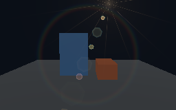
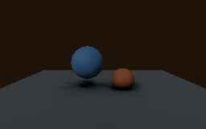
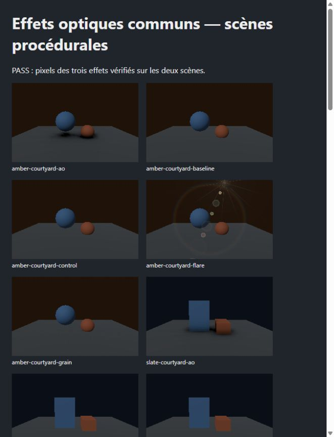

# Réserves d'architecture — validation du 18 octobre 2026

Base Git : `3c3a5efeba2473574597871f223d74aa800cf99a`, branche `Rust`, checkout
partagé modifié. Les commandes lisent les sources suivies, modifiées et nouvelles.
Les travaux préexistants Codex et hivemind sont conservés ; aucun commit ni push
n'est réalisé par cette correction.

Le [reçu machine](VALIDATION_20261018.json), les
[entrées Rust/WGSL/Cargo](VALIDATION_INPUTS_FINAL_20261018.json), le
[périmètre de build](BUILD_SCOPE_FINAL_20261018.json) et l'
[inventaire statique](ENGINE_INVENTORY_FINAL_20261018.json) conservent les
commandes, empreintes, portées et limites. L'inventaire reste à 1 066 mentions
incluant la provenance ; il ne vaut pas clôture de généricité.

## Résultats acquis

| Contrôle | Résultat | Portée |
|---|---|---|
| Clippy Studio WASM strict | PASS | Les 80 diagnostics initiaux de 34 fichiers sont corrigés ; `studio-wasm-flare-final-20261018.log` couvre aussi le contrat de profondeur et l'ordre final du flare. |
| Clippy natif workspace, toutes cibles | PASS | `native-clippy-flare-final-20261018.log` ; features natives du workspace. |
| Clippy moteur et probe natif après correction de profondeur | PASS | `depth-contract-clippy-20261018.log`. |
| Tests workspace `--lib --tests`, séquentiels | PASS | 2 230 réussis, 0 échec, 56 ignorés, 114 suites après les corrections finales. |
| Doctests workspace | PASS | 9 crates examinées ; aucun exemple exécutable déclaré. |
| Garde-fous d'architecture Python | PASS | 5 tests : propriété des sources, chemins Cargo, contrats communs, références d'animation et copies d'exemples. |
| Format Rust et syntaxe des scripts | PASS | `cargo fmt --all -- --check`, parseur PowerShell et AST Python. |
| Probe optique GPU natif | PASS | Vulkan, AMD Radeon RX 7800 XT ; dix readbacks et six comparaisons, captures inspectées. |
| Probe WebGPU | PASS | Deux initialisations du navigateur, dix PNG exportés et inspectés, six comparaisons par lancement. |
| Smoke Tidewater reconstruit | PASS | Sortie 0, près de 9 m parcourus ; entrées et binaire inchangés pendant le test. |
| Runner de reprise complet | PASS | Dix étapes ; snapshots avant/après identiques et payload WASM identique à celui exécuté dans le navigateur. |
| Verrou Clippy dans la CI WASM | Ajouté ; commande PASS localement | Aucune exécution distante acquise. |

Le [runner](../../../scripts/Test-GenericEngine.ps1) conserve les commandes,
sorties et empreintes dans un nouveau dossier ignoré. Les manifests complets du
checkout restent dans `output/`, car leur inventaire informatif peut contenir des
noms de fichiers de travail privés. Les reçus publics ne nécessitent pas ces noms.
Le script standard `Test-Rust.ps1` et le job CI WASM imposent aussi le lint Studio
strict. Le runner complet a réellement été exécuté avec `-PrepareBrowser`.

## Preuve GPU indépendante

Les [captures et mesures natives finales](generic-optical-native-final-20261018/proof.json)
proviennent du renderer réel, sur deux cours procédurales aux géométries différentes.
Les deux captures de contrôle sont identiques à leur référence à l'octet près.
Le grain, le flare et l'AO modifient chacun plus de 10 000 pixels sur chaque vue.
Le dithering est désactivé pour isoler ces effets. Aucun asset importé n'est chargé.

Les [reçus WebGPU](generic-optical-webgpu-20261018/proof-replay.json) et les dix
PNG voisins proviennent des readbacks exécutés par le navigateur. Ses contrôles
sont également identiques ; chaque comparaison modifie plus de 10 000 pixels.
Le backend est `BrowserWebGpu`, sans identité matérielle révélée par le navigateur.

Le premier lancement natif v3 a échoué : la caméra standard ne fournissait pas
`TEXTURE_BINDING` sur la profondeur. La correction appartient maintenant aux
effets communs et s'applique dans le monde de rendu avant l'allocation Bevy.
Le lancement v4 réussit avec la caméra standard, sans désactiver les effets.
Les [sept shaders](SHADER_RENAMES_20261018.json) restent identiques après
normalisation LF et conservent leurs UUID.

Le premier lancement navigateur a ensuite échoué avec zéro pixel de flare.
L'ordre après `PostProcess` n'imposait pas de précéder l'upscaling : sans le haze
importé, la copie finale pouvait partir avant l'effet. Le plugin commun impose
maintenant son exécution avant l'upscaling et l'UI. Le
[reçu intermédiaire](generic-optical-webgpu-20261018/intermediate-failure.json)
et sa capture restent distincts des deux PASS ultérieurs. Le seuil n'est pas
abaissé et aucune passe n'est désactivée pour obtenir ces PASS.

## Échecs et entrées intermédiaires

Les journaux initiaux ne sont pas remplacés. Un premier build a lu des entrées
modifiées pendant la compilation : son résultat n'identifie pas un état stable.
Les corrections Clippy intermédiaires ont eu leurs propres passages en échec.
Le premier test workspace parallèle a échoué sur deux tests de readiness ayant
un budget mural d'une seconde. Le même binaire passe ces deux assertions en
rejeu isolé séquentiel, puis le workspace complet passe en séquentiel. Les délais,
assertions et règles produit de ces tests ne sont pas modifiés ; les runners
bornent désormais les threads du harness de tests.

La dernière revue a également sécurisé le retour asynchrone d'import après
destruction de l'état UI et placé les helpers avant leurs modules de tests.
Un nouveau manifeste précède les contrôles finaux ; les captures natives et
le build WebGPU ne lisent pas ces fichiers Studio.
Le runner final prouve l'absence de dérive de ses entrées pendant ses dix étapes.
Après ce rejeu, deux fichiers hors Rust/WGSL/Cargo ont évolué : la documentation
des limites MSAA dans `COMMON_SCENE_INPUTS.md` et l'ajout du lint au workflow.
La commande CI a ensuite été exécutée localement avec succès ; ces changements
et les pins compilés inchangés sont explicités dans le reçu d'entrées final.

## Limites

La réserve de **généricité globale reste ouverte**. Le probe optique utilise le
chemin sRGB LDR : il ne qualifie pas le resolve temporel HDR, le relay importé,
l'eau, le ciel ou une régression complète de Tidewater. L'AO garde un import du
contrat temporel historique ; le contrôleur garde ses dimensions de capsule.
Le probe utilise MSAA Off et un prépass de profondeur ; les variantes MSAA ne
sont pas qualifiées. Le smoke Tidewater vérifie un parcours borné, pas la
couverture de toute la carte, la parité visuelle source ou l'édition Studio.
Les [familles restantes](../../planning/ENGINE_ARCHITECTURE_DEBT_20261017.md)
doivent encore être extraites et prouvées sur leurs parcours natifs/WebGPU.

Ces résultats locaux ne changent pas les gates, la qualification de distribution
ou l'état d'un binaire installé. Aucune exécution de CI distante n'est acquise ici.
